# Chainfold — Architecture

> **This document** is the canonical architecture reference for chainfold —
> the design, the shipped structure, and the rationale behind both, with
> diagrams. For the *roadmap and phase status* see
> [`refactor.md`](./refactor.md); for the *product pitch and quickstart* see
> [`README.md`](./README.md); for the original pre-refactor design brainstorm
> see [`blockchain_storage.md`](./blockchain_storage.md).
>
> **Status:** Phases 0–6 + the OwnedErc20 follow-up are shipped. The
> **library** and **CLI** surfaces are live; the **daemon** (`chainfoldd`)
> is planned. Phase 7 (memory pruning + `best`/`safe` finality wiring) is
> the next eligible chunk.

---

## Table of contents

1. [What chainfold is](#1-what-chainfold-is)
2. [The two guarantees](#2-the-two-guarantees)
3. [Product surfaces](#3-product-surfaces)
4. [Module map & layering](#4-module-map--layering)
5. [Core abstractions](#5-core-abstractions)
6. [Combinators](#6-combinators)
7. [Merge — heterogeneous sources](#7-merge--heterogeneous-sources)
8. [Matcher — correlation](#8-matcher--correlation)
9. [The EVM source layer](#9-the-evm-source-layer)
10. [Storage model](#10-storage-model)
11. [Data flow — cold, live, resume](#11-data-flow--cold-live-resume)
12. [Caching mechanics](#12-caching-mechanics)
13. [Reorg & finality model](#13-reorg--finality-model)
14. [Ownership & lifetime](#14-ownership--lifetime)
15. [Observability contract](#15-observability-contract)
16. [The CLI surface](#16-the-cli-surface)
17. [Type discipline](#17-type-discipline)
18. [Testing](#18-testing)
19. [Roadmap & in-flight work](#19-roadmap--in-flight-work)

---

## 1. What chainfold is

Chainfold is a **caching access layer for blockchain event histories**. It
gives you the illusion of working against a local full node — without ever
downloading a chain. One engine (caching backfill + in-memory range index +
reactive core) is exposed through three surfaces: an embeddable Rust
**library**, a `cast`-like **CLI**, and a planned transparent caching-RPC
**daemon** (`chainfoldd`).

Whatever the surface, you get:

| Capability | Meaning |
|---|---|
| **Caching backfill** | Ask for a block/time range once; later reads of the same range hit local SQLite, never RPC. Partial overlaps fetch only the missing slice. |
| **Lazy iteration** | A `(2020, 2026)` request returns a *snapshot object*, not a buffered `Vec`. Items are pulled on demand; drop the stream to cancel mid-walk. |
| **Resumable positions** | Every item carries a serializable position (`(block, log_index)` on EVM). Persist it, restart, resume. |
| **Live push** | New events reach the consumer in single-digit ms end-to-end; the internal hop (receipt → range index → wake) is sub-ms — SQLite is never on the live path. |
| **Subscribe-from-the-past** | Iterate from an old anchor, fall through transparently into the live tip, never surface a network error. |
| **Merge & correlate** | Combine events from different chains/filters into one chronological stream; correlate `src ⇄ dst` tails into `{matched, pending, orphans}`. |

---

## 2. The two guarantees

Everything in the design is in service of two measurable properties:

1. **Minimal RPC through aggressive caching.** Any range is fetched from the
   node *at most once*. Concurrent readers of the same cold gap are
   *singleflighted* into one `eth_getLogs`; ranges are snapped to aligned
   chunk boundaries so slightly-different requests share cache entries. A
   warm walk is ~98× faster than the cold one on a mainnet fork.

2. **Real-time delivery.** Live logs reach the consumer in single-digit ms
   end-to-end (~3 ms over WS on local anvil); chainfold's *internal* hop is
   sub-millisecond because the live path never touches SQLite.

Both guarantees are kept honest by the [observability contract](#15-observability-contract):
the same `tracing` spans that feed the `--stats` summary also feed test
assertions on RPC counts, so "minimize RPC" cannot silently rot.

---

## 3. Product surfaces

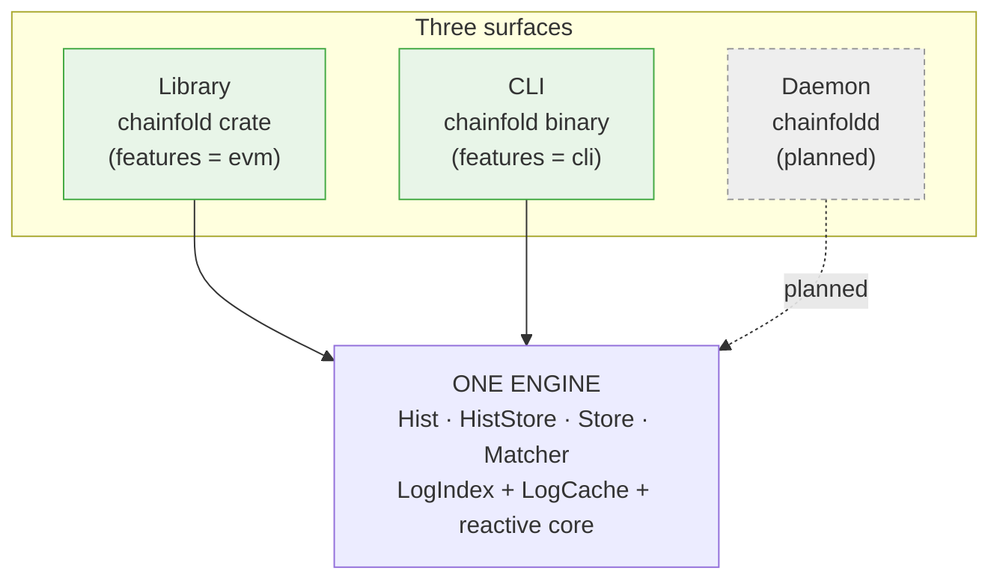

| Surface | Binary / crate | What it is |
|---|---|---|
| **Library** ✅ | `chainfold` crate | Embed the engine. The `Hist`/`HistStore`/`Store`/`Matcher` API this document describes. The source of truth — the other two surfaces are thin front-ends. |
| **CLI** ✅ | `chainfold` binary | A chain explorer whose distinguishing idea is **histories-first**: where `cast` returns a point value, chainfold returns the *history* it's a slice of. Ships `erc20` / `events` / `chains`; growing toward `blocks`, `call`, `storage`, `code`. |
| **Daemon** ⏳ | `chainfoldd` | A transparent JSON-RPC endpoint fronting an upstream node. Point `cast`/viem/ethers/a wallet at it and inherit at-most-once fetching, dedup, reorg handling, and live `eth_subscribe` — no code changes. |

The caching & correctness guarantees live in **one place** (the library) so
the front-ends stay thin.

---

## 4. Module map & layering

The cardinal rule: **the source-agnostic core never names a concrete
source.** `arch`, `combinators`, `merge`, and `matcher` know nothing about
EVM — their tests use a synthetic `MockPos`, never `EvmPosition`.
`signatures` is a standalone resolver (Sourcify → Etherscan) that also names
no source; the caller injects a cache impl. Concrete sources live behind
feature flags (`evm` today; `solana`/`bitcoin`/CEX later).

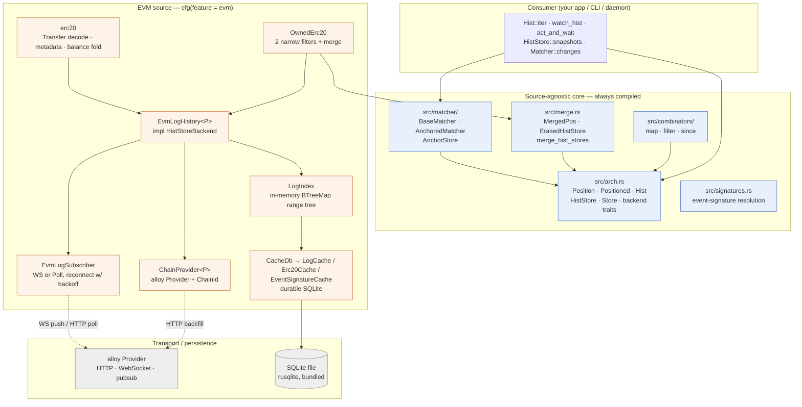

**Crate layout** (`src/`):

```
lib.rs                     pub mod {arch, combinators, matcher, merge, signatures}; cfg(evm) evm
├─ arch.rs                 Position · Positioned · Hist · HistStore · Store · backend traits
├─ combinators/            mapped.rs · filtered.rs · since.rs
├─ merge.rs                MergedPos · MergedItem · ErasedHistStore · merge_hist_stores
├─ matcher/                matcher.rs + anchor_store_sqlite.rs
├─ signatures.rs           event-name → signature/topic0 resolution
├─ evm/                    ← cfg(feature = "evm")
│  ├─ types.rs             EvmEvent · EvmPosition · ChainId · Topic · BlockNumber · LogIdx · …
│  ├─ history.rs           EvmLogHistory (the HistStoreBackend)
│  ├─ log_index/           block_pos · range_tree · nav · gap_fill  (in-memory hot path)
│  ├─ cache.rs + cache/    CacheDb → LogCache · Erc20Cache · EventSignatureCache (SQLite)
│  ├─ subscriber.rs        EvmLogSubscriber (WS / Poll)
│  ├─ erc20.rs             Transfer decode · metadata · balance apply
│  ├─ owned_erc20.rs       two-filter in/out merge
│  ├─ chain_provider.rs    ChainProvider<P>
│  ├─ aligned_ranges.rs    aligned_block_ranges
│  ├─ retry.rs             rpc_retry_layer
│  └─ observe.rs           the tracing contract
└─ bin/chainfold/          ← cfg(feature = "cli"): the real binary
```

Feature gating:

| Feature | Default | Pulls in |
|---|---|---|
| `evm` | off | `alloy` (HTTP+WS), `blake3`, `tracing` |
| `cli` | off | implies `evm`; adds `clap`, `tracing-subscriber`, `chrono`, `toml`, `dirs` |

---

## 5. Core abstractions

Five public shapes in `src/arch.rs`. Everything else composes them.

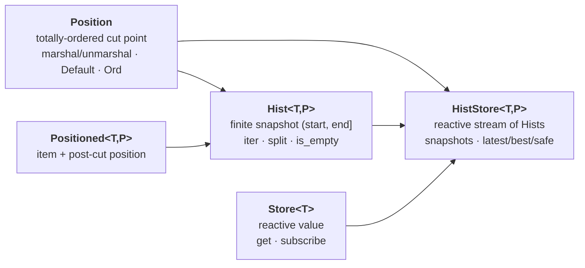

### `Position` — the cut point

A serializable, **totally-ordered** cut point in *one source's* stream. A
position is the gap *between* items, never an item itself. It is
**source-local** — positions from different sources are not comparable.
`Default` is the natural lower bound (`before any item`); for EVM that's
`EvmPosition { block: 0, log_index: 0 }`.

```rust
pub trait Position:
    Clone + Default + Eq + Ord + Debug + Send + Sync + 'static
{
    fn marshal(&self) -> Vec<u8>;
    fn unmarshal(bytes: &[u8]) -> Option<Self>;
}

// EVM's impl:
pub struct EvmPosition { pub block: BlockNumber, pub log_index: LogIdx }
```

### `Positioned<T, P>` — an item at a place

`{ item, pos }`, where `pos` is the *post-cut* of the item:
`hist.split(item.pos)` yields `(prefix_including_item, rest)`. That is the
convention for saving a resume anchor.

### `Hist<T, P>` — a finite snapshot

A finite, immutable window over `(start, end]`, iterated in position order.
Fixed at construction — later source activity does not change *this* `Hist`;
you get a fresh window from the `HistStore`.

```rust
impl<T, P: Position> Hist<T, P> {
    fn start(&self) -> &P;
    fn end(&self)   -> &P;
    fn is_empty(&self) -> bool;
    fn iter(&self)  -> impl Stream<Item = Result<Positioned<T,P>, HistoryError>>;
    fn split(&self, p: P) -> (Self, Self);   // clamps p into [start, end]
}
```

`split` delegates clamping to `HistBackend::clamp_pos` so positions with a
non-canonical `Ord` (the keyed `MergedPos`) can clamp component-wise.

### `HistStore<T, P>` — the reactive tip stream

A reactive sequence of `Hist` snapshots. Yields a fresh `Hist` whenever the
tip advances; the first yield is the current snapshot.

```rust
impl<T, P: Position> HistStore<T, P> {
    fn snapshots(&self) -> impl Stream<Item = Hist<T,P>>;
    async fn next(&self) -> Hist<T,P>;
    fn subscribe(&self, cb) -> AsyncDisposable;             // push variant
    async fn time_pos(&self, t: Timestamp) -> Result<P, _>; // time → position
    fn latest(&self) -> &Store<P>;   // mempool-ish tip (wired)
    fn best(&self)   -> &Store<P>;   // mined tip     (Phase 7 stub → latest)
    fn safe(&self)   -> &Store<P>;   // finalized tip (Phase 7 stub → latest)
}
```

### `Store<T>` — a reactive value

A Svelte/Zustand-style reactive value over a `tokio::sync::watch`.
`get()` is non-blocking; `subscribe()`'s first emission is the current value.

### Free functions & the resume model

```rust
// Yield every item after `start`, across snapshot boundaries. The anchor
// advances as items emit, so a snapshot arriving mid-walk just extends the
// window — items are never duplicated.
fn watch_hist<T,P>(store: &HistStore<T,P>, start: P) -> ItemStream<T,P>;

// Snapshot the tip BEFORE running op, run op, then await the first
// post-snapshot item satisfying predicate. Race-safe: items that appear
// between snapshot and op-completion are still observed.
async fn act_and_wait<T,P,R,...>(store, op, predicate)
    -> Result<(Positioned<T,P>, R), HistoryError>;
```

`AsyncDisposable` wraps a `CancellationToken` + `JoinHandle`; dropping it
cancels the background task.

### The backend seam — `HistBackend` and `HistStoreBackend`

Consumers hold the concrete `Hist` / `HistStore` structs; each is a thin handle
over an `Arc<dyn …Backend>`. A `Hist` is `{ backend: Arc<dyn HistBackend>,
start, end }`; a `HistStore` is `{ backend: Arc<dyn HistStoreBackend> }`.
`snapshots()`/`next()` mint `Hist`s that all share the store's underlying
`Arc<dyn HistBackend>`, so every snapshot of one source reads through the *same*
index. Adding a source = implement these two traits; combinators, merge, and
matcher then compose over them for free.

**`HistBackend<T, P>`** — backs a single `Hist`. Two methods; only `iter` is
required.

```rust
pub trait HistBackend<T: Send + Sync + 'static, P: Position>: Send + Sync {
    /// Stream items in `(start, end]`, ascending by position. Cached gaps
    /// return immediately; uncached gaps are filled on demand (for EVM, an
    /// `eth_getLogs` guarded by the singleflight `Notify`). Dropping the
    /// stream cancels any in-flight fetch.
    fn iter(&self, start: P, end: P) -> ItemStream<T, P>;

    /// Clamp `p` into `[start, end]` for `Hist::split`. See below — default
    /// is the `Ord`-based clamp; override only when `P`'s total `Ord` does
    /// not equal its window-containment order.
    fn clamp_pos(&self, p: P, start: &P, end: &P) -> P {
        if &p < start { start.clone() }
        else if &p > end { end.clone() }
        else { p }
    }
}
```

**`HistStoreBackend<T, P>`** — backs a `HistStore`: the reactive tip stream plus
the finality tip accessors.

```rust
#[async_trait]
pub trait HistStoreBackend<T: Send + Sync + 'static, P: Position>: Send + Sync {
    /// Fresh `Hist` per tip advance; first item is the current snapshot.
    fn snapshots(&self) -> HistStream<T, P>;

    /// The current snapshot (snapped to the latest known tip). Synchronous
    /// tip read internally — see `EvmLogHistory::next` → `latest_store.get()`.
    async fn next(&self) -> Hist<T, P>;

    /// Push variant of `snapshots` — invoke `cb` per snapshot; drop the
    /// returned handle to cancel. (Redundant with `snapshots` — see TODO R1.)
    fn subscribe(&self, cb: Box<dyn Fn(Hist<T, P>) + Send + Sync>) -> AsyncDisposable;

    /// Estimate a position at a wall-clock time (cut point for time-based
    /// resume). For EVM: block-time estimation, no per-call RPC.
    async fn time_pos(&self, time: Timestamp) -> Result<P, HistoryError>;

    /// Reactive finality tips. `latest` is wired; `best`/`safe` are Phase-7
    /// stubs that mirror `latest` today (see §13 and TODO R2/R3).
    fn latest(&self) -> &Store<P>;
    fn best(&self)   -> &Store<P>;
    fn safe(&self)   -> &Store<P>;
}
```

Bounds worth noting: `T: Send + Sync + 'static` (items cross task boundaries and
live in boxed streams); `P: Position` (so `Clone + Default + Ord + marshal`);
both traits are `Send + Sync` because they're held as `Arc<dyn …>` and shared
across the WS watcher, drain task, and consumer walkers concurrently.

#### `clamp_pos` in depth

`Hist::split(p)` (`arch.rs:302`) cuts a snapshot into `(head, tail)` and must
never widen the window — so it first clamps `p` into `[start, end]`. Rather than
hardcode `Ord`, it delegates to `backend.clamp_pos(p, start, end)`:

- **Default (`Ord`-based).** `p < start → start`, `p > end → end`, else `p`.
  Correct whenever a position's `Ord` *is* its containment order — true for
  `EvmPosition` (lexicographic `(block, log_index)`).
- **Why it's overridable.** `MergedPos` is a `BTreeMap<SourceKey, Vec<u8>>`
  ordered **byte-lex** to give the *total* order `Position: Ord` demands — but
  postcard leb128 doesn't preserve numeric order across byte-length boundaries,
  so byte-lex ≠ per-source containment. `MergedHistBackend` overrides
  `clamp_pos` to clamp **each per-source position separately, via that source's
  own `Ord`** (see [§7](#7-merge--heterogeneous-sources)). Without the override,
  splitting a merged `Hist` at a saved `MergedPos` could clamp to the wrong cut
  and drop or duplicate items per source.

In short: `clamp_pos` is the seam that keeps `split` correct for a position whose
sort order is not its containment order.

#### Concurrency contract

A single backend is read through many `Hist`s at once — snapshots share the
store's `Arc<dyn HistBackend>`, and the live path has the WS watcher writing
while consumers walk. Backends must therefore be safe under concurrent `iter`
and concurrent read/write. The EVM `LogIndex` satisfies this with a `Mutex` over
the BTree plus per-range singleflight (`Notify`): the first walker into a cold
gap fetches; peers coalesce onto it. Pinned by
`concurrent_searches_in_same_gap_fire_one_fetch` (`log_index.rs:586`) — 5
concurrent walkers over one `Arc<LogIndex>`, 1 fetch. (Coverage gaps — parallel
`multi_thread`/loom, disjoint-range walkers, reader-vs-`insert_page` — noted in
§18.)

---

## 6. Combinators

Pure proxies over a `HistStore` — **no I/O**. The wrapped store keeps driving
snapshots, tip stores, and time anchors.

| Combinator | Effect | Item out |
|---|---|---|
| `map_hist_store(hs, f)` | `f: Fn(&Src) -> Dst` per item | `MappedItem { item: Dst, source: Src }` |
| `filter_hist_store(hs, pred)` | keep items where `pred(&item)` | `FilteredItem { item, skipped: Vec<Item> }` |
| `since_hist_store(hs, cut)` | pre-split each yielded `Hist` at `cut` | `Item` (passthrough) |

`since` pre-splits at the **upstream** level: `since(map(src, expensive_f),
cut)` never calls `expensive_f` on pre-cut items, because `Hist::split`
happens before the mapper's `iter()` runs. (Pinned by
`since_skips_mapper_on_pre_cut_items`.)

---

## 7. Merge — heterogeneous sources

Combine N `HistStore`s that share an item type `T` (possibly with *different*
per-source `Position` types) into one chronological
`HistStore<MergedItem<T>, MergedPos>` via a streaming k-way merge ordered by
a user-supplied `cmp`.

```rust
pub struct MergedPos  { pub positions: BTreeMap<SourceKey, Vec<u8>> } // vector clock
pub struct MergedItem<T> { pub item: T, pub source_key: SourceKey, pub source_pos: Vec<u8> }
pub struct ErasedHistStore<T> { /* type-erases each source's P */ }

pub fn merge_hist_stores<T, F>(
    sources: BTreeMap<SourceKey, ErasedHistStore<T>>,
    cmp: F,
) -> HistStore<MergedItem<T>, MergedPos>
where F: Fn(&MergedItem<T>, &MergedItem<T>) -> Ordering;
```

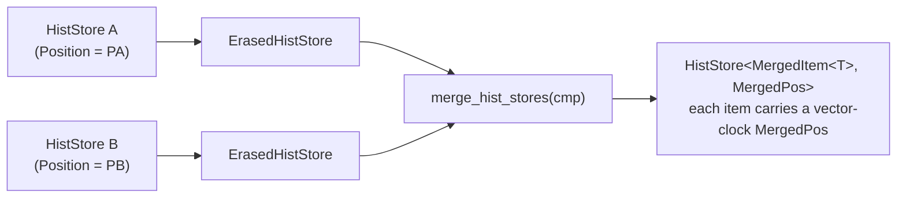

Each `MergedItem` carries a **vector-clock** `MergedPos`: the source that
just emitted advances; the others stay at whatever they last yielded (or
`Default` if never yielded this window). Saving the last `MergedPos` and
resuming via `hist.split(saved).1` reproduces the exact per-source
continuation, and survives sources being added/removed across restarts.

**The `Ord` subtlety:** `MergedPos` orders byte-lex over its `BTreeMap`
(needed for a *total* order for the `Position` trait), but that does **not**
match component-wise containment (postcard leb128 doesn't preserve numeric
order across byte-length boundaries). So `MergedHistBackend` overrides
`clamp_pos` to clamp each per-source position with *that source's own* `Ord`.

---

## 8. Matcher — correlation

Pure correlation between two source streams (`src` and `dst`), producing a
`{ matched, pending, orphans }` view. Two layers:

- **`BaseMatcher`** — the compute kernel. No mutable state beyond a
  background aggregator task for `changes()`. Driven directly via
  `compute_state(anchors)`.
- **`AnchoredMatcher`** — adds persistence over an `AnchorStore` + an
  in-memory cache. Production callers use this.

```rust
pub struct MatcherAnchors<SP, DP> { pub src: SP, pub dst: DP }
pub struct Match<Src, Dst> { pub src: Src, pub dst: Dst }
pub struct MatchOutput<Src, Dst> {
    pub matched: Vec<Match<Src, Dst>>,
    pub pending: Vec<Src>,     // src items awaiting a dst
    pub orphans: Vec<Dst>,     // dst items with no src
}

#[async_trait] pub trait MatchFn<Src, Dst, Out, SP, DP> {
    async fn matchup(&self, input: MatchInput<..>) -> Result<Out, HistoryError>;
}
#[async_trait] pub trait AnchorStore {           // impls: InMemory, Sqlite
    async fn get(&self, key: &str) -> Result<Option<Vec<u8>>, HistoryError>;
    async fn set(&self, key: &str, value: Vec<u8>) -> Result<(), HistoryError>;
}
```

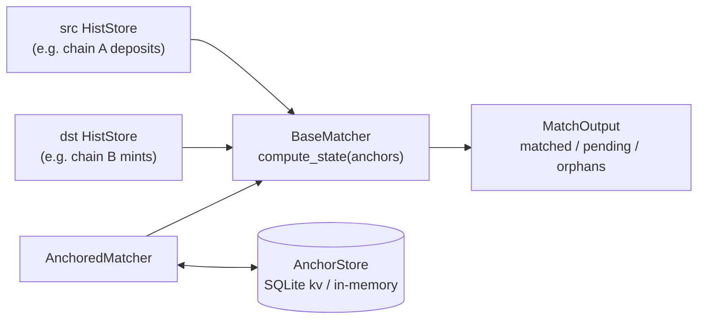

**Asymmetric anchor advance is by design.** An anchor pair `{src, dst}` means
"items strictly *after* these positions are still eligible for matching" —
*not* "everything up to here is processed." Advance only `src` past a matched
pair and, on the next compute, that pair moves from `matched` → `orphans`
because the dst item is still in the dst tail. Consumers wanting monotonic
guarantees advance the anchor pair in sync.

**Matched pairs are transient** — they surface for one or more computes, then
vanish once anchors advance past them. Persist matched pairs in your app
*before* advancing if you need a permanent log.

> **Reducer** (the matcher's sibling — a stateful monotonic *fold* over one
> stream, positioned by a vector of source positions) is specced but **not
> built**. Both are intended to ship; they solve different problems (fold vs
> correlation). See [Roadmap](#19-roadmap--in-flight-work).

---

## 9. The EVM source layer

The concrete `HistStoreBackend` for EVM log streams (`feature = "evm"`).

| Component | Role |
|---|---|
| **`EvmLogHistory<P>`** | `HistStoreBackend<EvmEvent, EvmPosition>` over one log filter. Owns the `LogIndex`, the three tip stores, and drives the subscriber. |
| **`LogIndex`** | In-memory `BTreeMap<BlockPos, Range>` per filter. Empty-range tombstones, singleflight via `Arc<Notify>` per range, lazy first-touch load from `LogCache`, async drain to SQLite. **The hot path.** |
| **`CacheDb` → `LogCache` / `Erc20Cache` / `EventSignatureCache`** | Durable SQLite over one shared `Arc<Mutex<Connection>>`. Narrow per-concern views; **never on the live path.** |
| **`EvmLogSubscriber`** | `eth_subscribe(logs)` over WebSocket, or HTTP poll fallback. Reconnect-with-backoff (100 ms → 30 s); gap-fill on reconnect is invisible to the consumer. Drop cancels via `CancellationToken`. |
| **`OwnedErc20<P>`** | Two narrow `EvmLogHistory` (`topic1 = owner` outgoing, `topic2 = owner` incoming) sharing one cache, merged by `(block, log_index)`. Direction reported via `source_key` (`IN_KEY` / `OUT_KEY`). |
| **`erc20`** | `decode_transfer`, `fetch_erc20_metadata`, `apply_transfer` (running-balance fold). |
| **`ChainProvider<P>`** | An alloy `Provider` bundled with its `ChainId`, so the layer reads the chain for free instead of re-issuing `eth_chainId`. |
| **`aligned_block_ranges`** | Snaps RPC ranges to `batch_size` boundaries so concurrent consumers hit the same cache entries. |

**Position bridging:** `EvmPosition(0, 0)` ↔ `BlockPos::Bottom`; otherwise
`BlockPos::At { block, log_index }` maps 1:1.

**Why in/out ERC20 is a merge of two filters, not a post-filter:** each inner
history fetches *its own* subset at the RPC level (`topic1=owner` and
`topic2=owner`), so the node returns only the owner's transfers — not the
whole Transfer stream filtered client-side. See design decision #11 in
`MEMORY.md`.

---

## 10. Storage model

Two tiers. The **in-memory `LogIndex`** is the hot path; **SQLite** is the
durable backfill store, drained to asynchronously and never blocking a live
event or a warm read.

### In-memory: `LogIndex`

A per-filter `BTreeMap` of scanned ranges over block positions. Scanned-ness
is **first-class**: a range that was scanned and found empty is stored as a
*tombstone* alongside filled ranges.

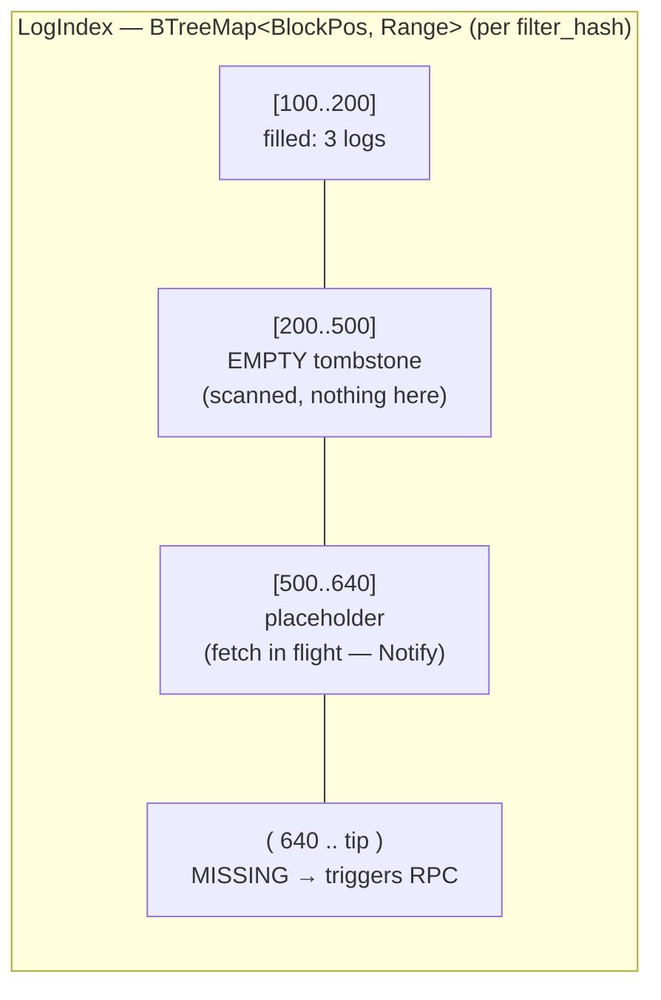

- Iter into a **filled** range → yields items immediately.
- Iter into an **empty** tombstone → yields nothing, **no RPC**.
- Iter into a **missing** range → triggers an `eth_getLogs`, guarded by a
  singleflight placeholder (concurrent readers `await` the same `Notify`).

### Durable: SQLite (via `rusqlite`, bundled)

`CacheDb` opens one file and vends narrow views; migrations live in
`src/evm/cache.rs`.

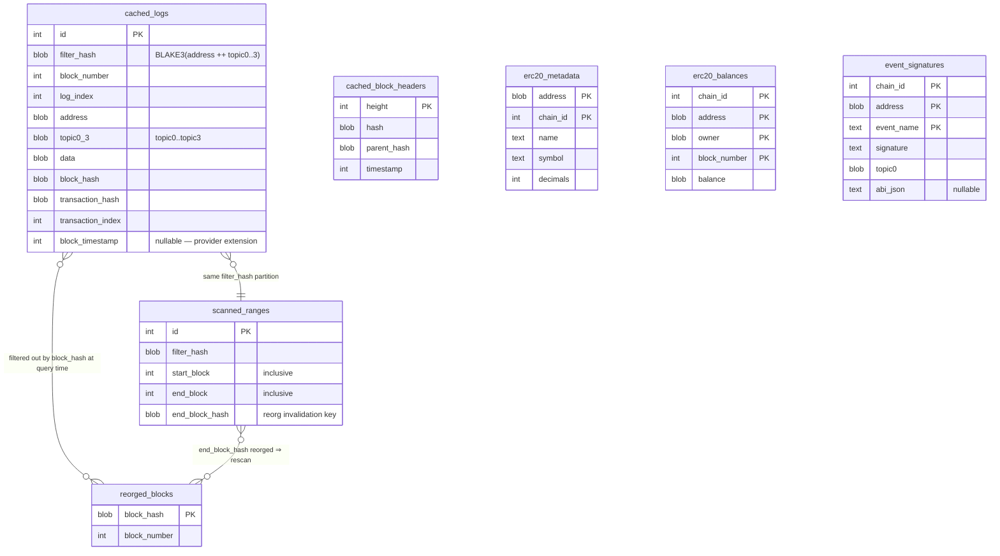

Key modelling decisions baked into the schema:

- **Uniqueness is `(filter_hash, block_hash, log_index)`**, *not*
  block_number — so the same log index on two forks can coexist. Reorged
  logs are **never deleted**; they stay in `cached_logs` and are filtered out
  at query time via `reorged_blocks`. (Append-only reorg handling, decision
  #7.)
- **`filter_hash`** = `BLAKE3(address ++ topic0..3)` partitions logs by the
  `eth_getLogs` filter that produced them. Different filters on the same
  contract (Transfer vs Approval) get separate partitions.
- **`scanned_ranges`** records *which ranges were fetched* even when they
  returned zero logs — that's how a gap query knows what it still needs. Its
  `end_block_hash` is the reorg-invalidation key: if that hash lands in
  `reorged_blocks`, the range is refetched.
- **Ranges are not eagerly merged** on insert; only finalized ranges are
  compacted (decision #8), so a tip reorg can't invalidate a huge merged
  range.
- **`cached_block_headers`** is shared across all filters (not partitioned),
  and carries the timestamp used to stamp `EvmEvent.timestamp` when the log
  itself lacks a `block_timestamp`.

**Matcher anchors** live in a *separate* SQLite file — `SqliteAnchorStore` is
a small `kv` table, independent of the log cache.

---

## 11. Data flow — cold, live, resume

The cold-backfill path and the live-push path share the same in-memory
`LogIndex`; SQLite sits under the cold path and is drained-to under the live
path, never blocking either.

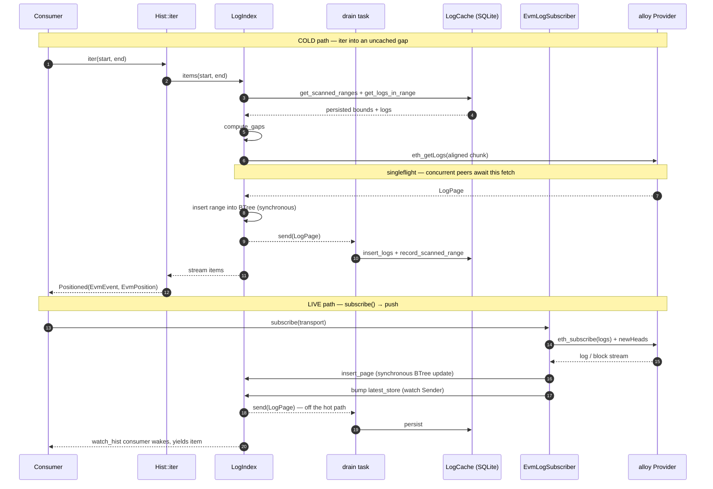

**Resume / subscribe-from-the-past** unifies the two: `watch_hist(&store,
saved_anchor)` splits each fresh snapshot at the running anchor and iterates
only the tail. Early snapshots walk the cold cache; once the walk reaches the
tip, new snapshots (driven by the live subscriber bumping `latest_store`)
extend the window seamlessly. The consumer never distinguishes "history" from
"live", and reconnect gap-fill is invisible.

---

## 12. Caching mechanics

Four mechanisms conspire to make guarantee #1 ("at most once") hold under
concurrency and slightly-misaligned requests:

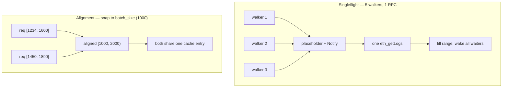

1. **At-most-once.** `scanned_ranges` + the in-memory tombstones mean a range
   is fetched once; later reads diff against what's scanned and fetch only the
   genuine gap.
2. **Singleflight.** The first reader into a cold gap installs a placeholder
   and fires the RPC; concurrent readers await the placeholder's `Notify`.
   (Test: 5 walkers → 1 `eth_getLogs`.)
3. **Alignment.** `aligned_block_ranges` snaps RPC ranges to `batch_size`
   boundaries (default 1000 blocks) so consumers asking slightly different
   ranges collide on the same cache entries.
4. **SQLite off the live path.** A WS-delivered log goes
   `Subscriber → LogIndex → consumer` synchronously; the durable write is
   drained in the background. Warm reads and live events never wait on disk.

The retry layer (`rpc_retry_layer`) wraps transient RPC failures with bounded
backoff; the observability contract counts every call so the "warm walk = 0
`eth_getLogs`" property is test-enforced, not aspirational.

---

## 13. Reorg & finality model

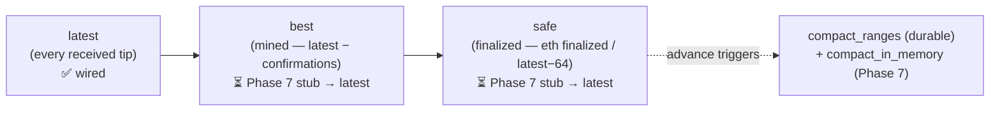

- **Logs are append-only.** Reorged block hashes go into `reorged_blocks`;
  queries filter them at read time. Nothing is truncated.
- **Scanned ranges self-invalidate.** A range whose `end_block_hash` is
  reorged is refetched.
- **Three reactive tip stores** on every `HistStore`: `latest` (fully wired),
  `best` (Phase 7: `latest − confirmation_depth`), `safe` (Phase 7: RPC
  `finalized`, else `latest − 64`).
- **Compaction runs only below `safe`** so a tip reorg can never invalidate a
  merged range (decision #8).
- **Consumer-side recovery today:** track `block_hash` on the last consumed
  `EvmEvent`; if a later walk surfaces a different hash at that position, walk
  back. Phase 7 may centralize this (reorg-aware `lca()`).

---

## 14. Ownership & lifetime

Every cancellable thing is owned by either an `Arc<T>` (shared) or an
`AsyncDisposable` (single-owner; drop cancels). **No raw `tokio::spawn`
survives its owning struct.**

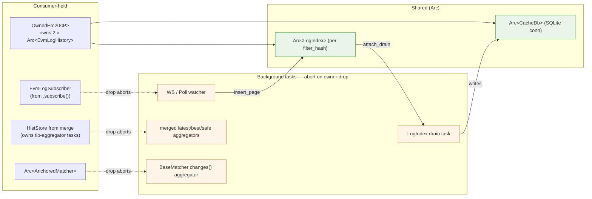

**The watch-coalescing footgun (recurring).** Both the merge tip aggregators
and `BaseMatcher::changes()` fan per-source `Store<P>` subscriptions into a
synthesized store. The tempting bug: skip each subscription's first emission
as "already represented." **This loses updates** — tokio `watch` coalesces,
so an update arriving between subscribe-time and the task's first poll shows
up *as* the first emission and gets dropped. **The rule: propagate every
emission** (redundant initial sends are harmless; the consumer-side watch
coalesces too). Pinned by `snapshots_advance_when_any_source_appends` and
`changes_fires_on_either_source_advance`.

---

## 15. Observability contract

The two headline guarantees are only credible if they stay *measurable*.
Chainfold emits a small, **stable** `tracing` contract at every RPC and cache
boundary — a contract, not incidental logging — defined in one place
(`src/evm/observe.rs`).

| Kind | target | span/event | fields |
|---|---|---|---|
| RPC call (span) | `chainfold::rpc` | `rpc` | `method` |
| SQLite read (span) | `chainfold::sqlite` | `sqlite` | `op` |
| Cache hit/miss (event) | `chainfold::cache` | — | `layer`, `outcome` |

The **wire format is strings** (what `tracing`/OTLP want); the **emission API
is typed** — `RpcMethod`, `SqliteOp`, `CacheLayer`, `CacheOutcome` are closed
enums with `as_str`/`from_wire` inverses, so a call site can't emit a stray
method name. Spans carry duration (open→close); cache events are instantaneous
counters. A `singleflight` cache hit means a concurrent caller was coalesced
onto an in-flight fetch — an RPC *saved*.

**Two consumers, one contract:**

- **CLI `--stats`** (`src/bin/chainfold/stats.rs`) — a `tracing_subscriber`
  Layer that tallies an end-of-run summary (RPC by method + wall-time, SQLite
  read time, cache hit/miss). Opt-in via `--stats` / `CHAINFOLD_STATS`; writes
  to stderr so stdout stays pipeable.
- **Daemon** (planned) — routes the same spans to an OTLP exporter
  (Tempo/Jaeger); no chainfold-specific glue.

This doubles as the **anti-regression guard**: the instrumentation that feeds
the human summary also feeds test assertions on RPC counts (a second walk of a
cached range must issue zero `eth_getLogs`), so "minimize RPC" can't rot.

---

## 16. The CLI surface

`chainfold` (behind `feature = "cli"`) is the real binary — histories-first,
every read cached. `main` returns an `ExitCode` and renders errors via
`Display`.

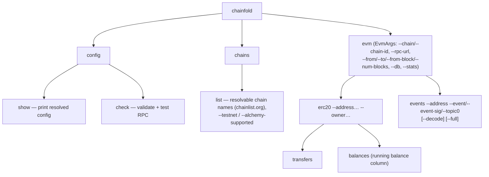

**Chain resolution precedence:** `--chain-id` > `--chain` > env
`CHAINFOLD_CHAIN` > config `[evm] default_chain` > built-in `ethereum`. Names
resolve against cached chainlist.org data via a `ChainResolver`
(lowest-chain-id-wins on shortName/chainSlug collisions, deterministic). RPC
selection: explicit `--rpc-url` > Alchemy (with API key) > chainlist public
RPC.

**Histories-first** is the through-line: a `balances` read is a *history of
balances*, an `events` read a slice of *event history*, and "value at tip" is
just `hist.at(tip)`. Every read maps onto the library `HistStore`, inheriting
caching / resume / follow for free. Growth path: a `blocks` command, then
`call` / `storage` / `code` accessors.

---

## 17. Type discipline

The EVM layer favors **semantic types over blind primitives** — a 20-byte
address can't be passed where a 32-byte hash is expected, a chain id can't be
swapped with a block number, a topic can't be confused with a hash.

| Type | Over | Notes |
|---|---|---|
| `Address` / `B256` | alloy | + `TxHash`/`BlockHash` aliases on fields that carry those |
| `Topic` | newtype over `B256` | owns the address↔topic relationship (`From<Address>` left-pads, `.address()` extracts); unwraps to `B256` at the alloy `Filter`/`Log` boundary |
| `ChainId` | `u64` | `#[serde(transparent)]` + `Ord` + `Display`; its `ToSql` lives in the *cache* layer so the domain type stays persistence-free |
| `BlockNumber` | `u64` | **affine**: block ± u64 = block; block − block = u64 via `.get()`. `#[serde(transparent)]` keeps the `EvmPosition` marshal byte-identical |
| `LogIdx` | `u32` | per-block log index. Named `LogIdx`, *not* `LogIndex`, to avoid colliding with the range-tree `LogIndex` |
| `FilterHash` | `[u8; 32]` | the BLAKE3 cache partition key; not an EVM hash, so a newtype (`ToSql` in the cache layer) |
| `Timestamp` | `u64` | source-agnostic (lives in `arch.rs`); the unit `time_pos`/`act_and_wait` speak |
| `SourceKey` | `String` | the `MergedPos.positions` / `MergedItem.source_key` key; `#[serde(transparent)]` + `Borrow<str>` |
| `BlockRange { from, to }` | `(u64, u64)` | named window in `compute_gaps` / alignment |
| `ChainProvider<P>` | `Provider` + `ChainId` | kills the redundant per-construction `eth_chainId` |
| `ChainHandle` / `ChainSelector` / `RpcSource` / `Url` | strings | CLI chain-resolution domain types |

`BlockNumber` and `LogIdx` staying `#[serde(transparent)]` is load-bearing:
saved resume-anchors stay byte-identical to the pre-newtype postcard encoding.
The SQLite/`compute_gaps`/alignment/RPC boundaries drop to raw `u64` at the
seam. The `MergedPos` *value* bytes and `Position::marshal` boundary stay
deliberately generic (erased `Vec<u8>`).

---

## 18. Testing

| Suite | What it covers | Gate |
|---|---|---|
| Lib unit | Source-agnostic surface via `MockPos`; EVM units | always |
| `tests/phase3_hist_store.rs` | `Hist` / `HistStore` shape | always |
| `tests/phase4_combinators.rs` | map/filter/since composition | always |
| `tests/phase5_merge.rs` | heterogeneous merge, two mock `Position` types | always |
| `tests/phase6_matcher.rs` | matcher incl. SQLite persistence across restart | always |
| `tests/mock_provider_smoke.rs` | alloy `Asserter` wrapper | `evm` |
| `tests/anvil_smoke.rs` | local anvil harness (fork case `#[ignore]`) | `evm` |
| `tests/phase1_layering.rs` | fork-mainnet warm-cache speedup | `#[ignore]` |
| `tests/phase2_push.rs` | anvil live-event latency | `#[ignore]` |
| `tests/owned_erc20.rs` | fork OwnedErc20 vs broad-filter baseline | `#[ignore]` |

```bash
cargo test --features evm             # fast lib + source-agnostic suite (~1s)
cargo test --all-features             # + CLI-bin unit tests
cargo test --features evm -- --ignored   # anvil / fork tests (needs `anvil`, MAINNET_RPC_URL)
```

Anti-regression: several tests assert RPC counts through the observability
contract (e.g. a second walk of a cached range issues zero `eth_getLogs`).
Coverage runs via `cargo-llvm-cov`, uploaded to Codecov (patch ≥ 80%).

**Concurrency coverage.** `concurrent_searches_in_same_gap_fire_one_fetch`
(`log_index.rs:586`) pins the shared-BTree singleflight: 5 concurrent walkers
over one `Arc<LogIndex>` and the same cold gap → 1 fetch, all 5 see the item.
It's `#[tokio::test]` (current-thread), so it covers *concurrent* (interleaved),
not *parallel* (multi-core), access. Known gaps: no `multi_thread`/loom test for
true data races; no test for concurrent walkers over *disjoint/overlapping*
ranges on one BTree; no reader-vs-writer test (a walk in flight while the
subscriber's `insert_page` mutates the same BTree). These matter more once the
reactive-core refactor reshapes who reads the shared index.

---

## 19. Roadmap & in-flight work

Canonical plan lives in [`refactor.md`](./refactor.md). The biggest unbuilt
pieces:

- **Phase 7 — pruning + `best`/`safe` wiring** *(next eligible)*.
  `LogIndex::prune_older_than` (drop item payloads, keep tombstones),
  `compact_in_memory(up_to_block)`, real `best`/`safe` polling, bounded RSS
  under indefinite follow. `LogCache::compact_ranges` (durable side) already
  exists and is tested; the in-memory eviction is what's missing.
- **`RangeIndex` generalization** *(uncommitted WIP in `src/evm/range_index/`,
  not yet wired into the module tree)*. Refactors the log-specific `LogIndex`
  into a generic `RangeIndex` over a `RangeSpec` seam (`IndexPos` +
  `Item`/`Full`/`Page` + `resolve`/`persist`/`load_window`), so the same
  singleflight/gap-fill/streaming machinery can back both EVM **logs** and a
  future EVM **blocks** history. Foundation for the histories-first `blocks`
  CLI command.
- **Reducer** — the matcher's sibling (stateful monotonic fold over one
  stream, positioned by a vector of source positions). `Erc20Balance` rebuild
  gates on it.
- **Real bridge decoder** for `bridge_matcher` — ABI-aware `MatchFn` impls
  (LayerZero ULN, OP `CrossDomainMessenger`, Arbitrum `Inbox`, …); the shipped
  CLI uses a generic `--match-on` key extractor.
- **`chainfoldd`** — the transparent caching JSON-RPC daemon (benefits from
  Phase 7's finality wiring).
- **More source backends** — Solana / Bitcoin / CEX websockets all fit the
  `HistStoreBackend` shape; each gets its own `Position` type, and cross-source
  merge already supports it.
- **Same-`P` typed merge alias** *(Phase 5 deferral)*. When every source
  shares one `Position` (the `OwnedErc20` case), a typed `merge<T, P>`
  returning `HistStore<T, P>` would skip the `MergedPos` erasure overhead. Not
  load-bearing today — `MergedItem.source_key` is genuinely useful for
  direction reporting.
- **Reorg-aware `lca()` / `is_equiv()`** *(Phase 7 candidate)*. Centralize the
  consumer-side reorg recovery of [§13](#13-reorg--finality-model) into the API
  — `HistStore::lca(a, b)` to roll a stale anchor back to the canonical chain's
  latest common ancestor, instead of hand-rolled `EvmEvent.block_hash`
  comparison.

### Examples (all require `--features evm`)

| Example | Demonstrates |
|---|---|
| `history_explorer` | raw single-filter log walker; `--measure` prints cold/warm/hot tiers |
| `erc20_explorer` | ERC20 transfers + running balance; `--owner` uses `OwnedErc20` |
| `bridge_explorer` | multi-chain cross-source merge (merge by `event.timestamp`) |
| `bridge_matcher` | cross-chain `Matcher` with anchor persistence in a separate SQLite file |
