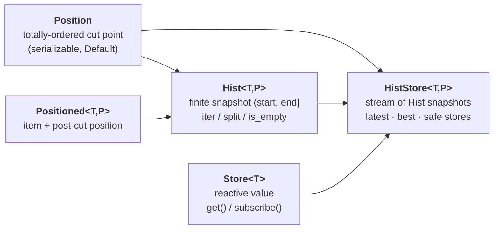
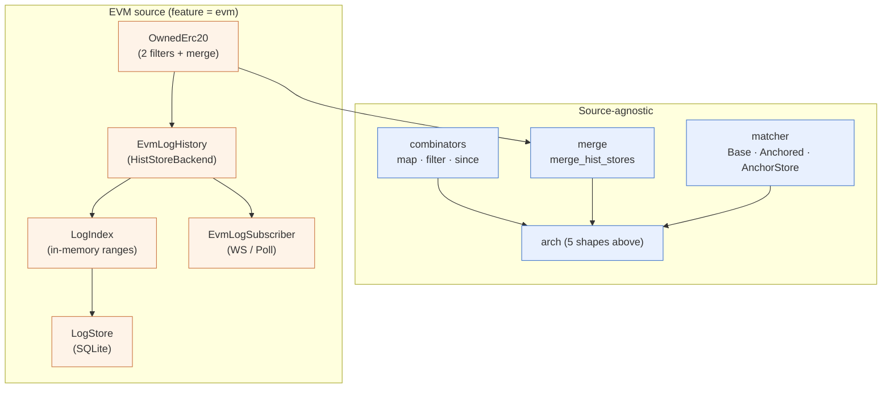

# chainfold

[](https://github.com/nikicat/chainfold/actions/workflows/ci.yml)
[](https://codecov.io/gh/nikicat/chainfold)

Treat blockchain event histories like local data. Chainfold gives a Rust
process the illusion of working against a local full node — caching
backfill, in-memory range index, sub-10ms live push, resumable
positions, and cross-source merge / correlation — without ever
downloading a chain.

> **Status:** under active development. Phases 0–6 of the
> [refactor plan](./refactor.md) and the OwnedErc20 follow-up shipped.
> 126 active tests + 7 anvil/fork-only tests pass. EVM source is the
> first concrete backend; the source-agnostic core is shaped to take
> Solana, Bitcoin, CEX, etc.
>
> See [`arch.md`](./arch.md) for the architecture overview (with
> Mermaid diagrams), [`refactor.md`](./refactor.md) for phase
> status, [`blockchain_storage.md`](./blockchain_storage.md) for the
> original design brainstorm.

## What you get

* **Cached backfill** — ask for a time/block range once; subsequent
  reads hit local SQLite, never the RPC. Partial overlaps fetch only
  the missing slice.
* **Lazy iteration** — `(2020-01-01, 2026-01-01)` returns a snapshot
  object, not a buffered Vec. Iterate items on demand; cancel mid-walk
  by dropping the stream.
* **Resumable positions** — every yielded item carries a
  serializable position (`(block, log_index)` for EVM). Persist it,
  restart, resume.
* **Live push** — `subscribe()` delivers WebSocket-pushed logs into
  the in-memory range index synchronously, then asynchronously drains
  to SQLite. Measured **~3 ms WS push latency** on local anvil. Reconnect
  gap-fill is invisible to the consumer.
* **Subscribe from the past** — `watch_hist(&store, old_anchor)`
  iterates from `old_anchor`, transparently rolls into the live tip,
  yields forever.
* **Cross-source merge** — combine N `HistStore`s into one
  chronologically-ordered stream. Sources can have different
  `Position` types. Each yielded item carries a vector-clock
  `MergedPos` that survives marshal/unmarshal.
* **Correlation Matcher** — pair `src` ⇄ `dst` tails into a
  `{ matched, pending, orphans }` view, persisted across restarts via
  a small SQLite kv store.

## Quickstart

```bash
git clone <repo> chainfold
cd chainfold
cargo build --features evm
cargo test --features evm   # 126 tests, ~1s
```

If you plan to commit changes, install the pre-commit hooks once per
clone so rustfmt and taplo run automatically before each commit:

```bash
prek install   # runs `prek` from your PATH; install via `cargo install prek` if missing
```

The same checks run in CI, so skipping the local hook only means
slower feedback — not different gates.

Walk recent USDC transfers for an owner:

```bash
cargo run --features evm --example erc20_explorer -- \
  --rpc-url https://eth.llamarpc.com \
  --address 0xA0b86991c6218b36c1d19D4a2e9Eb0cE3606eB48 \
  --owner   0xYourAddressHere \
  --num-blocks 200
```

Follow live (uses `subscribe()` + the OwnedErc20 in/out merge):

```bash
cargo run --features evm --example erc20_explorer -- \
  --address 0xA0b86991c6218b36c1d19D4a2e9Eb0cE3606eB48 \
  --owner   0xYourAddressHere \
  --follow
```

Merge events across two chains by timestamp:

```bash
cargo run --features evm --example bridge_explorer -- \
  --chain eth --rpc-url https://eth.llamarpc.com \
    --address 0xA0b86991c6218b36c1d19D4a2e9Eb0cE3606eB48 \
  --chain arb --rpc-url https://arb1.arbitrum.io/rpc \
    --address 0xaf88d065e77c8cC2239327C5EDb3A432268e5831 \
  --num-blocks 50
```

Pair events across two chains into `matched / pending / orphans`:

```bash
cargo run --features evm --example bridge_matcher -- \
  --src-rpc https://eth.llamarpc.com \
    --src-address 0xA0b86991c6218b36c1d19D4a2e9Eb0cE3606eB48 \
  --dst-rpc https://arb1.arbitrum.io/rpc \
    --dst-address 0xaf88d065e77c8cC2239327C5EDb3A432268e5831 \
  --match-on topic1
```

## Conceptual model

Five public shapes in the source-agnostic core (`src/arch.rs`). Everything
else is built on top.



Layered on top:



Full architecture, data-flow diagrams, and ownership/lifetime model in
[`arch.md`](./arch.md).

## Features

| Feature | Default | Pulls in |
|---|---|---|
| `evm` | off | `alloy` HTTP + WS providers, `blake3`, `tracing` |
| `cli` | off | implies `evm`; adds `clap`, `tracing-subscriber`, `chrono`, `toml`, `dirs` |

```toml
[dependencies]
chainfold = { version = "0.1", features = ["evm"] }
```

## Supported sources

| Source | Status |
|---|---|
| EVM (any chain via `alloy::providers::Provider<Ethereum>`) | ✅ Production-shaped; tested on Ethereum mainnet, Arbitrum |
| Solana | ⏳ Not started; `HistStoreBackend` shape is ready to accept it |
| Bitcoin | ⏳ Not started |
| CEX (Binance, Lighter, …) | ⏳ Not started |

Adding a source means implementing `HistStoreBackend<Event, Position>`
for that source. All combinators, merge, and matcher work automatically.

## Running integration tests

```bash
# Quick lib + source-agnostic suite (126 tests, ~1s):
cargo test --features evm

# Anvil + fork-mainnet tests (7 tests, slower; needs `anvil` on PATH
# and optionally MAINNET_RPC_URL in .env):
cargo test --features evm -- --ignored
```

A gitignored `.env` with `MAINNET_RPC_URL=https://...` is the
recommended way to supply your archive RPC for fork tests; the
harness will use a public fallback if unset.

## Coverage

Local coverage via [`cargo-llvm-cov`](https://github.com/taiki-e/cargo-llvm-cov):

```bash
just coverage        # text summary in the terminal
just coverage-open   # HTML report, opens in browser
just coverage-lcov   # emits lcov.info (same format CI uploads)
```

CI uploads to Codecov on every push. PRs get a status check that fails
if patch coverage (the *changed* lines) drops below 80%, and a
project-wide check that flags drops larger than 1%.

## License

TBD.
