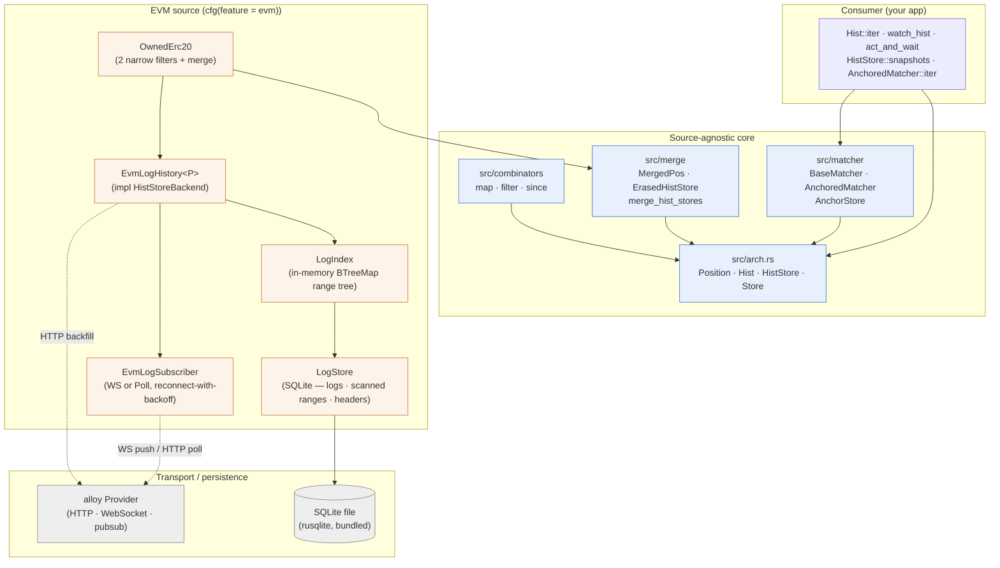
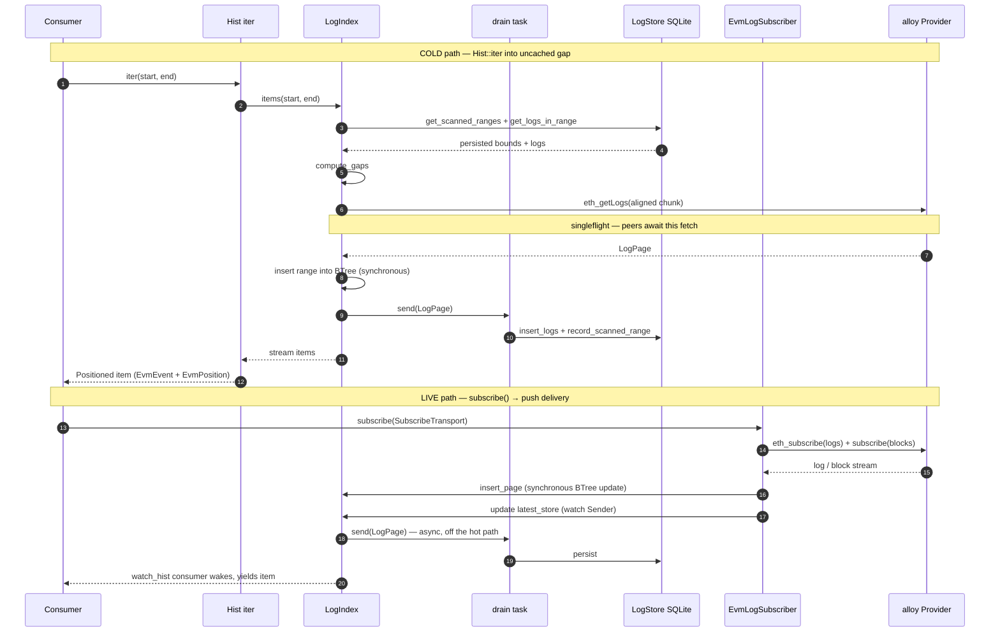
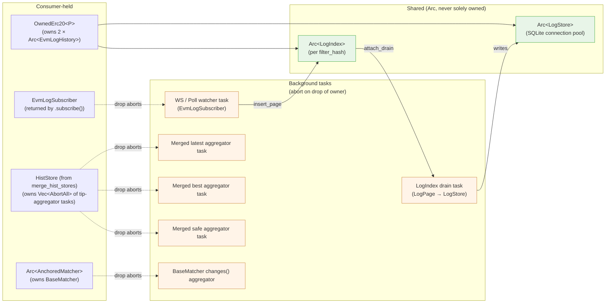

# Chainfold — Architecture

> Status: post-refactor (Phases 0–6 shipped, OwnedErc20 follow-up shipped). Phase 7 (pruning + best/safe finality wiring) is the next eligible chunk. See [refactor.md](./refactor.md) for the phased plan and `~/.claude-personal/projects/-home-nb-src-chainfold/memory/` for per-phase notes.

## What chainfold is

A Rust library that lets a process work with blockchain (and CEX) event histories like a local full node — without ever downloading the chain. Concretely it gives clients:

- **Caching backfill.** Ask for a time/block range once; subsequent reads of the same range hit local SQLite, never the RPC. Partial overlaps fetch only the missing slice.
- **Incremental, lazy iteration.** A request for `(2020-01-01, 2026-01-01)` does not block for a month. It returns a snapshot object; the consumer iterates and pulls items on demand.
- **Resumable positions.** Each item carries a position (`(block, log_index)` for EVM). Persist the position, restart, resume from where you stopped.
- **Live subscriptions.** New events surface in <10 ms (measured ~3 ms on local anvil over WebSocket) from the in-memory range index — never blocked on SQLite writes.
- **Subscribe-from-the-past.** Iterate from an old position, transparently fall through into the live tip, never see network errors. Reconnect gap-fill is invisible to the consumer.
- **Cross-source merge + correlation.** Combine events from different chains (or different filters on the same chain) into one chronological stream; correlate src ⇄ dst tails into a matched/pending/orphan view.

This document describes the **shipped** architecture (commit `f661955` and later). For the vision-document version with not-yet-built bits like `Reducer` and reorg-aware `lca()`, scroll to [Future work](#future-work).

## Component map



**Layering rule.** Everything in `src/arch.rs`, `src/combinators`, `src/merge`, and `src/matcher` is source-agnostic: it must not reference EVM (or Solana, Lighter, …). Tests for these modules use a synthetic `MockPos`, never `EvmPosition`. Source-specific concrete impls live behind feature flags (`evm` today; `solana`, `bitcoin`, … later).

## Core abstractions

Five public types in `src/arch.rs`. They compose into everything else.

### `Position`

A serializable, totally-ordered cut point in a single source's stream. A position is the *gap between* (or at the boundary of) items — never an item itself. It is **source-local**: positions from different sources are not comparable.

```rust
pub trait Position:
    Clone + Default + Eq + Ord + std::fmt::Debug + Send + Sync + 'static
{
    fn marshal(&self) -> Vec<u8>;
    fn unmarshal(bytes: &[u8]) -> Option<Self>;
}
```

`Default` is the natural lower-bound sentinel — for EVM it's `EvmPosition { block: 0, log_index: 0 }`.

For EVM:

```rust
pub struct EvmPosition {
    pub block: u64,
    pub log_index: u32,
}
```

### `Positioned<T, P>`

An item paired with its post-cut position.

```rust
pub struct Positioned<T, P: Position> {
    pub item: T,
    pub pos: P,
}
```

`hist.split(item.pos)` yields `(prefix_including_item, rest)` — that's the convention used to save resume anchors.

### `Hist<T, P>`

A finite, immutable snapshot of a history segment. Iterates items in `(start, end]` in position order.

```rust
impl<T, P: Position> Hist<T, P> {
    pub fn start(&self) -> &P;
    pub fn end(&self) -> &P;
    pub fn iter(&self) -> impl Stream<Item = Result<Positioned<T, P>, HistoryError>>;
    pub fn split(&self, p: P) -> (Self, Self);  // clamps p to [start, end]
    pub fn is_empty(&self) -> bool;
}
```

The window is fixed at construction. Even if new items arrive at the source, `this` `Hist` continues to reflect the same window. Get a fresh window via `HistStore::next` / `HistStore::snapshots`.

### `HistStore<T, P>`

Reactive sequence of `Hist` snapshots. Yields a fresh `Hist` whenever the source's tip advances.

```rust
impl<T, P: Position> HistStore<T, P> {
    pub fn snapshots(&self) -> impl Stream<Item = Hist<T, P>>;
    pub async fn next(&self) -> Hist<T, P>;            // current snapshot
    pub fn subscribe(&self, cb) -> AsyncDisposable;     // push variant
    pub async fn time_pos(&self, t: Timestamp) -> Result<P, HistoryError>;
    pub fn latest(&self) -> &Store<P>;                  // mempool-ish tip
    pub fn best(&self) -> &Store<P>;                    // mined tip (Phase 7)
    pub fn safe(&self) -> &Store<P>;                    // finalized tip (Phase 7)
}
```

`best`/`safe` are stubs that mirror `latest` until Phase 7 wires confirmation depth and finality polling.

### `Store<T>`

A reactive value (Svelte/Zustand-style). `get()` is non-blocking; `subscribe()` returns a stream where the first emission is the current value.

```rust
impl<T: Clone + Send + Sync + 'static> Store<T> {
    pub fn get(&self) -> T;
    pub fn subscribe(&self) -> impl Stream<Item = T>;
}
```

### Free functions

```rust
// Yield every item arriving after `start`, across snapshot boundaries.
pub fn watch_hist<T, P>(store: &HistStore<T, P>, start: P) -> impl Stream<Item = ...>;

// Snapshot the tip BEFORE running op, then await the first post-snapshot item
// satisfying `predicate`. Race-safe.
pub async fn act_and_wait<T, P, R, ...>(store: &HistStore<T, P>, op: OpFn, predicate: Pred)
    -> Result<(Positioned<T, P>, R), HistoryError>;
```

### `AsyncDisposable`

A handle returned by `subscribe(cb)` and similar push-based APIs. Drops cancel the background task.

```rust
pub struct AsyncDisposable { /* CancellationToken + JoinHandle */ }
impl Drop for AsyncDisposable { /* cancels + aborts */ }
```

## Combinators

Pure proxies over `HistStore` — no I/O. Wrapped store continues to drive snapshots, tip stores, and time anchors.

| Combinator | Effect | Item out |
|---|---|---|
| `map_hist_store(hs, f)` | Apply `f: Fn(&Src) -> Dst` per item | `MappedItem<Src, Dst> { item: Dst, source: Src }` |
| `filter_hist_store(hs, pred)` | Keep items where `pred(&item)` is true | `FilteredItem<Item> { item, skipped: Vec<Item> }` |
| `since_hist_store(hs, cut)` | Pre-split every yielded `Hist` at `cut` | `Item` (passthrough) |

The `since` combinator pre-splits at the *upstream* level. Concretely: `since(map(src, expensive_f), cut)` only calls `expensive_f` for post-cut items, because `Hist::split` happens before the mapper's `iter()` runs. Test `since_skips_mapper_on_pre_cut_items` pins this.

## Merge (heterogeneous sources)

Combine multiple `HistStore`s sharing a common item type `T` (potentially with different per-source `Position` types) into one `HistStore<MergedItem<T>, MergedPos>`. Streaming k-way merge ordered by a user-supplied `cmp`.

```rust
pub struct MergedPos { pub positions: BTreeMap<String, Vec<u8>> }
pub struct MergedItem<T> { pub item: T, pub source_key: String, pub source_pos: Vec<u8> }
pub struct ErasedHistStore<T> { /* type-erases per-source P */ }

pub fn merge_hist_stores<T, F>(
    sources: BTreeMap<String, ErasedHistStore<T>>,
    cmp: F,
) -> HistStore<MergedItem<T>, MergedPos>
where F: Fn(&MergedItem<T>, &MergedItem<T>) -> Ordering;
```

Each yielded `MergedItem` carries a vector-clock `MergedPos`: the source that just emitted advances; other sources stay at whatever they last yielded (or `Default` if they never yielded in this window). Saving the last yielded `MergedPos` and resuming via `hist.split(saved).1` produces the exact continuation, per source.

`MergedPos` Ord is byte-lex (`BTreeMap<String, Vec<u8>>` natural ord). That's a total order suitable for the `Position` trait, but it does **not** match component-wise containment — postcard leb128 doesn't preserve numeric order across byte-length boundaries. `MergedHistBackend` therefore overrides `HistBackend::clamp_pos` to clamp each per-source position separately via that source's own `Ord`.

## Matcher

Pure correlation between two source streams. Two layers:

* **`BaseMatcher`** is the compute kernel. No mutable state beyond a background aggregator task for `changes()`. Tests/ad-hoc callers drive it directly via `compute_state(anchors)`.
* **`AnchoredMatcher`** adds persistence over `AnchorStore` plus an in-memory cache. Production callers use this.

```rust
pub struct MatcherAnchors<SP: Position, DP: Position> { pub src: SP, pub dst: DP }
pub struct Match<Src, Dst> { pub src: Src, pub dst: Dst }
pub struct MatchOutput<Src, Dst> {
    pub matched: Vec<Match<Src, Dst>>,
    pub pending: Vec<Src>,
    pub orphans: Vec<Dst>,
}

#[async_trait]
pub trait MatchFn<Src, Dst, Output, SP, DP> {
    async fn matchup(&self, input: MatchInput<Src, Dst, SP, DP>) -> Result<Output, HistoryError>;
}
pub fn match_fn<F, ...>(closure: F) -> Arc<dyn MatchFn<...>>;  // sync-closure adapter

#[async_trait]
pub trait AnchorStore {
    async fn get(&self, key: &str) -> Result<Option<Vec<u8>>, HistoryError>;
    async fn set(&self, key: &str, value: Vec<u8>) -> Result<(), HistoryError>;
}
pub struct InMemoryAnchorStore { /* HashMap */ }
pub struct SqliteAnchorStore { /* own DB file, kv table */ }

pub type Matcher<Src, Dst, SP, DP> =
    AnchoredMatcher<Src, Dst, MatchOutput<Src, Dst>, SP, DP>;
```

**Asymmetric anchor advance is by design.** A matcher anchor pair `{src, dst}` is *not* "everything processed up to this pair" — it's "items strictly after these positions are still eligible for matching." Advance only `src` past a matched pair, and on next compute the pair moves from `matched` to `orphans` because the dst item is still in the dst tail. Consumers wanting monotonic guarantees advance anchors as a synchronized pair. Pinned by `asymmetric_anchor_advance_demotes_match_to_orphan`.

**Matched pairs are transient.** They surface for one or more compute calls, then disappear once anchors advance past them. If you need a permanent matched log, persist matched pairs in your application before advancing.

## EVM source layer

Concrete `HistStoreBackend` for EVM log streams. Requires the `evm` feature.

| Component | Role |
|---|---|
| `EvmLogHistory<P>` | `HistStoreBackend<EvmEvent, EvmPosition>` + `HistBackend<EvmEvent, EvmPosition>` over one log filter. |
| `LogStore` | Durable SQLite — `cached_logs`, `scanned_ranges`, `reorged_blocks`, `cached_block_headers`, `erc20_metadata`, `erc20_balances`. Narrow public API; never on the live path. |
| `LogIndex` | In-memory `BTreeMap<BlockPos, Range>` per filter. Empty-range tombstones, singleflight via `Arc<Notify>` per Range, lazy first-touch load from `LogStore`. |
| `EvmLogSubscriber` | WebSocket (`eth_subscribe`) or HTTP poll fallback. Drop cancels via `CancellationToken`. Reconnect-with-backoff 100 ms → 30 s. |
| `OwnedErc20<P>` | Two narrow `EvmLogHistory` instances sharing one `LogStore` (`topic1=owner` outgoing, `topic2=owner` incoming) merged into `HistStore<MergedItem<EvmEvent>, MergedPos>` ordered by `(block, log_index)`. Direction reported via `source_key` (`IN_KEY` / `OUT_KEY`). |
| `aligned_block_ranges` | Snaps RPC ranges to `batch_size` boundaries so concurrent consumers hit the same cache entries. |

Position bridging: `EvmPosition(0, 0)` ↔ `BlockPos::Bottom`; otherwise `BlockPos::At { block, log_index }` 1:1.

## Data flow

Cold-backfill path is below the live-event path on the diagram; both share the same `LogIndex` for the in-memory hot path.



Key invariants:

* SQLite is **never** on the live-event path. A WS-delivered log goes `Subscriber → LogIndex (in-memory) → consumer wakeup` synchronously; the SQLite write is drained in the background.
* Scanned-ness is first-class. Empty ranges (we scanned, found nothing) live alongside filled ranges in the same BTree. Iter into an empty range yields nothing; iter into a *missing* range triggers RPC.
* Singleflight. The first consumer hitting a cold gap inserts a placeholder and fires the RPC; concurrent consumers `await` the placeholder. Test: 5 walkers → 1 RPC.
* Aligned chunks. RPC ranges are snapped to `batch_size` boundaries (default 1000 blocks) so different consumers asking slightly different ranges hit the same cache entries.

## Ownership and lifetime

Everything cancellable is owned by either an `Arc<T>` (shared, reference-counted) or an `AsyncDisposable` / `AbortOnDrop` (single-owner; drop cancels). No naked `tokio::spawn` that survives the owning struct.



Key patterns:

* **`AsyncDisposable` / `AbortOnDrop`.** Wraps a `JoinHandle`; `Drop` calls `abort()`. Used for the WS watcher, the LogIndex drain task, merged-store tip aggregators, and the matcher changes aggregator.
* **`Arc<LogStore>` is shared.** Many `EvmLogHistory` instances over one chain can share one SQLite file; each has its own filter-hash-scoped slot. `OwnedErc20` exploits this — its two inner histories share one `Arc<LogStore>`.
* **`Arc<LogIndex>` is per-filter.** Same SQLite, separate in-memory ranges. Filter hash collisions across processes are intentional: two processes with the same filter rebuild the same `LogIndex` from the same SQLite scanned-ranges table.
* **No raw `tokio::spawn` leaks.** Every background task spawned by chainfold is owned by a struct that aborts it on drop.

### The watch-coalescing footgun (recurring)

Both `merge_hist_stores` tip aggregators and `BaseMatcher::changes()` aggregate per-source `Store<P>` subscriptions into a synthesized `Store<P>` / `Store<()>`. Initial naive implementation: skip the first emission of each per-source subscription, since it's the current value already represented in the synthesized channel.

**This loses real updates.** Tokio `watch` channels coalesce — if a source updates between subscribe-time and the aggregator task's first poll, that update arrives as the "first" emission and gets silently dropped.

**The rule:** propagate every emission. Redundant initial sends are harmless because the consumer-side watch coalesces too. Pinned by `snapshots_advance_when_any_source_appends` (merge) and `changes_fires_on_either_source_advance` (matcher).

## Reorg / finality model

* Logs are append-only in `LogStore`. Reorged block hashes go into a side table (`reorged_blocks`); queries filter them out at read time.
* Scanned ranges whose `end_block_hash` is reorged become invalid and are refetched.
* Three reactive tip stores on `HistStore`: `latest` (every received tip), `best` (mined; Phase 7 will subtract a confirmation depth), `safe` (finalized; Phase 7 will read `eth_getBlockByNumber("finalized")` where supported, fall back to `latest - 64`).
* Compaction of scanned ranges runs only below the `safe` tip so a tip reorg can't invalidate a huge merged range.
* Consumer-side reorg recovery: track `block_hash` on the last consumed `EvmEvent`; if the next `Hist::iter` walk surfaces a different hash at that position, walk back (this is the consumer's responsibility — Phase 7 may centralize it).

## Layering rules

1. **Source-agnostic core never references a concrete source.** No EVM type names in `arch.rs`, `combinators/*`, `merge.rs`, `matcher.rs`. Tests in those modules use `MockPos`.
2. **Concrete sources live behind feature flags.** Today: `evm`. Future: `solana`, `bitcoin`, `lighter`, …
3. **Backends implement traits; users get a struct.** `EvmLogHistory: HistStoreBackend<EvmEvent, EvmPosition>` is wrapped in an `Arc<dyn HistStoreBackend>` and handed to consumers as a `HistStore<EvmEvent, EvmPosition>`. Consumers do not know the backend type.
4. **No global state.** Every long-lived resource (SQLite connection, in-memory range tree, watch channel, background task) is owned by a struct with a clear `Drop`.

## Observability contract

The two headline guarantees — minimal RPC (§caching) and sub-ms live delivery — are only credible if they stay measurable as the code changes. Chainfold therefore emits a small, **stable** `tracing` contract at every RPC and cache boundary. It is a contract, not incidental logging: two independent consumers depend on the exact targets and field names, and it's defined in one place, `src/evm/observe.rs`.

| Kind | target | span name | fields |
|---|---|---|---|
| RPC call (span) | `chainfold::rpc` | `rpc` | `method` |
| SQLite read (span) | `chainfold::sqlite` | `sqlite` | `op` |
| Cache hit/miss (event) | `chainfold::cache` | — | `layer`, `outcome` |

Spans wrap the call/read and carry duration (open → close); a consumer sums wall-time per `method`/`op`. Cache events are instantaneous counters keyed by `layer` (`block_header`, `erc20_metadata`, `signature`, `singleflight`) + `outcome` (`hit`/`miss`). A `singleflight` hit means a concurrent caller was coalesced onto an in-flight fetch — an RPC *saved*.

**The wire format is strings (what `tracing`/OTLP want); the emission API is typed.** `RpcMethod`, `SqliteOp`, `CacheLayer`, and `CacheOutcome` are closed enums with `as_str` / `from_wire` inverses (round-trip-tested), so a call site can't emit a stray method name and a subscriber keys its tallies by the typed value, never a raw string. Everything is DEBUG (spans) / TRACE (events) and costs nothing when no interested subscriber is installed.

Two consumers, one contract:

- **CLI `--stats`** (`src/bin/chainfold/stats.rs`) — a `tracing_subscriber::Layer` that tallies into an end-of-run summary (RPC calls by method + wall-time, SQLite read time, cache hit/miss). Opt-in via `--stats` or `CHAINFOLD_STATS`; it forces its own targets enabled independent of `RUST_LOG`, and writes to stderr so stdout stays pipeable.
- **Server daemon** — embeds chainfold and routes the same spans to an OTLP exporter (Tempo/Jaeger). RPC spans nest under whatever request span the daemon opened; no chainfold-specific glue.

This doubles as the **anti-regression guard** for guarantee #1: the instrumentation that feeds the human summary also feeds test assertions on RPC counts (e.g. a second walk of a cached range must issue zero `eth_getLogs`), so "minimize RPC" can't silently rot under refactors. Not-yet-instrumented: the live `eth_subscribe` stream (a single long-lived call, not a count worth minimizing).

## Future work

Tracked in [refactor.md](./refactor.md) and `MEMORY.md`. The biggest unbuilt pieces are:

* **Phase 7 — pruning + best/safe wiring.** `LogIndex::prune_older_than` (drops items, keeps empty-range tombstones), `compact_in_memory(up_to_block)`, real `best`/`safe` polling, bounded long-running RSS.
* **Reducer.** Per `refactor.md`, the matcher's sibling: a stateful monotonic fold over N sources producing one output `HistStore`. Output position is a vector of source positions. Both `Reducer` and `Matcher` ship; they target different problems (fold vs correlation). Currently deferred — `Erc20Balance` rebuild blocks on it.
* **Real bridge decoder for `bridge_matcher`.** The CLI ships a generic `--match-on topic/data` key extractor; a real bridge needs an ABI-aware `MatchFn` (LayerZero ULN, OP `CrossDomainMessenger`, Arbitrum `Inbox`, …).
* **Same-`P` typed merge alias.** `merge_hist_stores` always returns `HistStore<MergedItem<T>, MergedPos>`. When all sources share one `P` (the OwnedErc20 case) a typed `merge<T, P>` returning `HistStore<T, P>` would skip the `MergedPos` overhead. Not load-bearing today because the `MergedItem.source_key` is genuinely useful for direction reporting.
* **Reorg-aware `lca()` and `is_equiv()`.** The pre-refactor `arch.md` envisioned `HistStore::lca(a, b)` for rolling back a stale anchor to the canonical chain's latest common ancestor. Currently consumer-side via `EvmEvent.block_hash` comparison. Centralizing into the API is a Phase 7 candidate.
* **Other source backends.** Solana logs / Bitcoin scripthash subscriptions / CEX (Binance, Lighter, …) websockets all fit the `HistStoreBackend` shape. Each gets its own `Position` type; cross-source merge already supports it.

## Examples that exist today

* `examples/history_explorer.rs` — raw log walker over a single filter. `--measure` prints cold/warm/hot latency tiers.
* `examples/erc20_explorer.rs` — ERC20 transfer explorer with running balance. `--owner` uses `OwnedErc20` (two narrow filters merged); without `--owner` walks the full Transfer stream.
* `examples/bridge_explorer.rs` — multi-chain cross-source merge demo (`--chain key --rpc-url URL --address ADDR` repeated). Merges by `event.timestamp`, prints `[chain:block:idx]` events.
* `examples/bridge_matcher.rs` — cross-chain `Matcher` CLI. `--src-rpc/--src-address` + `--dst-rpc/--dst-address` + `--match-on topic1|topic2|topic3|data`. Anchor persistence in a separate SQLite file. Generic key extractor — real-bridge ABI decoders are a follow-up.

All four examples require `--features evm`.

## Tests

| Suite | Count | Notes |
|---|---|---|
| Lib unit | 95 | Runs without external deps. Mock sources for the source-agnostic surface. |
| `tests/phase3_hist_store.rs` | 9 | Source-agnostic `Hist` / `HistStore` shape tests. |
| `tests/phase4_combinators.rs` | 6 | map/filter/since composition. |
| `tests/phase5_merge.rs` | 8 | Heterogeneous merge with two mock `Position` types. |
| `tests/phase6_matcher.rs` | 6 | Includes SQLite persistence across restart (tempfile). |
| `tests/anvil_smoke.rs` | 1 (+1 ignored) | Local anvil + fork-mainnet harness check. |
| `tests/mock_provider_smoke.rs` | 1 | alloy `Asserter` wrapper. |
| `tests/phase1_layering.rs` | (1 ignored) | Fork-mainnet warm-cache speedup measurement. |
| `tests/phase2_push.rs` | (3 ignored) | Anvil live-event latency tests. |
| `tests/owned_erc20.rs` | (2 ignored) | Fork-mainnet OwnedErc20 correctness vs broad-filter baseline. |

Total: **126 active, 7 ignored** (anvil/fork-only — gated behind `--ignored` and the `anvil` binary). Run ignored tests with:

```bash
MAINNET_RPC_URL=https://your-rpc cargo test --features evm -- --ignored
```
