# Chainfold — Architecture

> **This document** is the canonical architecture reference for chainfold —
> the design, the shipped structure, and the rationale behind both, with
> diagrams. For the *roadmap and phase status* see
> [`refactor.md`](./refactor.md); for the *product pitch and quickstart* see
> [`README.md`](../README.md); for the original pre-refactor design brainstorm
> see [`blockchain_storage.md`](./blockchain_storage.md).
>
> **Status:** Phases 0–6 + the OwnedErc20 follow-up are shipped, and the
> reactive-core refactor (R1–R4, R7 — `EvmChain` + the generic
> `RangeIndexStore`, replacing `EvmLogHistory`/`LogIndex`/`EvmLogSubscriber`)
> is fully landed on `refactor/reactive-core`, including the CLI, examples,
> and test-suite migration. The **library** and **CLI** surfaces are live;
> the **daemon** (`chainfoldd`) is planned. Phase 7 (memory pruning +
> `best`/`safe` head producers) is the next eligible chunk.

---

## Table of contents

1. [What chainfold is](#1-what-chainfold-is)
2. [The two guarantees](#2-the-two-guarantees)
3. [Product surfaces](#3-product-surfaces)
4. [Module map & layering](#4-module-map--layering)
5. [Core abstractions](#5-core-abstractions)
5A. [Client API vs. backend traits (shipped)](#5a-client-api-vs-backend-traits-shipped)
6. [Combinators](#6-combinators)
7. [Merge — ordered and interleaved](#7-merge--ordered-and-interleaved)
8. [Matcher — correlation](#8-matcher--correlation)
9. [The EVM source layer](#9-the-evm-source-layer)
10. [Storage model](#10-storage-model)
11. [Data flow — cold, live, resume](#11-data-flow--cold-live-resume)
12. [Caching mechanics](#12-caching-mechanics)
13. [Reorg & finality model](#13-reorg--finality-model)
14. [Ownership & lifetime](#14-ownership--lifetime)
15. [Observability contract](#15-observability-contract)
16. [The CLI surface](#16-the-cli-surface)
17. [Type discipline](#17-type-discipline)
18. [Testing](#18-testing)
19. [Roadmap & in-flight work](#19-roadmap--in-flight-work)

---

## 1. What chainfold is

Chainfold is a **caching access layer for blockchain event histories**. It
gives you the illusion of working against a local full node — without ever
downloading a chain. One engine (caching backfill + in-memory range index +
reactive core) is exposed through three surfaces: an embeddable Rust
**library**, a `cast`-like **CLI**, and a planned transparent caching-RPC
**daemon** (`chainfoldd`).

Whatever the surface, you get:

| Capability | Meaning |
|---|---|
| **Caching backfill** | Ask for a block/time range once; later reads of the same range hit local SQLite, never RPC. Partial overlaps fetch only the missing slice. |
| **Lazy iteration** | A `(2020, 2026)` request returns a *snapshot object*, not a buffered `Vec`. Items are pulled on demand; drop the stream to cancel mid-walk. |
| **Resumable positions** | Every item carries a serializable position (`(block, log_index)` on EVM). Persist it, restart, resume. |
| **Live push** | New events reach the consumer in single-digit ms end-to-end; the internal hop (receipt → range index → wake) is sub-ms — SQLite is never on the live path. |
| **Subscribe-from-the-past** | Iterate from an old anchor, fall through transparently into the live tip, never surface a network error. |
| **Merge & correlate** | Combine events from different chains/filters into one chronological stream; correlate `src ⇄ dst` tails into `{matched, pending, orphans}`. |

---

## 2. The two guarantees

Everything in the design is in service of two measurable properties:

1. **Minimal RPC through aggressive caching.** Any range is fetched from the
   node *at most once*. Concurrent readers of the same cold gap are
   *singleflighted* into one `eth_getLogs`; ranges are snapped to aligned
   chunk boundaries so slightly-different requests share cache entries. A
   warm walk is ~98× faster than the cold one on a mainnet fork.

2. **Real-time delivery.** Live logs reach the consumer in single-digit ms
   end-to-end (~3 ms over WS on local anvil); chainfold's *internal* hop is
   sub-millisecond because the live path never touches SQLite.

Both guarantees are kept honest by the [observability contract](#15-observability-contract):
the same `tracing` spans that feed the `--stats` summary also feed test
assertions on RPC counts, so "minimize RPC" cannot silently rot.

---

## 3. Product surfaces

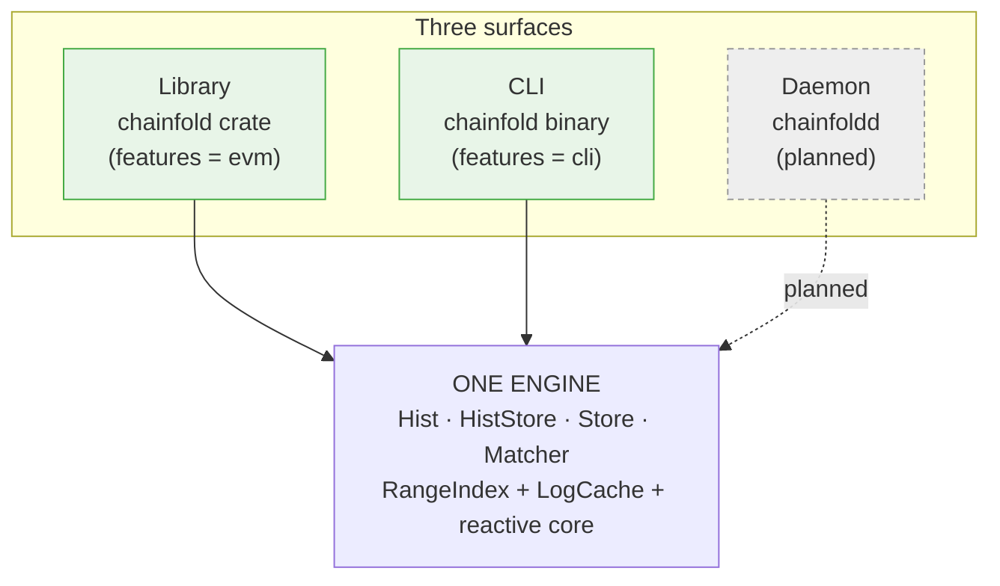

| Surface | Binary / crate | What it is |
|---|---|---|
| **Library** ✅ | `chainfold` crate | Embed the engine. The `Hist`/`HistStore`/`Store`/`Matcher` API this document describes. The source of truth — the other two surfaces are thin front-ends. |
| **CLI** ✅ | `chainfold` binary | A chain explorer whose distinguishing idea is **histories-first**: where `cast` returns a point value, chainfold returns the *history* it's a slice of. Ships `erc20` / `events` / `chains`; growing toward `blocks`, `call`, `storage`, `code`. |
| **Daemon** ⏳ | `chainfoldd` | A transparent JSON-RPC endpoint fronting an upstream node. Point `cast`/viem/ethers/a wallet at it and inherit at-most-once fetching, dedup, reorg handling, and live `eth_subscribe` — no code changes. |

The caching & correctness guarantees live in **one place** (the library) so
the front-ends stay thin.

---

## 4. Module map & layering

The cardinal rule: **the source-agnostic core never names a concrete
source.** `arch`, `combinators`, `merge`, and `matcher` know nothing about
EVM — their tests use a synthetic `MockPos`, never `EvmPosition`.
`signatures` is a standalone resolver (Sourcify → Etherscan) that also names
no source; the caller injects a cache impl. Concrete sources live behind
feature flags (`evm` today; `solana`/`bitcoin`/CEX later).

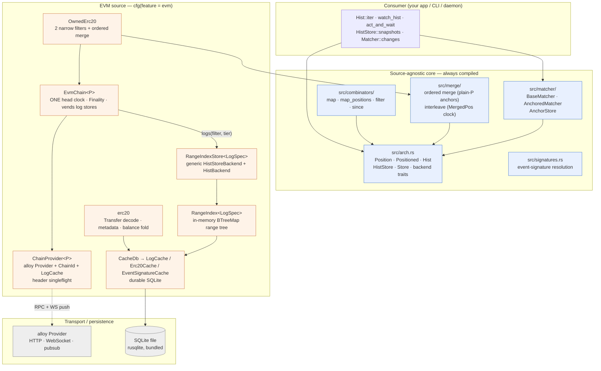

**Crate layout** (`src/`):

```
lib.rs                     pub mod {arch, combinators, matcher, merge, shared, signatures}; cfg(evm) evm
├─ arch.rs                 Position · Positioned · Hist · HistStore · Store · backend traits
├─ combinators/            mapped.rs · map_pos.rs · filtered.rs · since.rs
├─ merge/                  ordered.rs (merge_hist_stores, plain-P anchors) · interleave.rs (interleave_hist_stores · MergedPos) · types.rs · kway.rs
├─ matcher/                matcher.rs + anchor_store_sqlite.rs
├─ shared.rs               Shared<T> — Arc newtype; .share() names the refcount bump
├─ signatures.rs           event-name → signature/topic0 resolution
├─ evm/                    ← cfg(feature = "evm")
│  ├─ types.rs             EvmEvent · EvmPosition · ChainId · Topic · BlockNumber · LogIdx · ChunkSize · …
│  ├─ chain.rs + chain/    EvmChain — config · head_clock · wiring · rpc
│  ├─ range_index/         spec (RangeSpec seam) · block_pos · range_tree · gap_fill · log_spec · store (RangeIndexStore)
│  ├─ cache.rs + cache/    CacheDb → LogCache · Erc20Cache · EventSignatureCache (SQLite)
│  ├─ erc20.rs             Transfer decode · metadata · balance apply
│  ├─ owned_erc20.rs       two-filter in/out ordered merge
│  ├─ chain_provider.rs    ChainProvider<P> — chain-scoped RPC seam
│  ├─ aligned_ranges.rs    aligned_block_ranges
│  ├─ retry.rs             rpc_retry_layer
│  └─ observe.rs           the tracing contract
└─ bin/chainfold/          ← cfg(feature = "cli"): the real binary
```

Feature gating:

| Feature | Default | Pulls in |
|---|---|---|
| `evm` | off | `alloy` (HTTP+WS), `blake3`, `tracing` |
| `cli` | off | implies `evm`; adds `clap`, `tracing-subscriber`, `chrono`, `toml`, `dirs` |

---

## 5. Core abstractions

Five public shapes in `src/arch.rs`. Everything else composes them.

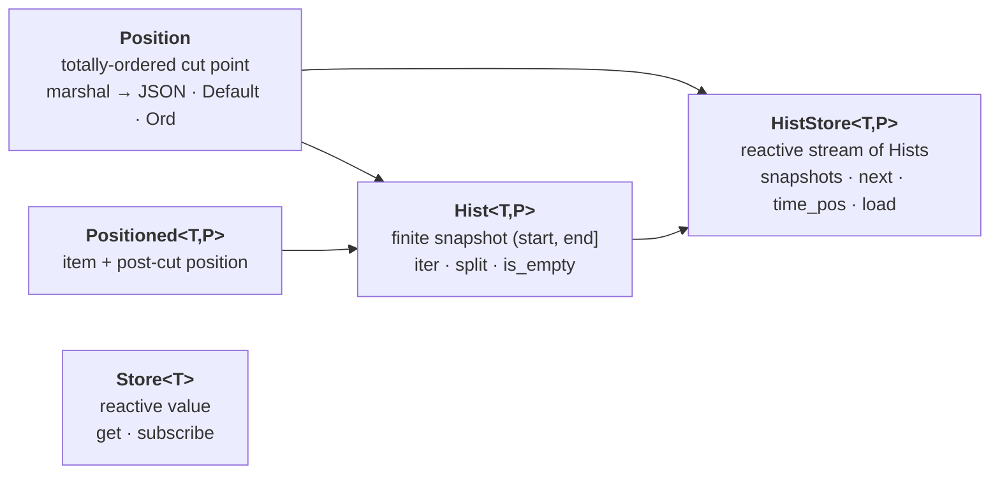

### `Position` — the cut point

A serializable, **totally-ordered** cut point in *one source's* stream. A
position is the gap *between* items, never an item itself. It is
**source-local** — positions from different sources are not comparable.
`Default` is the natural lower bound (`before any item`); for EVM that's
`EvmPosition { block: 0, log_index: 0 }`.

```rust
pub trait Position:
    Clone + Default + Eq + Ord + Debug + Send + Sync + 'static
{
    fn marshal(&self) -> serde_json::Value;
}

// EVM's impl:
pub struct EvmPosition { pub block: BlockNumber, pub log_index: LogIdx }
```

`marshal` returns a *structured* `serde_json::Value` (not opaque bytes), so
composite positions nest by pure composition — `MergedPos` marshals to a JSON
object of its sources' values, `MatcherAnchors` to a `{src, dst}` object — with
no hand-rolled framing. There is deliberately **no `unmarshal`** on the trait:
deserialization lives on the owning store as [`HistStore::load`](#histstoret-p--the-reactive-tip-stream),
because `load` must exist *before* any position instance does and, for merge,
needs the source identities only the store holds. Mirrors the reference
`history.ts`'s `pos.serialize()` / `store.load(json)` asymmetry.

### `Positioned<T, P>` — an item at a place

`{ item, pos }`, where `pos` is the *post-cut* of the item:
`hist.split(item.pos)` yields `(prefix_including_item, rest)`. That is the
convention for saving a resume anchor.

### `Hist<T, P>` — a finite snapshot

A finite, immutable window over `(start, end]`, iterated in position order.
Fixed at construction — later source activity does not change *this* `Hist`;
you get a fresh window from the `HistStore`.

```rust
impl<T, P: Position> Hist<T, P> {
    fn start(&self) -> &P;
    fn end(&self)   -> &P;
    fn is_empty(&self) -> bool;
    fn iter(&self)  -> impl Stream<Item = Result<Positioned<T,P>, HistoryError>>;
    fn split(&self, p: P) -> (Self, Self);   // clamps p into [start, end]
}
```

`split` delegates clamping to `HistBackend::clamp_pos` so positions with a
non-canonical `Ord` (the keyed `MergedPos`) can clamp component-wise.

### `HistStore<T, P>` — the reactive tip stream

A reactive sequence of `Hist` snapshots. Yields a fresh `Hist` whenever the
tip advances; the first yield is the current snapshot.

```rust
impl<T, P: Position> HistStore<T, P> {
    fn snapshots(&self) -> impl Stream<Item = Hist<T,P>>;
    async fn next(&self) -> Hist<T,P>;
    async fn time_pos(&self, t: Timestamp) -> Result<P, _>;      // time → position
    fn load(&self, v: serde_json::Value) -> Option<P>;           // marshal's inverse
}
```

There are **no finality accessors** here (R3): finality is a chain-wide fact,
not a per-store one, so it lives on the source's chain entity —
`EvmChain::head(Finality)` — and a store carries a single neutral end/tip
signal exposed through `snapshots()`/`next()`. See [§13](#13-reorg--finality-model).

### `Store<T>` — a reactive value

A Svelte/Zustand-style reactive value over a `tokio::sync::watch`.
`get()` is non-blocking; `subscribe()`'s first emission is the current value.

### Free functions & the resume model

```rust
// Yield every item after `start`, across snapshot boundaries. The anchor
// advances as items emit, so a snapshot arriving mid-walk just extends the
// window — items are never duplicated.
fn watch_hist<T,P>(store: &HistStore<T,P>, start: P) -> ItemStream<T,P>;

// Snapshot the tip BEFORE running op, run op, then await the first
// post-snapshot item satisfying predicate. Race-safe: items that appear
// between snapshot and op-completion are still observed.
async fn act_and_wait<T,P,R,...>(store, op, predicate)
    -> Result<(Positioned<T,P>, R), HistoryError>;
```

Background tasks are guarded by `tokio_util::task::AbortOnDropHandle` — drop
the owner, the task aborts (R7; the old `AsyncDisposable` wrapper is deleted).
See [§14](#14-ownership--lifetime).

### The backend seam — `HistBackend` and `HistStoreBackend`

Consumers hold the concrete `Hist` / `HistStore` structs; each is a thin handle
over an `Arc<dyn …Backend>`. A `Hist` is `{ backend: Arc<dyn HistBackend>,
start, end }`; a `HistStore` is `{ backend: Arc<dyn HistStoreBackend> }`.
`snapshots()`/`next()` mint `Hist`s that all share the store's underlying
`Arc<dyn HistBackend>`, so every snapshot of one source reads through the *same*
index. A range-based source doesn't hand-write these traits anymore: it authors
a `RangeSpec` and gets both impls from the generic `RangeIndexStore<S>`
([§5A](#5a-client-api-vs-backend-traits-shipped)); non-range backends (merge,
combinators, mocks) still implement them directly. Either way, combinators,
merge, and matcher compose over the traits for free.

**`HistBackend<T, P>`** — backs a single `Hist`. Two methods; only `iter` is
required.

```rust
pub trait HistBackend<T: Send + Sync + 'static, P: Position>: Send + Sync {
    /// Stream items in `(start, end]`, ascending by position. Cached gaps
    /// return immediately; uncached gaps are filled on demand (for EVM, an
    /// `eth_getLogs` guarded by the singleflight `Notify`). Dropping the
    /// stream cancels any in-flight fetch.
    fn iter(&self, start: P, end: P) -> ItemStream<T, P>;

    /// Clamp `p` into `[start, end]` for `Hist::split`. See below — default
    /// is the `Ord`-based clamp; override only when `P`'s total `Ord` does
    /// not equal its window-containment order.
    fn clamp_pos(&self, p: P, start: &P, end: &P) -> P {
        if &p < start { start.clone() }
        else if &p > end { end.clone() }
        else { p }
    }
}
```

**`HistStoreBackend<T, P>`** — backs a `HistStore`: the reactive tip stream plus
the time anchor and position deserialization.

```rust
#[async_trait]
pub trait HistStoreBackend<T: Send + Sync + 'static, P: Position>: Send + Sync {
    /// Fresh `Hist` per tip advance; first item is the current snapshot.
    fn snapshots(&self) -> HistStream<T, P>;

    /// The current snapshot (snapped to the latest known tip). For
    /// `RangeIndexStore` this waits until the source has seeded the tip,
    /// then is a plain watch read.
    async fn next(&self) -> Hist<T, P>;

    /// Estimate a position at a wall-clock time (cut point for time-based
    /// resume). For EVM: block-time estimation, no per-call RPC.
    async fn time_pos(&self, time: Timestamp) -> Result<P, HistoryError>;

    /// Deserialize a position from a `Position::marshal` value. The store
    /// owns deserialization — it knows the concrete `P` (and, for merge,
    /// the per-source identities). `None` on invalid input.
    fn load(&self, value: serde_json::Value) -> Option<P>;
}
```

Bounds worth noting: `T: Send + Sync + 'static` (items cross task boundaries and
live in boxed streams); `P: Position` (so `Clone + Default + Ord + marshal`);
both traits are `Send + Sync` because they're held as `Arc<dyn …>` and shared
across the WS watcher, drain task, and consumer walkers concurrently.

#### `clamp_pos` in depth

`Hist::split(p)` (`arch.rs:302`) cuts a snapshot into `(head, tail)` and must
never widen the window — so it first clamps `p` into `[start, end]`. Rather than
hardcode `Ord`, it delegates to `backend.clamp_pos(p, start, end)`:

- **Default (`Ord`-based).** `p < start → start`, `p > end → end`, else `p`.
  Correct whenever a position's `Ord` *is* its containment order — true for
  `EvmPosition` (lexicographic `(block, log_index)`).
- **Why it's overridable.** The interleave's `MergedPos<P>` holds one typed
  position per source; its total `Ord` (required by `Position`) is
  lexicographic over the sorted key union. A total order — but **not**
  component-wise containment: clock A can sort before clock B while being
  *ahead* of B on some source. The interleave's hist backend overrides
  `clamp_pos` to clamp **each per-source position separately, via `P`'s own
  `Ord`** (see [§7](#7-merge--ordered-and-interleaved)). Without the
  override, splitting an interleaved `Hist` at a saved `MergedPos` could
  clamp to the wrong cut and drop or duplicate items per source.

In short: `clamp_pos` is the seam that keeps `split` correct for a position whose
sort order is not its containment order.

#### Concurrency contract

A single backend is read through many `Hist`s at once — snapshots share the
store's `Arc<dyn HistBackend>`, and the live path has the wiring tasks writing
(`on_events` → `insert_page`) while consumers walk. Backends must therefore be
safe under concurrent `iter` and concurrent read/write. The `RangeIndex`
satisfies this with a `Mutex` over the BTree plus per-range singleflight
(`Notify`): the first walker into a cold gap fetches; peers coalesce onto it.
Pinned by `concurrent_searches_in_same_gap_fire_one_fetch` (now in
`range_index.rs` tests) — 5 concurrent walkers over one shared index, 1
fetch. (Coverage gaps — parallel `multi_thread`/loom, disjoint-range walkers,
reader-vs-`insert_page` — noted in §18.)

---

## 5A. Client API vs. backend traits (shipped)

> **Status: shipped** (R3, 2026-07-02 — `5916497` core reshape + `dd6525c`
> EVM, on `refactor/reactive-core`). This is the two-layer split as built;
> [deviations from the pre-R3 sketch](#deviations-from-the-pre-r3-sketch)
> below records where it landed differently.

Two layers. A range-based source authors a **`RangeSpec`** (what to store,
resolve, persist) plus concrete wiring driving two entry points; everything
reactive — the `HistStoreBackend`, its index, gap-fill, snapshots, position
deserialization — is **generic, written once** as `RangeIndexStore<S>`. This
mirrors the reference [`history.ts`](../../reference/src/history.ts)'s
`HistStoreImpl` over its `RangeTree` + `HistoryCallbacks`.

### Generic reactive layer — written once

`RangeIndexStore<S: RangeSpec>` (`src/evm/range_index/store.rs`) implements
**both** §5 backend traits over a `RangeIndex<S>` plus one reactive tip:

- **One nullable end tip** — a single `watch::Sender<Option<S::PubPos>>` (the
  reference's `end` field + `endChanged` event, fused into one watch channel).
  `None` until the source seeds it; `snapshots()`/`next()` *wait* for a seeded
  tip rather than fabricate an empty snapshot at `earliest`.
- **Two entry points** (the reference's `HistoryCallbacks`), called by wiring:
  - `on_events(page)` — live batch: insert into the in-memory tree, then bump
    the tip to `S::page_tip(page)` (the reference's `onEvents` →
    `onBump(page.to)`).
  - `on_bump(pos)` — the tip advanced with **zero** events (a head block with
    no matching logs; a reconnect; the initial seed). Monotonic via
    `send_if_modified` — a bump at-or-before the current tip is a no-op.
- **`HistBackend::iter`** = lazy `ensure_window_loaded` (materialize persisted
  scanned ranges into the tree) + the streaming, singleflight
  `RangeIndex::items`.
- **Store-owned deserialization** — `HistStoreBackend::load` delegates to
  `RangeSpec::load_pos`.
- **Wiring lifetime** — background tasks attach via
  `attach_wiring(AbortOnDropHandle<()>)` and hold only `Weak` back-references:
  they die with the store, and there is no `Arc` cycle (R7).

### Leaf seam — a source author implements `RangeSpec`

```rust
trait RangeSpec: Clone + Send + Sync + 'static {
    type Pos: IndexPos;        // tree-key position        (logs: BlockPos)
    type Item: Copy;           // lightweight tree entry   (logs: LogRef, a cache pointer)
    type Event;                // public item              (logs: EvmEvent)
    type PubPos: Position;     // public navigable position (logs: EvmPosition)
    type Page;                 // one fetch / one live delivery (logs: LogPage)

    // shape: positions, page bounds, the tip a delivered page bumps to
    fn item_pos(&Item) -> Pos;        fn page_items(&Page) -> Vec<Item>;
    fn page_bounds(&Page) -> BlockRange;   fn page_tip(&Page) -> PubPos;
    fn index_pos(&PubPos) -> Pos;     fn window(from: &PubPos, to: &PubPos) -> BlockRange;

    // the three durable-store touches
    fn resolve(&self, &Item) -> Result<Positioned<Event, PubPos>, _>;  // sync read, never RPC
    fn persist(&self, &Page) -> Result<(), _>;                         // gap-fill + drain
    fn load_window(&self, BlockRange) -> Result<Vec<LoadedSpan<Item>>, _>;  // lazy tree load

    // store-owned position deserialization (behind HistStore::load)
    fn load_pos(&self, serde_json::Value) -> Option<PubPos>;
}
```

Fetching is a separately injected closure — `Fetcher<Page>`, wrapping the
source's RPC (`eth_getLogs` for logs) — so tests pass a pure-Rust stub and the
provider-capturing fetch stays out of the persistence spec. `LogSpec` (a cache
handle + `FilterHash`) is the EVM-logs impl; an EVM-**blocks** spec is the
planned second instance (the `blocks` command, M1).

### Client — the chain entity (concrete per source)

```rust
enum Finality { Latest, Best, Safe }     // Best/Safe mirror Latest until Phase 7
struct LogFilter { address: Address, topics: [Option<Topic>; 4] }   // the "query" for logs
struct HeadEvent { number: BlockNumber, hash: BlockHash }

EvmChain::new(provider: ChainProvider<P>, config: EvmChainConfig).await  // one head fetch
chain.head(tier)          -> Store<HeadEvent>                  // the chain-wide clock
chain.logs(&filter, tier) -> HistStore<EvmEvent, EvmPosition>  // sync, no RPC
chain.refresh_head().await -> BlockNumber                      // one-shot poll (non-follow)
// chain.blocks(tier) — planned (M1)
```

`EvmChain` is concrete because it vends *many* item types (`logs`, `blocks`,
later traces/state) — no single trait/`dyn` expresses that. It owns the
chain-wide concerns **once**: the `ChainProvider` (which carries the
`LogCache`, [§12](#12-caching-mechanics)), the single head clock, the
`time_pos` block-time anchor. `logs(filter, tier)` builds a `LogSpec` +
fetcher + `RangeIndexStore`, seeds the tip from the current head, spawns the
store's wiring, and hands back a plain `HistStore` — cheap and synchronous,
no RPC; cached state materializes lazily.

**Follow mode is fixed at construction** (`EvmChainConfig::follow`), not a
per-store method: `None` = one-shot (head moves only via `refresh_head()`),
`Poll`/`Ws` = the chain runs one head clock and every store gets live wiring.
Log delivery stays **per filter** — `eth_subscribe(logs)` can't express
OR-topics (decision #11), so only the *head clock* is chain-wide. See
[§11](#11-data-flow--cold-live-resume) for the wiring variants and the
false-coverage soundness rule.

### Finality lives on the chain

`head(tier): Store<HeadEvent>` is the chain-wide clock (pre-R3 it was
redundantly on every history). The chain holds **one**
`watch::Sender<HeadEvent>`; `head(Best/Safe)` mirror `Latest` until Phase 7
wires their producers into the head clock (per-tier channels — a
confirmation-depth lag for `best`, a `finalized` poll for `safe`). Every
published head has its block header persisted *first* — the **headers-present
invariant** — so `LogSpec::resolve` can fill event timestamps synchronously.
A log store's tip widens a head block to `EvmPosition(block, LogIdx::MAX)`.

### Deviations from the pre-R3 sketch

The sketch that lived here proposed a source-agnostic `Source` trait +
`HistoryCallbacks` trait. What shipped deviates deliberately:

- **No `Source` trait was added** (concrete-first, decision #6). The leaf
  seam is `RangeSpec` + the concrete wiring in `chain/wiring.rs`. Lift a
  trait when the blocks source (M1) arrives and shows what's actually common.
- **`HistBackend`/`HistStoreBackend` survive** — the sketch had them collapse
  away, but they remain the composition seam merge/combinators/mocks implement
  directly. What changed: a range-based source no longer hand-writes them;
  `RangeIndexStore<S>` implements both, once.
- **`HistoryCallbacks` is not a trait** — `on_events`/`on_bump` are inherent
  methods on `RangeIndexStore`; wiring holds a `Weak<RangeIndexStore<_>>` and
  calls them directly.
- **Follow is not a per-store `subscribe`/`follow` method** — it's fixed at
  `EvmChain::new`; the chain owns one head clock, each store owns its wiring.
- **`head(tier)` carries `HeadEvent { number, hash }`**, not a bare block
  number — the hash rides along for reorg detection and the headers-present
  invariant.
- `watch(since)` never became a method — the free `watch_hist` already covers
  it. `Page` is not a generic struct — it's `RangeSpec::Page` (concrete:
  `LogPage`).

### Sketch → shipped mapping

| | pre-R3 shipped | R3 sketch | **R3 shipped** |
|---|---|---|---|
| Per-source contract | hand-written `HistBackend` + `HistStoreBackend` | one `Source` trait | **`RangeSpec` + concrete wiring** (trait deferred to M1) |
| Reactive `HistStore` | per source | generic | **`RangeIndexStore<S>` — generic, written once** |
| Live / follow | ad-hoc `EvmLogSubscriber` | `Source::subscribe(callbacks)` | **one chain head clock + per-store wiring tasks** |
| Tip w/ no events | inline `update_tip_to` | `HistoryCallbacks::on_bump` | **`RangeIndexStore::on_bump`** (single nullable watch tip) |
| Finality tips | `latest/best/safe` on every backend | `Chain::head(tier)` | **`EvmChain::head(Finality) -> Store<HeadEvent>`** |
| Backfill unit | items (`iter`) | pages (`fetch` → `Page`) | **`RangeSpec::Page` + injected `Fetcher<Page>`** |
| Position (de)serialization | `marshal`/`unmarshal: Vec<u8>` on `Position` | — | **`marshal -> serde_json::Value`; `load` on the store** |
| Task guard | `AsyncDisposable` (token + abort) | `AbortOnDropHandle` | **`AbortOnDropHandle` + `Weak` back-refs** (R7) |

---

## 6. Combinators

Pure proxies over a `HistStore` — **no I/O**. The wrapped store keeps driving
snapshots, tip stores, and time anchors.

| Combinator | Effect | Item out |
|---|---|---|
| `map_hist_store(hs, f)` | `f: Fn(&Src) -> Dst` per item | `MappedItem { item: Dst, source: Src }` |
| `map_positions(hs, mapper)` | lift positions `P → Q` per `PosMapper` | `Item` (passthrough; positions wrapped) |
| `filter_hist_store(hs, pred)` | keep items where `pred(&item)` | `FilteredItem { item, skipped: Vec<Item> }` |
| `since_hist_store(hs, cut)` | pre-split each yielded `Hist` at `cut` | `Item` (passthrough) |

`since` pre-splits at the **upstream** level: `since(map(src, expensive_f),
cut)` never calls `expensive_f` on pre-cut items, because `Hist::split`
happens before the mapper's `iter()` runs. (Pinned by
`since_skips_mapper_on_pre_cut_items`.)

`map_positions` is `map_hist_store`'s mirror (items untouched, positions
lifted into a wider type) and exists for the cross-family interleave's
app-enum pattern ([§7](#7-merge--ordered-and-interleaved)). The `PosMapper`
owns `wrap`/`unwrap` **and** `Q`'s `load` — the upstream store can only parse
its own `P` marshal, not the enum's tagged form, so deserialization rides the
mapper (still "on the store" from the consumer's point of view).

---

## 7. Merge — ordered and interleaved

Two merge primitives for two semantically different operations, split by
**position-space reasoning** (2026-07-02; replaced the erased heterogeneous
merge — `ErasedAnchor`/`ErasedHistStore` had zero production users). Both
are monomorphic over one shared item/position type and yield
`MergedItem<T, P> { value, source_key, source_pos }`.

| | `merge_hist_stores` (ordered) | `interleave_hist_stores` (vector clock) |
|---|---|---|
| Sources | share **one position space** (N filters on one chain) | **disjoint position spaces** (cross-chain / cross-family) |
| Order | `P`'s own total order | user `cmp` (typically time) — best-effort, ties unresolvable |
| Anchor | plain `P` — the space's own positions | `MergedPos<P>` = per-source vector clock |
| Same position twice | coalesced: one space ⇒ one item per position | never compared — different spaces |
| Used by | `OwnedErc20` in/out; a pool's Mint/Burn/Swap/Sync | multi-chain wallet; `bridge_explorer` |

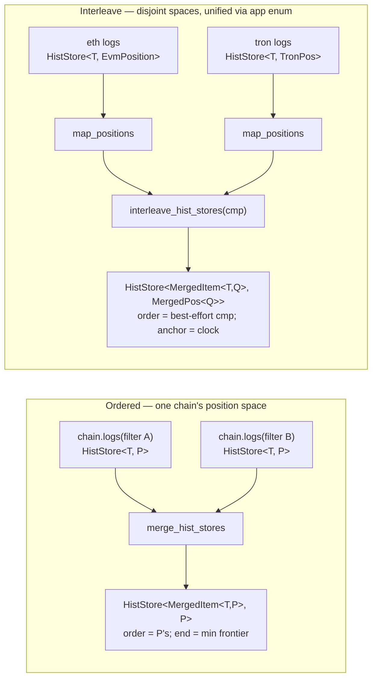

### Ordered merge (the workhorse)

```rust
pub fn merge_hist_stores<T, P: Position>(
    sources: BTreeMap<SourceKey, HistStore<T, P>>,   // no cmp — order IS P's order
) -> HistStore<MergedItem<T, P>, P>                  // anchors: plain P
```

The chain defines a global total order, and within one position space a
position **identifies** an item — `(block, log_index)` names a unique log
chain-wide. Two consequences fall out of taking that seriously:

- **Same-position coalescing.** Sources carrying an item at the identical
  position (overlapping filters — e.g. a self-transfer, one log matching
  both `OwnedErc20` filters) are reporting *the same item*. The merged
  stream yields each position once, from the lowest `SourceKey`, and drops
  the other copies (pinned by `same_position_coalesces_to_lowest_key`).
- **Plain-`P` anchors.** With one item per position, a yielded item's own
  position is an exact resume anchor and `hist.split(saved).1` is the
  standard core convention — no merge-specific position type, no vector
  clock. A merged anchor marshals identically to an inner-store anchor
  (pinned by `anchors_marshal_as_plain_positions`), and a `--from-block`
  bound is just `EvmPosition::new(b - 1, u32::MAX)`, same as on any store.

**Merged end = min over the sources' ends**: the frontier where *all*
sources are complete — a snapshot must not claim coverage a lagging source
hasn't reported. `snapshots()` re-emits only when the min advances; under
one chain head clock the filter stores' ends advance together, so the gate
is invisible in practice (pinned by `snapshots_gate_on_min_frontier`).

Default `Ord` clamping is exact (positions are the space's own `P`), so the
ordered variant needs no `clamp_pos` override — and `load` is any source's
`load` (all sources share `P`).

> An earlier iteration yielded *both* copies of a same-position item with
> source-tagged anchors (`OrderedPos { pos, bound: Before|At(key)|After }`
> plus a `DiscretePosition::pred` fetch-widening seam, so a resume *between*
> the copies was exact). Coalescing replaced it: the duplicate carries no
> information (it is the same log), consumers all deduped anyway, and the
> position-identity reading dissolves the extra anchor type, the trait, and
> the boundary-refetch machinery outright.

### Interleave (vector clock)

```rust
pub fn interleave_hist_stores<T, P: Position>(
    sources: BTreeMap<SourceKey, HistStore<T, P>>,
    cmp: impl Fn(&MergedItem<T, P>, &MergedItem<T, P>) -> Ordering + Send + Sync + 'static,
) -> HistStore<MergedItem<T, P>, MergedPos<P>>

pub struct MergedPos<P: Position> { /* BTreeMap<SourceKey, P> */ }
// construct: FromIterator<(K, P)> / From<[(K, P); N]>; read: get(&SourceKey)
```

Positions are incomparable across sources *even when the type matches*
(block 100 on ETH vs Polygon), so item ordering is inherently
**best-effort/presentational** via `cmp` (stable tie-break by source key; no
strict-order promise) and the honest anchor is the clock: the source that
just yielded advances its entry; the others stay at whatever they last
yielded. Saving the last `MergedPos` and resuming via `split(saved).1` is
the exact per-source continuation, and it survives sources being
added/removed across restarts — a missing key means that source's `Default`
(pinned by `merged_pos_handles_added_source`). the reference implementation agrees with this
shape: its `MergedPos` implements no comparison at all (serialize-only), and
its forwarder merges EVM + Hyperliquid + Lighter feeds in production this
way.

**The `Ord` subtlety:** `MergedPos<P>`'s total `Ord` (required by the
`Position` bounds) is lexicographic over the key union via `P::Ord`
(present > absent), which does **not** match component-wise containment — so
the interleave's hist backend overrides `clamp_pos` to clamp each component
separately (see [§5](#clamp_pos-in-depth)).

### Cross-family unification — the wallet recipe

Sources with *different* position types (EVM vs Tron vs BTC…) unify
**before** the interleave via an app-defined closed enum lifted with
`map_positions` ([§6](#6-combinators)). Chain *sets* stay runtime-dynamic
(source keys); chain *families* are compile-time-bounded by which source
impls are compiled in — so the enum costs no real flexibility, and no
`dyn`-erasure fallback exists.

```rust
enum WalletPos { Evm(EvmPosition), Tron(TronPos) }   // app-owned; one variant per family

let mut sources = BTreeMap::new();
sources.insert("eth".into(),  map_positions(eth_transfers,  EvmWrap));  // HistStore<T, WalletPos>
sources.insert("tron".into(), map_positions(tron_transfers, TronWrap));
let wallet = interleave_hist_stores(sources, by_time);  // anchors: MergedPos<WalletPos>
```

Pinned end-to-end — including the tagged-anchor marshal round-trip across a
restart — by `tests/interleave.rs`.

---

## 8. Matcher — correlation

Pure correlation between two source streams (`src` and `dst`), producing a
`{ matched, pending, orphans }` view. Two layers:

- **`BaseMatcher`** — the pure compute kernel. No mutable state, no background
  task. Driven via `compute_state(anchors)` (which re-reads the current
  snapshot via `next()`), or the pure `compute_with(src_hist, dst_hist,
  anchors)` when you already hold the Hists.
- **`AnchoredMatcher`** — adds persistence over an `AnchorStore` + an
  in-memory cache. Production callers use this.

```rust
pub struct MatcherAnchors<SP, DP> { pub src: SP, pub dst: DP }
pub struct Match<Src, Dst> { pub src: Src, pub dst: Dst }
pub struct MatchOutput<Src, Dst> {
    pub matched: Vec<Match<Src, Dst>>,
    pub pending: Vec<Src>,     // src items awaiting a dst
    pub orphans: Vec<Dst>,     // dst items with no src
}

#[async_trait] pub trait MatchFn<Src, Dst, Out, SP, DP> {
    async fn matchup(&self, input: MatchInput<..>) -> Result<Out, HistoryError>;
}
#[async_trait] pub trait AnchorStore {           // impls: InMemory, Sqlite
    async fn get(&self, key: &str) -> Result<Option<Vec<u8>>, HistoryError>;
    async fn set(&self, key: &str, value: Vec<u8>) -> Result<(), HistoryError>;
}
```

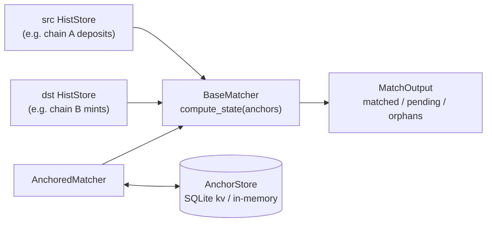

**Asymmetric anchor advance is by design.** An anchor pair `{src, dst}` means
"items strictly *after* these positions are still eligible for matching" —
*not* "everything up to here is processed." Advance only `src` past a matched
pair and, on the next compute, that pair moves from `matched` → `orphans`
because the dst item is still in the dst tail. Consumers wanting monotonic
guarantees advance the anchor pair in sync.

**Matched pairs are transient** — they surface for one or more computes, then
vanish once anchors advance past them. Persist matched pairs in your app
*before* advancing if you need a permanent log.

> **Reducer** (the matcher's sibling — a stateful monotonic *fold* over one
> stream, positioned by a vector of source positions) is specced but **not
> built**. Both are intended to ship; they solve different problems (fold vs
> correlation). See [Roadmap](#19-roadmap--in-flight-work).

---

## 9. The EVM source layer

The concrete client for EVM log streams (`feature = "evm"`).

| Component | Role |
|---|---|
| **`EvmChain<P>`** | The per-chain entity. Owns the `ChainProvider`, **one** head clock (`newHeads` or poll; headers persisted before publishing), and vends per-filter stores via `logs(&LogFilter, Finality)` (sync, no RPC). Follow mode fixed at construction (`EvmChainConfig`); one-shot chains advance via `refresh_head()`. |
| **`RangeIndexStore<S: RangeSpec>`** | The reactive layer, written once: `HistStoreBackend` + `HistBackend` over a `RangeIndex<S>` plus a single nullable `end` tip (`watch::Sender<Option<PubPos>>`; monotonic `on_bump`, `on_events` = insert page + bump). Wiring tasks attach as `AbortOnDropHandle`s holding `Weak` back-refs. |
| **`RangeIndex<S>`** | Generic in-memory `BTreeMap<S::Pos, Range>` per source stream. Empty-range tombstones, singleflight via `Arc<Notify>` per range, lazy first-touch window load, async drain to SQLite. **The hot path.** |
| **`LogSpec`** | The `RangeSpec` for EVM logs: `LogRef` tree items, sync `resolve` to `EvmEvent` (headers-present invariant), persist/load against `LogCache`, `EvmPosition` load. |
| **`CacheDb` → `LogCache` / `Erc20Cache` / `EventSignatureCache`** | Durable SQLite over one shared connection. Narrow per-concern views; **never on the live path.** |
| **chain wiring** (`chain/wiring.rs`) | Per-store tasks driving `on_events`/`on_bump`: mirror-head (one-shot), eager gap-fill (poll follow), or a narrow per-filter `eth_subscribe(logs)` interleaved with head-driven empty coverage in one session (ws follow). Reconnect-with-backoff (100 ms → 30 s); reconnect gap-fill must succeed before push delivery resumes. |
| **`OwnedErc20`** | Two narrow `chain.logs(...)` stores (`topic1 = owner` outgoing, `topic2 = owner` incoming), combined with the **ordered merge** — both filters share the chain's `(block, log_index)` space, so no comparator, and anchors are plain `EvmPosition`s. Direction reported via `source_key` (`IN_KEY` / `OUT_KEY`); a self-transfer matches both filters but surfaces once (coalesced, tagged `IN_KEY`; balance-neutral in `apply_transfer`). Sync constructor, no provider generic. |
| **`erc20`** | `decode_transfer`, `fetch_erc20_metadata`, `apply_transfer` (running-balance fold). |
| **`ChainProvider<P>`** | An alloy `Provider` bundled with its `ChainId` **and the `Shared<LogCache>`**. Internalizes `rpc_span` instrumentation + error mapping (inherent `get_block_number`/`get_logs`) and owns the **singleflight** `ensure_block_header` (per-block gate + double-checked cache read). |
| **`aligned_block_ranges`** | Snaps RPC ranges to `batch_size` boundaries so concurrent consumers hit the same cache entries. |

**Position bridging:** `EvmPosition(0, 0)` ↔ `BlockPos::Bottom`; otherwise
`BlockPos::At { block, log_index }` maps 1:1.

**Why in/out ERC20 is a merge of two filters, not a post-filter:** each inner
history fetches *its own* subset at the RPC level (`topic1=owner` and
`topic2=owner`), so the node returns only the owner's transfers — not the
whole Transfer stream filtered client-side. See design decision #11 in
`MEMORY.md`.

---

## 10. Storage model

Two tiers. The **in-memory `RangeIndex`** is the hot path; **SQLite** is the
durable backfill store, drained to asynchronously and never blocking a live
event or a warm read.

### In-memory: `RangeIndex<S: RangeSpec>`

A per-source-stream `BTreeMap` of scanned ranges over tree positions
(`LogSpec`: per-filter, keyed by `BlockPos`). Scanned-ness
is **first-class**: a range that was scanned and found empty is stored as a
*tombstone* alongside filled ranges.

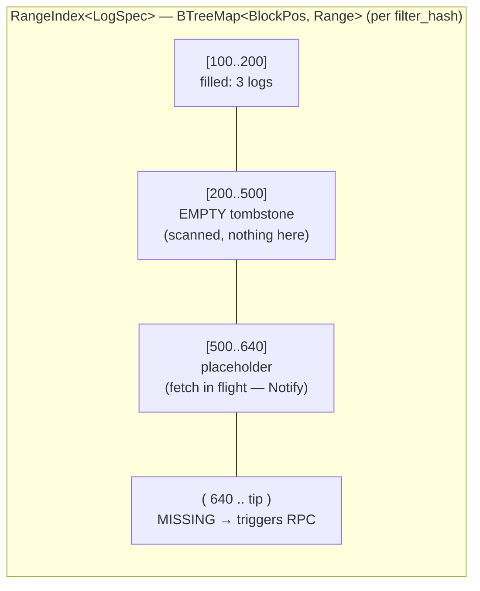

- Iter into a **filled** range → yields items immediately.
- Iter into an **empty** tombstone → yields nothing, **no RPC**.
- Iter into a **missing** range → triggers an `eth_getLogs`, guarded by a
  singleflight placeholder (concurrent readers `await` the same `Notify`).

### Durable: SQLite (via `rusqlite`, bundled)

`CacheDb` opens one file and vends narrow views; migrations live in
`src/evm/cache.rs`.

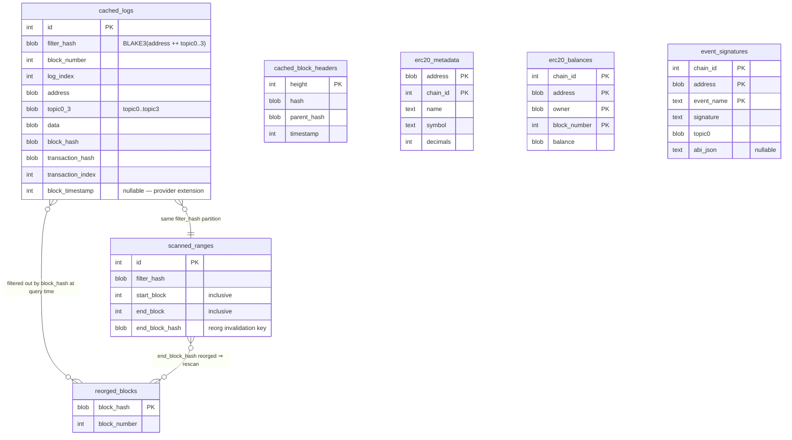

Key modelling decisions baked into the schema:

- **Uniqueness is `(filter_hash, block_hash, log_index)`**, *not*
  block_number — so the same log index on two forks can coexist. Reorged
  logs are **never deleted**; they stay in `cached_logs` and are filtered out
  at query time via `reorged_blocks`. (Append-only reorg handling, decision
  #7.)
- **`filter_hash`** = `BLAKE3(address ++ topic0..3)` partitions logs by the
  `eth_getLogs` filter that produced them. Different filters on the same
  contract (Transfer vs Approval) get separate partitions.
- **`scanned_ranges`** records *which ranges were fetched* even when they
  returned zero logs — that's how a gap query knows what it still needs. Its
  `end_block_hash` is the reorg-invalidation key: if that hash lands in
  `reorged_blocks`, the range is refetched.
- **Ranges are not eagerly merged** on insert; only finalized ranges are
  compacted (decision #8), so a tip reorg can't invalidate a huge merged
  range.
- **`cached_block_headers`** is shared across all filters (not partitioned),
  and carries the timestamp used to stamp `EvmEvent.timestamp` when the log
  itself lacks a `block_timestamp`.

**Matcher anchors** live in a *separate* SQLite file — `SqliteAnchorStore` is
a small `kv` table, independent of the log cache.

---

## 11. Data flow — cold, live, resume

The cold-backfill path and the live-push path share the same in-memory
`RangeIndex`; SQLite sits under the cold path and is drained-to under the
live path, never blocking either.

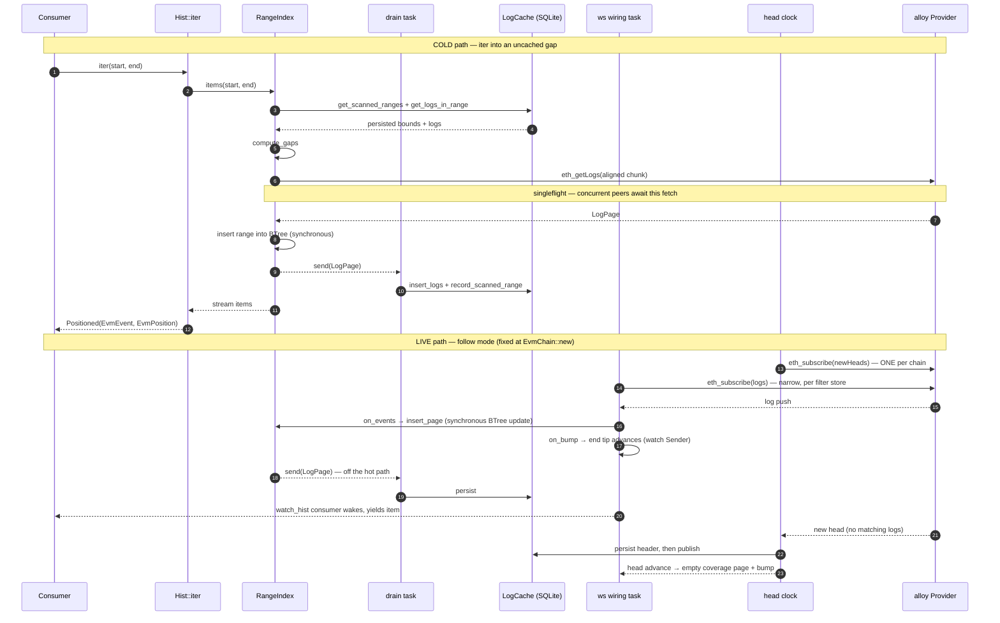

**Resume / subscribe-from-the-past** unifies the two: `watch_hist(&store,
saved_anchor)` splits each fresh snapshot at the running anchor and iterates
only the tail. Early snapshots walk the cold cache; once the walk reaches the
tip, new snapshots (driven by the wiring bumping the store's `end` tip)
extend the window seamlessly. The consumer never distinguishes "history" from
"live", and reconnect gap-fill is invisible.

---

## 12. Caching mechanics

Four mechanisms conspire to make guarantee #1 ("at most once") hold under
concurrency and slightly-misaligned requests:

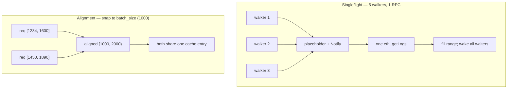

1. **At-most-once.** `scanned_ranges` + the in-memory tombstones mean a range
   is fetched once; later reads diff against what's scanned and fetch only the
   genuine gap.
2. **Singleflight.** The first reader into a cold gap installs a placeholder
   and fires the RPC; concurrent readers await the placeholder's `Notify`.
   (Test: 5 walkers → 1 `eth_getLogs`.)
3. **Alignment.** `aligned_block_ranges` snaps RPC ranges to `batch_size`
   boundaries (default 1000 blocks) so consumers asking slightly different
   ranges collide on the same cache entries.
4. **SQLite off the live path.** A WS-delivered log goes
   `wiring → RangeIndex → consumer` synchronously; the durable write is
   drained in the background. Warm reads and live events never wait on disk.

The retry layer (`rpc_retry_layer`) wraps transient RPC failures with bounded
backoff; the observability contract counts every call so the "warm walk = 0
`eth_getLogs`" property is test-enforced, not aspirational.

---

## 13. Reorg & finality model

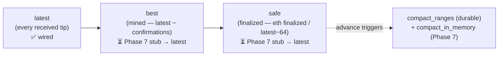

- **Logs are append-only.** Reorged block hashes go into `reorged_blocks`;
  queries filter them at read time. Nothing is truncated.
- **Scanned ranges self-invalidate.** A range whose `end_block_hash` is
  reorged is refetched.
- **Finality is chain-wide** (R3): the `Finality` tier on
  `EvmChain::head(tier)` / `EvmChain::logs(filter, tier)`, not per-store
  accessors. `Latest` is fully wired; `Best`/`Safe` mirror `Latest` until
  Phase 7 wires their producers (`latest − confirmation_depth`; RPC
  `finalized`, else `latest − 64`) into the head clock.
- **Compaction runs only below `safe`** so a tip reorg can never invalidate a
  merged range (decision #8).
- **Consumer-side recovery today:** track `block_hash` on the last consumed
  `EvmEvent`; if a later walk surfaces a different hash at that position, walk
  back. Phase 7 may centralize this (reorg-aware `lca()`).

---

## 14. Ownership & lifetime

Every cancellable thing is owned by either an `Arc`/`Shared` handle (shared)
or an `AbortOnDropHandle` (single-owner; drop aborts — R7). **No raw
`tokio::spawn` survives its owning struct.** Background tasks hold only
`Weak` back-references to the store that owns them, so there is no
keep-alive cycle.


**The watch-coalescing footgun.** Any task driven by a `tokio::sync::watch`
subscription must propagate **every** emission. The tempting bug: skip the
subscription's first emission as "already represented by the channel's init
value." **This loses updates** — `watch` coalesces, so an update arriving
between subscribe-time and the task's first poll shows up *as* the first
emission and gets dropped. **The rule: propagate every emission** (redundant
sends are harmless; the consumer-side watch coalesces too). Pinned by
`snapshots_advance_when_any_source_appends`. The two historical instances —
the matcher's `changes()` aggregator (removed by R4) and merge's tip
aggregators (removed by R3) — are both gone; today's merge `snapshots()`
seeds one snapshot per child before `select_all`ing their streams, which is
the same rule expressed structurally.

---

## 15. Observability contract

The two headline guarantees are only credible if they stay *measurable*.
Chainfold emits a small, **stable** `tracing` contract at every RPC and cache
boundary — a contract, not incidental logging — defined in one place
(`src/evm/observe.rs`).

| Kind | target | span/event | fields |
|---|---|---|---|
| RPC call (span) | `chainfold::rpc` | `rpc` | `method` |
| SQLite read (span) | `chainfold::sqlite` | `sqlite` | `op` |
| Cache hit/miss (event) | `chainfold::cache` | — | `layer`, `outcome` |

The **wire format is strings** (what `tracing`/OTLP want); the **emission API
is typed** — `RpcMethod`, `SqliteOp`, `CacheLayer`, `CacheOutcome` are closed
enums with `as_str`/`from_wire` inverses, so a call site can't emit a stray
method name. Spans carry duration (open→close); cache events are instantaneous
counters. A `singleflight` cache hit means a concurrent caller was coalesced
onto an in-flight fetch — an RPC *saved*.

**Two consumers, one contract:**

- **CLI `--stats`** (`src/bin/chainfold/stats.rs`) — a `tracing_subscriber`
  Layer that tallies an end-of-run summary (RPC by method + wall-time, SQLite
  read time, cache hit/miss). Opt-in via `--stats` / `CHAINFOLD_STATS`; writes
  to stderr so stdout stays pipeable.
- **Daemon** (planned) — routes the same spans to an OTLP exporter
  (Tempo/Jaeger); no chainfold-specific glue.

This doubles as the **anti-regression guard**: the instrumentation that feeds
the human summary also feeds test assertions on RPC counts (a second walk of a
cached range must issue zero `eth_getLogs`), so "minimize RPC" can't rot.

---

## 16. The CLI surface

`chainfold` (behind `feature = "cli"`) is the real binary — histories-first,
every read cached. `main` returns an `ExitCode` and renders errors via
`Display`.

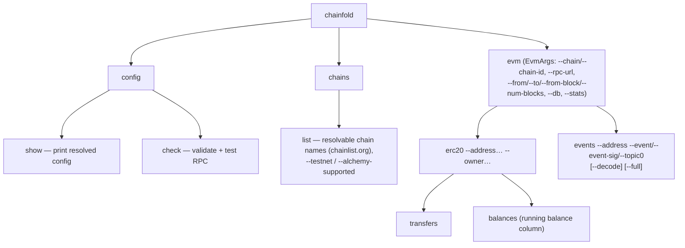

**Chain resolution precedence:** `--chain-id` > `--chain` > env
`CHAINFOLD_CHAIN` > config `[evm] default_chain` > built-in `ethereum`. Names
resolve against cached chainlist.org data via a `ChainResolver`
(lowest-chain-id-wins on shortName/chainSlug collisions, deterministic). RPC
selection: explicit `--rpc-url` > Alchemy (with API key) > chainlist public
RPC.

**Histories-first** is the through-line: a `balances` read is a *history of
balances*, an `events` read a slice of *event history*, and "value at tip" is
just `hist.at(tip)`. Every read maps onto the library `HistStore`, inheriting
caching / resume / follow for free. Growth path: a `blocks` command, then
`call` / `storage` / `code` accessors.

---

## 17. Type discipline

The EVM layer favors **semantic types over blind primitives** — a 20-byte
address can't be passed where a 32-byte hash is expected, a chain id can't be
swapped with a block number, a topic can't be confused with a hash.

| Type | Over | Notes |
|---|---|---|
| `Address` / `B256` | alloy | + `TxHash`/`BlockHash` aliases on fields that carry those |
| `Topic` | newtype over `B256` | owns the address↔topic relationship (`From<Address>` left-pads, `.address()` extracts); unwraps to `B256` at the alloy `Filter`/`Log` boundary |
| `ChainId` | `u64` | `#[serde(transparent)]` + `Ord` + `Display`; its `ToSql` lives in the *cache* layer so the domain type stays persistence-free |
| `BlockNumber` | `u64` | **affine**: block ± u64 = block; block − block = u64 via `.get()`. `#[serde(transparent)]` keeps the `EvmPosition` marshal byte-identical |
| `LogIdx` | `u32` | per-block log index. Named `LogIdx`, *not* `LogIndex` — that name belonged to the pre-R3 range tree (now `RangeIndex`) |
| `FilterHash` | `[u8; 32]` | the BLAKE3 cache partition key; not an EVM hash, so a newtype (`ToSql` in the cache layer) |
| `Timestamp` | `u64` | source-agnostic (lives in `arch.rs`); the unit `time_pos`/`act_and_wait` speak |
| `SourceKey` | `String` | the merge-source / `MergedPos` clock / `MergedItem.source_key` key; `#[serde(transparent)]`; `MergedPos::get` speaks it |
| `BlockRange { from, to }` | `(u64, u64)` | named window in `compute_gaps` / alignment |
| `ChainProvider<P>` | `Provider` + `ChainId` | kills the redundant per-construction `eth_chainId` |
| `ChainHandle` / `ChainSelector` / `RpcSource` / `Url` | strings | CLI chain-resolution domain types |

`BlockNumber` and `LogIdx` staying `#[serde(transparent)]` is load-bearing:
saved resume-anchors stay byte-identical to the pre-newtype postcard encoding.
The SQLite/`compute_gaps`/alignment/RPC boundaries drop to raw `u64` at the
seam. `MergedPos<P>` holds typed positions since the merge split; the
remaining deliberately-generic boundary is `Position::marshal`'s
`serde_json::Value`.

---

## 18. Testing

| Suite | What it covers | Gate |
|---|---|---|
| Lib unit | Source-agnostic surface via `MockPos`; EVM units | always |
| `tests/hist_store.rs` | `Hist` / `HistStore` shape | always |
| `tests/combinators.rs` | map/filter/since composition | always |
| `tests/interleave.rs` | cross-family interleave: app enum + `map_positions`, restart resume (the wallet recipe) | always |
| `tests/matcher.rs` | matcher incl. SQLite persistence across restart | always |
| `tests/mock_provider_smoke.rs` | alloy `Asserter` wrapper | `evm` |
| `tests/anvil_smoke.rs` | local anvil harness (fork case `#[ignore]`) | `evm` |
| `tests/cache_layering.rs` | fork-mainnet warm-cache speedup | `#[ignore]` |
| `tests/live_follow.rs` | anvil live-event latency | `#[ignore]` |
| `tests/owned_erc20.rs` | fork OwnedErc20 vs broad-filter baseline | `#[ignore]` |

(The integration suites carried `phaseN_*` names from the phased refactor
until 2026-07-02; they're subject-named now. The ordered merge's own pins —
min-frontier gating, same-position coalescing, plain-position anchors — live
in `src/merge/ordered.rs` unit tests.)

```bash
cargo test --features evm             # fast lib + source-agnostic suite (~1s)
cargo test --all-features             # + CLI-bin unit tests
cargo test --features evm -- --ignored   # anvil / fork tests (needs `anvil`, MAINNET_RPC_URL)
```

Anti-regression: several tests assert RPC counts through the observability
contract (e.g. a second walk of a cached range issues zero `eth_getLogs`).
Coverage runs via `cargo-llvm-cov`, uploaded to Codecov (patch ≥ 80%).

**Concurrency coverage.** `concurrent_searches_in_same_gap_fire_one_fetch`
(`src/evm/range_index.rs` tests) pins the shared-BTree singleflight: 5
concurrent walkers over one `Arc<RangeIndex<LogSpec>>` and the same cold gap
→ 1 fetch, all 5 see the item. It's `#[tokio::test]` (current-thread), so it
covers *concurrent* (interleaved), not *parallel* (multi-core), access. Known
gaps (tracked as R6 in `TODO.md`): no `multi_thread`/loom test for true data
races; no test for concurrent walkers over *disjoint/overlapping* ranges on
one BTree; no reader-vs-writer test (a walk in flight while the ws wiring's
`on_events` mutates the same BTree).

---

## 19. Roadmap & in-flight work

Canonical plan lives in [`refactor.md`](./refactor.md). The biggest unbuilt
pieces:

- **Phase 7 — pruning + `best`/`safe` wiring** *(next eligible)*.
  `RangeIndex::prune_older_than` (drop item payloads, keep tombstones),
  `compact_in_memory(up_to_block)`, real `best`/`safe` producers wired into
  `EvmChain`'s head clock, bounded RSS under indefinite follow.
  `LogCache::compact_ranges` (durable side) already exists and is tested;
  the in-memory eviction is what's missing.
- **EVM blocks source** *(M1)*. A `BlockSpec: RangeSpec` reusing the same
  `RangeIndex`/`RangeIndexStore` machinery (shipped generic with R3) to back
  `chain.blocks(tier) -> HistStore<Block, BlockNumber>` — foundation for the
  histories-first `blocks` CLI command. When it lands, consider lifting a
  source-agnostic `Source` trait over the per-source wiring (deferred from
  §5A per decision #6, concrete-first).
- **Reducer** — the matcher's sibling (stateful monotonic fold over one
  stream, positioned by a vector of source positions). `Erc20Balance` rebuild
  gates on it.
- **Real bridge decoder** for `bridge_matcher` — ABI-aware `MatchFn` impls
  (LayerZero ULN, OP `CrossDomainMessenger`, Arbitrum `Inbox`, …); the shipped
  CLI uses a generic `--match-on` key extractor.
- **`chainfoldd`** — the transparent caching JSON-RPC daemon (benefits from
  Phase 7's finality wiring).
- **More source backends** — Solana / Bitcoin / CEX websockets all fit the
  `HistStoreBackend` shape; each gets its own `Position` type, and cross-source
  merge already supports it.
- **Same-`P` typed merge alias** *(Phase 5 deferral)*. When every source
  shares one `Position` (the `OwnedErc20` case), a typed `merge<T, P>`
  returning `HistStore<T, P>` would skip the `MergedPos` erasure overhead. Not
  load-bearing today — `MergedItem.source_key` is genuinely useful for
  direction reporting.
- **Reorg-aware `lca()` / `is_equiv()`** *(Phase 7 candidate)*. Centralize the
  consumer-side reorg recovery of [§13](#13-reorg--finality-model) into the API
  — `HistStore::lca(a, b)` to roll a stale anchor back to the canonical chain's
  latest common ancestor, instead of hand-rolled `EvmEvent.block_hash`
  comparison.

### Examples (all require `--features evm`)

| Example | Demonstrates |
|---|---|
| `history_explorer` | raw single-filter log walker; `--measure` prints cold/warm/hot tiers |
| `erc20_explorer` | ERC20 transfers + running balance; `--owner` uses `OwnedErc20` |
| `bridge_explorer` | multi-chain cross-source merge (merge by `event.timestamp`) |
| `bridge_matcher` | cross-chain `Matcher` with anchor persistence in a separate SQLite file |
