# Chainfold — Architecture

> **This document** is the canonical architecture reference for chainfold —
> the *as-built* design, its structure, and the rationale behind both, with
> diagrams. For the *forward plan and backlog* see
> [`ROADMAP.md`](./ROADMAP.md); for *coding conventions* see
> [`STYLE.md`](./STYLE.md); for *dev setup* see
> [`DEVELOPMENT.md`](./DEVELOPMENT.md); for the *product pitch and
> quickstart* see [`README.md`](../README.md).
>
> **Status:** The **library** and **CLI** surfaces are live over the shared
> chain engine, with two concrete source families (EVM logs + blocks;
> Bitcoin blocks); the **daemon** (`chainfoldd`) is planned. Phase 7 (memory
> pruning + `best`/`safe` head producers) is the next eligible chunk.

---

## Table of contents

1. [What chainfold is](#1-what-chainfold-is)
2. [The two guarantees](#2-the-two-guarantees)
3. [Product surfaces](#3-product-surfaces)
4. [Module map & layering](#4-module-map--layering)
5. [Core abstractions](#5-core-abstractions)
5A. [Client API vs. backend traits](#5a-client-api-vs-backend-traits)
6. [Combinators](#6-combinators)
7. [Merge — ordered and interleaved](#7-merge--ordered-and-interleaved)
8. [Matcher — correlation](#8-matcher--correlation)
9. [The EVM source layer](#9-the-evm-source-layer)
10. [Storage model](#10-storage-model)
11. [Data flow — cold, live, resume](#11-data-flow--cold-live-resume)
12. [Caching mechanics](#12-caching-mechanics)
13. [Reorg & finality model](#13-reorg--finality-model)
14. [Ownership & lifetime](#14-ownership--lifetime)
15. [Observability contract](#15-observability-contract)
16. [The CLI surface](#16-the-cli-surface)
17. [Type discipline](#17-type-discipline)
18. [Testing](#18-testing)
19. [Locked-in design decisions](#19-locked-in-design-decisions)

---

## 1. What chainfold is

Chainfold is a **caching access layer for blockchain event histories**. It
gives you the illusion of working against a local full node — without ever
downloading a chain. One engine (caching backfill + in-memory range index +
reactive core) is exposed through three surfaces: an embeddable Rust
**library**, a `cast`-like **CLI**, and a planned transparent caching-RPC
**daemon** (`chainfoldd`).

Whatever the surface, you get:

| Capability | Meaning |
|---|---|
| **Caching backfill** | Ask for a block/time range once; later reads of the same range hit local SQLite, never RPC. Partial overlaps fetch only the missing slice. |
| **Lazy iteration** | A `(2020, 2026)` request returns a *snapshot object*, not a buffered `Vec`. Items are pulled on demand; drop the stream to cancel mid-walk. |
| **Resumable positions** | Every item carries a serializable position (`(block, log_index)` on EVM). Persist it, restart, resume. |
| **Live push** | New events reach the consumer in single-digit ms end-to-end; the internal hop (receipt → range index → wake) is sub-ms — SQLite is never on the live path. |
| **Subscribe-from-the-past** | Iterate from an old anchor, fall through transparently into the live tip, never surface a network error. |
| **Merge & correlate** | Combine events from different chains/filters into one chronological stream; correlate `src ⇄ dst` tails into `{matched, pending, orphans}`. |

**Why it exists.** The two motivating workloads are *state reconstruction*
(fold events into a balance/position — which over raw RPC means racing a gap
between the state fetch and the subscription, with no way to subscribe from
an arbitrary past block) and *history comparison* (a bridge daemon diffing
two chains' event histories — which means hand-rolling anchors, reconnect
gap-fill, and re-fetch suppression). Both hammer the same ranges repeatedly,
so both die without aggressive caching. Chainfold packages the lifecycle —
backfill, live tracking, gap recovery, resume — behind one reactive API.

---

## 2. The two guarantees

Everything in the design is in service of two measurable properties:

1. **Minimal RPC through aggressive caching.** Any range is fetched from the
   node *at most once*. Concurrent readers of the same cold gap are
   *singleflighted* into one `eth_getLogs`; ranges are snapped to aligned
   chunk boundaries so slightly-different requests share cache entries. A
   warm walk issues zero RPC and runs orders of magnitude faster than the
   cold one.

2. **Real-time delivery.** Live logs reach the consumer in single-digit ms
   end-to-end (~3 ms over WS on local anvil); chainfold's *internal* hop is
   sub-millisecond because the live path never touches SQLite.

Both guarantees are kept honest by the [observability contract](#15-observability-contract):
the same `tracing` spans that feed the `--stats` summary also feed test
assertions on RPC counts, so "minimize RPC" cannot silently rot.

---

## 3. Product surfaces

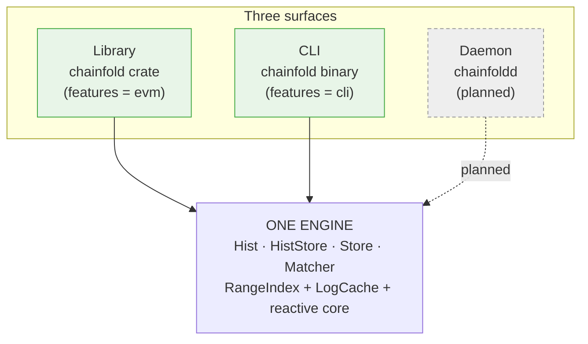

| Surface | Binary / crate | What it is |
|---|---|---|
| **Library** ✅ | `chainfold` crate | Embed the engine. The `Hist`/`HistStore`/`Store`/`Matcher` API this document describes. The source of truth — the other two surfaces are thin front-ends. |
| **CLI** ✅ | `chainfold` binary | A chain explorer whose distinguishing idea is **histories-first**: where `cast` returns a point value, chainfold returns the *history* it's a slice of. Ships `erc20` / `events` / `chains`; growing toward `blocks`, `call`, `storage`, `code`. |
| **Daemon** ⏳ | `chainfoldd` | A transparent JSON-RPC endpoint fronting an upstream node. Point `cast`/viem/ethers/a wallet at it and inherit at-most-once fetching, dedup, reorg handling, and live `eth_subscribe` — no code changes. |

The caching & correctness guarantees live in **one place** (the library) so
the front-ends stay thin.

---

## 4. Module map & layering

The cardinal rule: **the source-agnostic core never names a concrete
source.** `arch`, `combinators`, `merge`, `matcher` — and, since the Bitcoin
source landed, the shared engine modules `chain`, `cache`, `range_index`,
`observe` — know nothing about any family; their tests use synthetic
`MockPos`/`MockSpec` fixtures, never `EvmPosition`. `signatures` is a
standalone resolver (Sourcify → Etherscan) that also names no source; the
caller injects a cache impl. Concrete sources live behind feature flags
(`evm` and `bitcoin` today; `solana`/CEX later) as thin siblings over the
shared engine: domain types + hashes, a `RangeSpec` impl per stream, the
family's `HeadClock`/`BlockTimeSource` sessions, and the wire client.

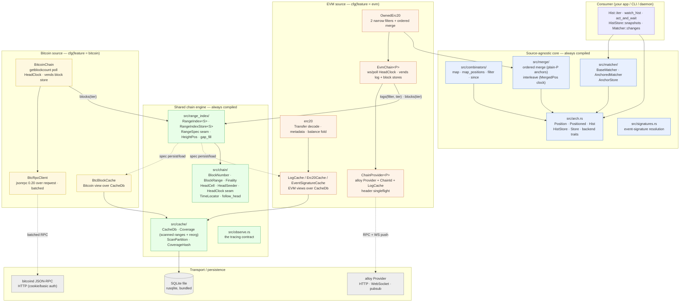

**Crate layout** (`src/`):

```
lib.rs                     pub mod {arch, cache, chain, combinators, matcher, merge, observe, range_index, shared, signatures}; cfg(evm) evm; cfg(bitcoin) bitcoin
├─ arch.rs                 Position · Positioned · Hist · HistStore · Store · backend traits
├─ chain/                  shared chain-family scaffolding
│  ├─ height.rs            BlockNumber · BlockRange · BlockCount · ChunkSize · TxCount
│  ├─ head.rs              HeadEvent · HeadCell · HeadClock (session seam) · HeadSeeder · Finality
│  ├─ anchor.rs            BlockTimeSource seam · TimeLocator (guess → timestamp-refined search)
│  └─ wiring.rs            follow_head::<S> — per-store head-channel driver
├─ range_index/            RangeIndex<S> · spec.rs (RangeSpec/IndexPos seam) · height_pos.rs (HeightPos) ·
│                          range_tree · gap_fill · store.rs (RangeIndexStore · TimePos · TipSeed) · testkit (MockSpec)
├─ cache.rs + cache/       CacheDb (open/migrate/purge/stats, one shared schema) ·
│                          coverage.rs (Coverage — scanned_ranges + reorged_blocks · ScanPartition · CoverageHash)
├─ observe.rs              the tracing contract (targets · CacheLayer/CacheOutcome · ConnectTimingLayer)
├─ combinators/            mapped.rs · map_pos.rs · filtered.rs · since.rs
├─ merge/                  ordered.rs (merge_hist_stores, plain-P anchors) · interleave.rs (interleave_hist_stores · MergedPos) · types.rs · kway.rs
├─ matcher/                matcher.rs + anchor_store_sqlite.rs
├─ share.rs                Share — Arc extension trait; .share() names the refcount bump
├─ signatures.rs           event-name → signature/topic0 resolution
├─ evm/                    ← cfg(feature = "evm")
│  ├─ types.rs             EvmEvent · EvmPosition · ChainId · Topic · BlockHash/TxHash · LogIdx · Gas · …
│  ├─ chain.rs + chain/    EvmChain — config · head_clock (EvmHeadClock ws/poll sessions) · logs · blocks
│  ├─ log_spec.rs          LogSpec (RangeSpec for logs) — with block_pos.rs (BlockPos · LogRef · LogPage)
│  ├─ block_spec.rs        BlockSpec (RangeSpec for blocks, over the shared HeightPos)
│  ├─ cache.rs + cache/    EVM views over CacheDb — LogCache · Erc20Cache · EventSignatureCache + EVM sql binds
│  ├─ erc20.rs             Transfer decode · metadata · balance apply
│  ├─ owned_erc20.rs       two-filter in/out ordered merge
│  ├─ chain_provider.rs    ChainProvider<P> — chain-scoped RPC seam
│  └─ transport.rs         wire layer — HttpTransport (owned; no URL in telemetry/errors) · RpcTimingLayer · rpc_retry_layer
├─ bitcoin/                ← cfg(feature = "bitcoin")
│  ├─ types.rs             BtcBlock · BtcBlockHash (display-order hex) · CompactTarget
│  ├─ transport.rs         BtcAuth · ReqwestTransport (jsonrpc async Transport) · TracingTransport
│  ├─ rpc.rs               BtcRpcClient — getblockcount · batched getblockhash/getblockheader
│  ├─ cache.rs             BtcBlockCache — Bitcoin view over CacheDb (cached_btc_blocks)
│  ├─ spec.rs              BtcBlockSpec (RangeSpec for blocks, over the shared HeightPos)
│  └─ chain.rs             BitcoinChain — BtcHeadClock poll session · blocks()/blocks_hist()
└─ bin/chainfold/          ← cfg(feature = "cli"): the real binary (evm + bitcoin subtrees)
```

Feature gating:

| Feature | Default | Pulls in |
|---|---|---|
| `evm` | off | `alloy` (HTTP+WS) |
| `bitcoin` | off | `jsonrpc` (framing only — the wire transport is our reqwest impl) |
| `cli` | off | implies `evm` + `bitcoin`; adds `clap`, `tracing-subscriber`, `chrono`, `toml`, `dirs` |

(`tracing`, `blake3`, `tower-layer`/`tower-service`, `bytesize`, `reqwest`,
`rusqlite` are unconditional — the shared engine compiles featureless.)

---

## 5. Core abstractions

Five public shapes in `src/arch.rs`. Everything else composes them.


### `Position` — the cut point

A serializable, **totally-ordered** cut point in *one source's* stream. A
position is the gap *between* items, never an item itself. It is
**source-local** — positions from different sources are not comparable.
`Default` is the natural lower bound (`before any item`); for EVM that's
`EvmPosition { block: 0, log_index: 0 }`.

```rust
pub trait Position:
    Clone + Default + Eq + Ord + Debug + Send + Sync + 'static
{
    fn marshal(&self) -> serde_json::Value;
}

// EVM's impl:
pub struct EvmPosition { pub block: BlockNumber, pub log_index: LogIdx }
```

`marshal` returns a *structured* `serde_json::Value` (not opaque bytes), so
composite positions nest by pure composition — `MergedPos` marshals to a JSON
object of its sources' values, `MatcherAnchors` to a `{src, dst}` object — with
no hand-rolled framing. There is deliberately **no `unmarshal`** on the trait:
deserialization lives on the owning store as [`HistStore::load`](#histstoret-p--the-reactive-tip-stream),
because `load` must exist *before* any position instance does and, for merge,
needs the source identities only the store holds. Mirrors the reference
`history.ts`'s `pos.serialize()` / `store.load(json)` asymmetry.

### `Positioned<T, P>` — an item at a place

`{ item, pos }`, where `pos` is the *post-cut* of the item:
`hist.split(item.pos)` yields `(prefix_including_item, rest)`. That is the
convention for saving a resume anchor.

### `Hist<T, P>` — a finite snapshot

A finite, immutable window over `(start, end]`, iterated in position order.
Fixed at construction — later source activity does not change *this* `Hist`;
you get a fresh window from the `HistStore`.

```rust
impl<T, P: Position> Hist<T, P> {
    fn start(&self) -> &P;
    fn end(&self)   -> &P;
    fn is_empty(&self) -> bool;
    fn iter(&self)  -> impl Stream<Item = Result<Positioned<T,P>, HistoryError>>;
    fn split(&self, p: P) -> (Self, Self);   // clamps p into [start, end]
}
```

`split` delegates clamping to `HistBackend::clamp_pos` so positions with a
non-canonical `Ord` (the keyed `MergedPos`) can clamp component-wise.

### `HistStore<T, P>` — the reactive tip stream

A reactive sequence of `Hist` snapshots. Yields a fresh `Hist` whenever the
tip advances; the first yield is the current snapshot.

```rust
impl<T, P: Position> HistStore<T, P> {
    fn snapshots(&self) -> impl Stream<Item = Hist<T,P>>;
    async fn next(&self) -> Hist<T,P>;
    async fn time_pos(&self, t: Timestamp) -> Result<P, _>;      // time → position
    fn load(&self, v: serde_json::Value) -> Option<P>;           // marshal's inverse
}
```

There are **no finality accessors** here: finality is a chain-wide fact,
not a per-store one, so it lives on the source's chain entity —
`EvmChain::head(Finality)` — and a store carries a single neutral end/tip
signal exposed through `snapshots()`/`next()`. See [§13](#13-reorg--finality-model).

### `Signal<T>` — a reactive value

A reactive value over a `tokio::sync::watch` (à la SolidJS/Leptos signals).
`get()` is non-blocking; `subscribe()`'s first emission is the current value.
Named `Signal`, not `Store`, to keep the reactive *value* distinct from the
`*Store` backing stores (`HistStore`, `AnchorStore`, `RangeIndexStore`).

### Free functions & the resume model

```rust
// Yield every item after `start`, across snapshot boundaries. The anchor
// advances as items emit, so a snapshot arriving mid-walk just extends the
// window — items are never duplicated.
fn watch_hist<T,P>(store: &HistStore<T,P>, start: P) -> ItemStream<T,P>;

// Snapshot the tip BEFORE running op, run op, then await the first
// post-snapshot item satisfying predicate. Race-safe: items that appear
// between snapshot and op-completion are still observed.
async fn act_and_wait<T,P,R,...>(store, op, predicate)
    -> Result<(Positioned<T,P>, R), HistoryError>;
```

Background tasks are guarded by `tokio_util::task::AbortOnDropHandle` — drop
the owner, the task aborts. See [§14](#14-ownership--lifetime).

### The backend seam — `HistBackend` and `HistStoreBackend`

Consumers hold the concrete `Hist` / `HistStore` structs; each is a thin handle
over an `Arc<dyn …Backend>`. A `Hist` is `{ backend: Arc<dyn HistBackend>,
start, end }`; a `HistStore` is `{ backend: Arc<dyn HistStoreBackend> }`.
`snapshots()`/`next()` mint `Hist`s that all share the store's underlying
`Arc<dyn HistBackend>`, so every snapshot of one source reads through the *same*
index. A range-based source doesn't hand-write these traits anymore: it authors
a `RangeSpec` and gets both impls from the generic `RangeIndexStore<S>`
([§5A](#5a-client-api-vs-backend-traits)); non-range backends (merge,
combinators, mocks) still implement them directly. Either way, combinators,
merge, and matcher compose over the traits for free.

**`HistBackend<T, P>`** — backs a single `Hist`. Two methods; only `iter` is
required.

```rust
pub trait HistBackend<T: Send + Sync + 'static, P: Position>: Send + Sync {
    /// Stream items in `(start, end]`, ascending by position. Cached gaps
    /// return immediately; uncached gaps are filled on demand (for EVM, an
    /// `eth_getLogs` guarded by the singleflight `Notify`). Dropping the
    /// stream cancels any in-flight fetch.
    fn iter(&self, start: P, end: P) -> ItemStream<T, P>;

    /// Clamp `p` into `[start, end]` for `Hist::split`. See below — default
    /// is the `Ord`-based clamp; override only when `P`'s total `Ord` does
    /// not equal its window-containment order.
    fn clamp_pos(&self, p: P, start: &P, end: &P) -> P {
        if &p < start { start.clone() }
        else if &p > end { end.clone() }
        else { p }
    }
}
```

**`HistStoreBackend<T, P>`** — backs a `HistStore`: the reactive tip stream plus
the time anchor and position deserialization.

```rust
#[async_trait]
pub trait HistStoreBackend<T: Send + Sync + 'static, P: Position>: Send + Sync {
    /// Fresh `Hist` per tip advance; first item is the current snapshot.
    fn snapshots(&self) -> HistStream<T, P>;

    /// The current snapshot (snapped to the latest known tip). For
    /// `RangeIndexStore` this waits until the source has seeded the tip,
    /// then is a plain watch read.
    async fn next(&self) -> Hist<T, P>;

    /// Estimate a position at a wall-clock time (cut point for time-based
    /// resume). For EVM: block-time estimation, no per-call RPC.
    async fn time_pos(&self, time: Timestamp) -> Result<P, HistoryError>;

    /// Deserialize a position from a `Position::marshal` value. The store
    /// owns deserialization — it knows the concrete `P` (and, for merge,
    /// the per-source identities). `None` on invalid input.
    fn load(&self, value: serde_json::Value) -> Option<P>;
}
```

Bounds worth noting: `T: Send + Sync + 'static` (items cross task boundaries and
live in boxed streams); `P: Position` (so `Clone + Default + Ord + marshal`);
both traits are `Send + Sync` because they're held as `Arc<dyn …>` and shared
across the WS watcher, drain task, and consumer walkers concurrently.

#### `clamp_pos` in depth

`Hist::split(p)` (`arch.rs:302`) cuts a snapshot into `(head, tail)` and must
never widen the window — so it first clamps `p` into `[start, end]`. Rather than
hardcode `Ord`, it delegates to `backend.clamp_pos(p, start, end)`:

- **Default (`Ord`-based).** `p < start → start`, `p > end → end`, else `p`.
  Correct whenever a position's `Ord` *is* its containment order — true for
  `EvmPosition` (lexicographic `(block, log_index)`).
- **Why it's overridable.** The interleave's `MergedPos<P>` holds one typed
  position per source; its total `Ord` (required by `Position`) is
  lexicographic over the sorted key union. A total order — but **not**
  component-wise containment: clock A can sort before clock B while being
  *ahead* of B on some source. The interleave's hist backend overrides
  `clamp_pos` to clamp **each per-source position separately, via `P`'s own
  `Ord`** (see [§7](#7-merge--ordered-and-interleaved)). Without the
  override, splitting an interleaved `Hist` at a saved `MergedPos` could
  clamp to the wrong cut and drop or duplicate items per source.

In short: `clamp_pos` is the seam that keeps `split` correct for a position whose
sort order is not its containment order.

#### Concurrency contract

A single backend is read through many `Hist`s at once — snapshots share the
store's `Arc<dyn HistBackend>`, and the live path has the wiring tasks writing
(`on_events` → `insert_page`) while consumers walk. Backends must therefore be
safe under concurrent `iter` and concurrent read/write. The `RangeIndex`
satisfies this with a `Mutex` over the BTree plus per-range singleflight
(`Notify`): the first walker into a cold gap fetches; peers coalesce onto it.
Pinned by `concurrent_searches_in_same_gap_fire_one_fetch` (now in
`range_index.rs` tests) — 5 concurrent walkers over one shared index, 1
fetch. (Coverage gaps — parallel `multi_thread`/loom, disjoint-range walkers,
reader-vs-`insert_page` — noted in §18.)

---

## 5A. Client API vs. backend traits

Two layers. A range-based source authors a **`RangeSpec`** (what to store,
resolve, persist) plus concrete wiring driving two entry points; everything
reactive — the `HistStoreBackend`, its index, gap-fill, snapshots, position
deserialization — is **generic, written once** as `RangeIndexStore<S>`. This
mirrors the production-validated reference implementation the design was
translated from (a store impl over a range tree + narrow source callbacks).

### Generic reactive layer — written once

`RangeIndexStore<S: RangeSpec>` (`src/range_index/store.rs`) implements
**both** §5 backend traits over a `RangeIndex<S>` plus one reactive tip:

- **One nullable end tip** — a single `watch::Sender<Option<S::PubPos>>` (the
  reference's `end` field + `endChanged` event, fused into one watch channel).
  `None` until the source seeds it; `snapshots()`/`next()` *wait* for a seeded
  tip rather than fabricate an empty snapshot at `earliest`.
- **Two entry points** (the reference's `HistoryCallbacks`), called by wiring:
  - `on_events(page)` — live batch: insert into the in-memory tree, then bump
    the tip to `S::page_tip(page)` (the reference's `onEvents` →
    `onBump(page.to)`).
  - `on_bump(pos)` — the tip advanced with **zero** events (a head block with
    no matching logs; a reconnect; the initial seed). Monotonic via
    `send_if_modified` — a bump at-or-before the current tip is a no-op.
- **`HistBackend::iter`** = lazy `ensure_window_loaded` (materialize persisted
  scanned ranges into the tree) + the streaming, singleflight
  `RangeIndex::items`.
- **Store-owned deserialization** — `HistStoreBackend::load` delegates to
  `RangeSpec::load_pos`.
- **Wiring lifetime** — background tasks attach via
  `attach_wiring(AbortOnDropHandle<()>)` and hold only `Weak` back-references:
  they die with the store, and there is no `Arc` cycle.

### Leaf seam — a source author implements `RangeSpec`

```rust
trait RangeSpec: Clone + Send + Sync + 'static {
    type Pos: IndexPos;        // tree-key position        (logs: BlockPos)
    type Item: Copy;           // lightweight tree entry   (logs: LogRef, a cache pointer)
    type Event;                // public item              (logs: EvmEvent)
    type PubPos: Position;     // public navigable position (logs: EvmPosition)
    type Page;                 // one fetch / one live delivery (logs: LogPage)

    // shape: positions, page bounds, the tip a delivered page bumps to
    fn item_pos(&Item) -> Pos;        fn page_items(&Page) -> Vec<Item>;
    fn page_bounds(&Page) -> BlockRange;   fn page_tip(&Page) -> PubPos;
    fn index_pos(&PubPos) -> Pos;     fn window(from: &PubPos, to: &PubPos) -> BlockRange;

    // the three durable-store touches
    fn resolve(&self, &Item) -> Result<Positioned<Event, PubPos>, _>;  // sync read, never RPC
    fn persist(&self, &Page) -> Result<(), _>;                         // gap-fill + drain
    fn load_window(&self, BlockRange) -> Result<Vec<LoadedSpan<Item>>, _>;  // lazy tree load

    // store-owned position deserialization (behind HistStore::load)
    fn load_pos(&self, serde_json::Value) -> Option<PubPos>;
}
```

Fetching is a separately injected closure — `Fetcher<Page>`, wrapping the
source's RPC (`eth_getLogs` for logs) — so tests pass a pure-Rust stub and the
provider-capturing fetch stays out of the persistence spec. Three instances
exist: `LogSpec` (a cache handle + `FilterHash`; sparse, `LogRef`-indirect
resolution) and `BlockSpec` (dense EVM blocks) in `src/evm/`, and
`BtcBlockSpec` (dense Bitcoin blocks) in `src/bitcoin/`. The dense specs
share the `HeightPos` tree key from `src/range_index/`; the seam itself is
exercised featureless by the synthetic `MockSpec` testkit.

### Client — the chain entity (concrete per source)

```rust
enum Finality { Latest, Best, Safe }     // Best/Safe mirror Latest until Phase 7
struct LogFilter { address: Address, topics: [Option<Topic>; 4] }   // the "query" for logs

EvmChain::new(provider: ChainProvider<P>, config: EvmChainConfig)  // sync, infallible: no RPC, no tasks
chain.logs(&filter, tier)        -> HistStore<EvmEvent, EvmPosition>  // reactive; sync, no RPC
chain.blocks(tier)               -> HistStore<EvmBlock, BlockNumber>  // reactive; sync, no RPC (dense source)
chain.logs_hist(&filter, range)  -> Hist<EvmEvent, EvmPosition>   // bounded window; head-free
chain.blocks_hist(range)         -> Hist<EvmBlock, BlockNumber>   // bounded window; head-free
chain.estimate_block(time).await -> BlockNumber                   // wall-clock → block (lazy anchor)
```

`EvmChain` is concrete because it vends *many* item types (`logs`, `blocks`,
later traces/state) — no single trait/`dyn` expresses that; each source
lives in its own `chain/` submodule (methods + fetcher + `TimePos` impl +
source-specific wiring). **`BitcoinChain`** (`src/bitcoin/chain.rs`) is the
concrete sibling — same construction contract (sync, infallible, RPC-free),
same `blocks(tier)`/`blocks_hist(range)`/`estimate_block(time)` surface over
its own `BtcRpcClient` — with no shared `Chain` trait (decision #6: no
client demands one yet). What *is* shared is the scaffolding in
`crate::chain`: the head channel (`HeadCell`), the demand-started clock
owner (`HeadSeeder`, running the family's `HeadClock` *sessions* under one
reconnect-backoff loop — ws/poll for EVM, a `getblockcount` poll for
Bitcoin), the per-store `follow_head` wiring, `Finality`, and the
`TimeLocator` (below). The chain owns the chain-wide concerns **once**: the
`ChainProvider` (which carries the `LogCache`,
[§12](#12-caching-mechanics)) or `BtcRpcClient`, the single demand-started
head clock, the lazy `time_pos` anchor. `logs(filter, tier)` builds a `LogSpec` +
fetcher + `RangeIndexStore`, spawns the store's wiring, and hands back a
plain `HistStore` — cheap, synchronous and side-effect-free; cached state
materializes lazily. `blocks(tier)` is the same shape over a `BlockSpec`: a
**dense** source where every height is an item, positioned by bare
`BlockNumber`. It has no push path — `newHeads` lacks the tx count — so each
head advance eager-gap-fills through a batched `eth_getBlockByNumber`
fetcher; its `cached_blocks` coverage lives under `ScanPartition::Blocks` (a
typed partition key beside the per-filter `ScanPartition::Filter`, §12).

The `*_hist(range)` variants return a finite `Hist` over an explicit
inclusive `BlockRange`: no tip, no wiring, no head demand — a fully-cached
walk is completely offline, and a range beyond the real head fails loudly at
iteration rather than clamping.

**Wall-clock → height** (`estimate_block`, the stores' `time_pos`) is a
two-step search in the shared `TimeLocator` (`src/chain/anchor.rs`): the
nominal block cadence extrapolates an *initial guess only*, which an
interpolation search (bisection fallback past a probe cap) refines against
**real block timestamps**, read through the family's cache-first
`BlockTimeSource` — warm searches are fully offline, and the result is the
first block minted at/after the target (exact up to Bitcoin's local
timestamp wobble; consensus only enforces median-time monotonicity).

**There is no bare-head API.** The head is not an entity consumers read —
it is the `end()` of the reactive histories ("last N blocks" = snapshot,
then `split(tip − N)`). Internally one watch channel (`Option<HeadEvent>`,
`None` until first observed — the chain-level analog of the store's unset
tip) fans observations out to every store's wiring.

**Head tracking is demand-started** (`EvmChainConfig::transport`, poll or
ws — every chain follows; there is no "one-shot chain" mode). Construction
does nothing; the first demand for a tip — a consumer awaiting a snapshot
(the store's `TipSeed` signal) or `estimate_block` resolving its anchor —
starts the clock exactly once, and it runs until the chain and its stores
drop. Demand-driven all the way down, symmetric with iteration's lazy
gap-fill: histories fill on iteration, tips resolve on first consumption.
Log delivery stays **per filter** — `eth_subscribe(logs)` can't express
OR-topics (decision #11), so only the *head clock* is chain-wide. See
[§11](#11-data-flow--cold-live-resume) for the wiring variants and the
false-coverage soundness rule.

### Finality lives on the chain

The store constructors take a `Finality` tier; `Best`/`Safe` mirror `Latest`
until Phase 7 wires their producers into the head clock (per-tier channels —
a confirmation-depth lag for `best`, a `finalized` poll for `safe`). Every
head the **ws** clock publishes has its block header persisted *first* — the
**headers-present invariant** — so `LogSpec::resolve` can fill
push-delivered timestamps synchronously; poll heads carry no header claim
(poll-mode logs always arrive through the fetcher, which ensures its own
headers). A log store's tip widens a head block to
`EvmPosition(block, LogIdx::MAX)`.

---

## 6. Combinators

Pure proxies over a `HistStore` — **no I/O**. The wrapped store keeps driving
snapshots, tip stores, and time anchors.

| Combinator | Effect | Item out |
|---|---|---|
| `map_hist_store(hs, f)` | `f: Fn(&Src) -> Dst` per item | `MappedItem { item: Dst, source: Src }` |
| `map_positions(hs, mapper)` | lift positions `P → Q` per `PosMapper` | `Item` (passthrough; positions wrapped) |
| `filter_hist_store(hs, pred)` | keep items where `pred(&item)` | `FilteredItem { item, skipped: Vec<Item> }` |
| `since_hist_store(hs, cut)` | pre-split each yielded `Hist` at `cut` | `Item` (passthrough) |

`since` pre-splits at the **upstream** level: `since(map(src, expensive_f),
cut)` never calls `expensive_f` on pre-cut items, because `Hist::split`
happens before the mapper's `iter()` runs. (Pinned by
`since_skips_mapper_on_pre_cut_items`.)

`map_positions` is `map_hist_store`'s mirror (items untouched, positions
lifted into a wider type) and exists for the cross-family interleave's
app-enum pattern ([§7](#7-merge--ordered-and-interleaved)). The `PosMapper`
owns `wrap`/`unwrap` **and** `Q`'s `load` — the upstream store can only parse
its own `P` marshal, not the enum's tagged form, so deserialization rides the
mapper (still "on the store" from the consumer's point of view).

---

## 7. Merge — ordered and interleaved

Two merge primitives for two semantically different operations, split by
**position-space reasoning**. Both are monomorphic over one shared
item/position type and yield `MergedItem<T, P> { value, source_key, source_pos }`.

| | `merge_hist_stores` (ordered) | `interleave_hist_stores` (vector clock) |
|---|---|---|
| Sources | share **one position space** (N filters on one chain) | **disjoint position spaces** (cross-chain / cross-family) |
| Order | `P`'s own total order | user `cmp` (typically time) — best-effort, ties unresolvable |
| Anchor | plain `P` — the space's own positions | `MergedPos<P>` = per-source vector clock |
| Same position twice | coalesced: one space ⇒ one item per position | never compared — different spaces |
| Used by | `OwnedErc20` in/out; a pool's Mint/Burn/Swap/Sync | multi-chain wallet; `bridge_explorer` |

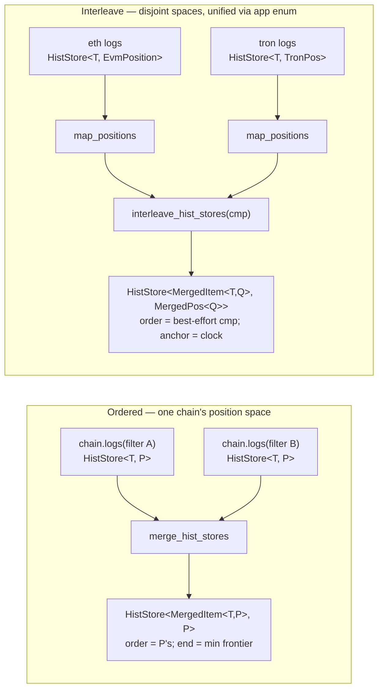

### Ordered merge (the workhorse)

```rust
pub fn merge_hist_stores<T, P: Position>(
    sources: BTreeMap<SourceKey, HistStore<T, P>>,   // no cmp — order IS P's order
) -> HistStore<MergedItem<T, P>, P>                  // anchors: plain P
```

The chain defines a global total order, and within one position space a
position **identifies** an item — `(block, log_index)` names a unique log
chain-wide. Two consequences fall out of taking that seriously:

- **Same-position coalescing.** Sources carrying an item at the identical
  position (overlapping filters — e.g. a self-transfer, one log matching
  both `OwnedErc20` filters) are reporting *the same item*. The merged
  stream yields each position once, from the lowest `SourceKey`, and drops
  the other copies (pinned by `same_position_coalesces_to_lowest_key`).
- **Plain-`P` anchors.** With one item per position, a yielded item's own
  position is an exact resume anchor and `hist.split(saved).1` is the
  standard core convention — no merge-specific position type, no vector
  clock. A merged anchor marshals identically to an inner-store anchor
  (pinned by `anchors_marshal_as_plain_positions`), and a `--from-block`
  bound is just `EvmPosition::new(b - 1, u32::MAX)`, same as on any store.

**Merged end = min over the sources' ends**: the frontier where *all*
sources are complete — a snapshot must not claim coverage a lagging source
hasn't reported. `snapshots()` re-emits only when the min advances; under
one chain head clock the filter stores' ends advance together, so the gate
is invisible in practice (pinned by `snapshots_gate_on_min_frontier`).

Default `Ord` clamping is exact (positions are the space's own `P`), so the
ordered variant needs no `clamp_pos` override — and `load` is any source's
`load` (all sources share `P`).

> An earlier iteration yielded *both* copies of a same-position item with
> source-tagged anchors (`OrderedPos { pos, bound: Before|At(key)|After }`
> plus a `DiscretePosition::pred` fetch-widening seam, so a resume *between*
> the copies was exact). Coalescing replaced it: the duplicate carries no
> information (it is the same log), consumers all deduped anyway, and the
> position-identity reading dissolves the extra anchor type, the trait, and
> the boundary-refetch machinery outright.
>
> A constraint that shaped this: the fetch protocol is exclusive-start
> (`iter` is `(start, end]`) and **cannot express include-at-start**.
> Coalescing sidesteps it by dropping duplicates rather than re-delivering;
> any future design that must re-deliver an item *at* a resume position
> needs either a `pred`-like seam or per-source clock starts.

### Interleave (vector clock)

```rust
pub fn interleave_hist_stores<T, P: Position>(
    sources: BTreeMap<SourceKey, HistStore<T, P>>,
    cmp: impl Fn(&MergedItem<T, P>, &MergedItem<T, P>) -> Ordering + Send + Sync + 'static,
) -> HistStore<MergedItem<T, P>, MergedPos<P>>

pub struct MergedPos<P: Position> { /* BTreeMap<SourceKey, P> */ }
// construct: FromIterator<(K, P)> / From<[(K, P); N]>; read: get(&SourceKey)
```

Positions are incomparable across sources *even when the type matches*
(block 100 on ETH vs Polygon), so item ordering is inherently
**best-effort/presentational** via `cmp` (stable tie-break by source key; no
strict-order promise) and the honest anchor is the clock: the source that
just yielded advances its entry; the others stay at whatever they last
yielded. Saving the last `MergedPos` and resuming via `split(saved).1` is
the exact per-source continuation, and it survives sources being
added/removed across restarts — a missing key means that source's `Default`
(pinned by `merged_pos_handles_added_source`). The reference implementation
agrees with this shape: its merged position implements no comparison at all
(serialize-only), and it merges EVM + CEX/perp-DEX feeds in production this
way.

**The `Ord` subtlety:** `MergedPos<P>`'s total `Ord` (required by the
`Position` bounds) is lexicographic over the key union via `P::Ord`
(present > absent), which does **not** match component-wise containment — so
the interleave's hist backend overrides `clamp_pos` to clamp each component
separately (see [§5](#clamp_pos-in-depth)).

### Cross-family unification — the wallet recipe

Sources with *different* position types (EVM vs Tron vs BTC…) unify
**before** the interleave via an app-defined closed enum lifted with
`map_positions` ([§6](#6-combinators)). Chain *sets* stay runtime-dynamic
(source keys); chain *families* are compile-time-bounded by which source
impls are compiled in — so the enum costs no real flexibility, and no
`dyn`-erasure fallback exists.

```rust
enum WalletPos { Evm(EvmPosition), Tron(TronPos) }   // app-owned; one variant per family

let mut sources = BTreeMap::new();
sources.insert("eth".into(),  map_positions(eth_transfers,  EvmWrap));  // HistStore<T, WalletPos>
sources.insert("tron".into(), map_positions(tron_transfers, TronWrap));
let wallet = interleave_hist_stores(sources, by_time);  // anchors: MergedPos<WalletPos>
```

Pinned end-to-end — including the tagged-anchor marshal round-trip across a
restart — by `tests/interleave.rs`.

---

## 8. Matcher — correlation

Pure correlation between two source streams (`src` and `dst`), producing a
`{ matched, pending, orphans }` view. Two layers:

- **`BaseMatcher`** — the pure compute kernel. No mutable state, no background
  task. Driven via `compute_state(anchors)` (which re-reads the current
  snapshot via `next()`), or the pure `compute_with(src_hist, dst_hist,
  anchors)` when you already hold the Hists.
- **`AnchoredMatcher`** — adds persistence over an `AnchorStore` + an
  in-memory cache. Production callers use this.

```rust
pub struct MatcherAnchors<SP, DP> { pub src: SP, pub dst: DP }
pub struct Match<Src, Dst> { pub src: Src, pub dst: Dst }
pub struct MatchOutput<Src, Dst> {
    pub matched: Vec<Match<Src, Dst>>,
    pub pending: Vec<Src>,     // src items awaiting a dst
    pub orphans: Vec<Dst>,     // dst items with no src
}

#[async_trait] pub trait MatchFn<Src, Dst, Out, SP, DP> {
    async fn matchup(&self, input: MatchInput<..>) -> Result<Out, HistoryError>;
}
#[async_trait] pub trait AnchorStore {           // impls: InMemory, Sqlite
    async fn get(&self, key: &str) -> Result<Option<Vec<u8>>, HistoryError>;
    async fn set(&self, key: &str, value: Vec<u8>) -> Result<(), HistoryError>;
}
```

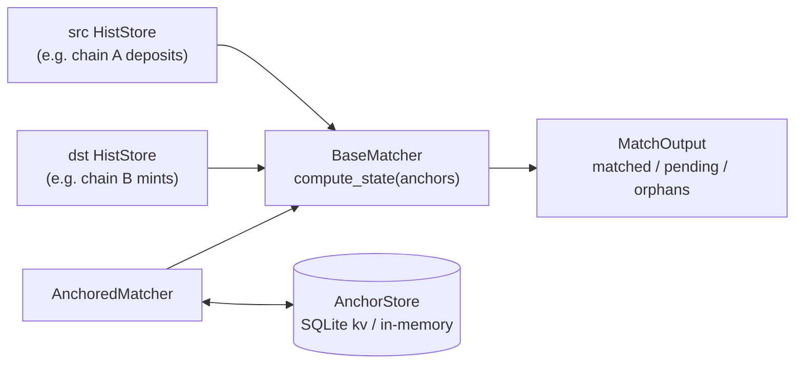

**`AnchoredMatcher::iter()` drives directly off both sources' `snapshots()`**
via `tokio::select!`, carrying and folding the latest `Hist` of each — the
Hist that triggered a recompute is the one folded. There is no background
task and no intermediate channel (R4 removed both), so the watch-coalescing
footgun of [§14](#14-ownership--lifetime) cannot apply here.

**The anchor blob is self-describing:** `MatcherAnchors` marshals as two
adjacent length-prefixed positions (`u32_le(len) ‖ bytes`, twice), each side
(de)serialized via its own `Position` marshal — so two heterogeneous position
types share one `AnchorStore` value without a wrapping serde derive.
`SqliteAnchorStore` is a single `(key, value BLOB)` table in its **own** DB
file, deliberately independent of the log cache.

**Asymmetric anchor advance is by design.** An anchor pair `{src, dst}` means
"items strictly *after* these positions are still eligible for matching" —
*not* "everything up to here is processed." Advance only `src` past a matched
pair and, on the next compute, that pair moves from `matched` → `orphans`
because the dst item is still in the dst tail. Consumers wanting monotonic
guarantees advance the anchor pair in sync.

**Matched pairs are transient** — they surface for one or more computes, then
vanish once anchors advance past them. Persist matched pairs in your app
*before* advancing if you need a permanent log.

> **Reducer** (the matcher's sibling — a stateful monotonic *fold* over one
> stream, positioned by a vector of source positions) is specced but **not
> built**. Both are intended to ship; they solve different problems (fold vs
> correlation — decision #9). See [`ROADMAP.md`](./ROADMAP.md#deferred-features).

---

## 9. The EVM source layer

The concrete client for EVM log streams (`feature = "evm"`).

| Component | Role |
|---|---|
| **`EvmChain<P>`** | The per-chain entity. Owns the `ChainProvider`, **one** demand-started head clock (`newHeads` or poll per `EvmChainConfig::transport`; ws heads persist headers before publishing), and vends per-source histories from per-source submodules: reactive stores (`logs(&LogFilter, tier)` / `blocks(tier)` — sync, side-effect-free) and bounded hists (`logs_hist(&filter, range)` / `blocks_hist(range)` — head-free, offline when cached). Construction does nothing; the first snapshot await (or `estimate_block`) starts tracking, which then runs until the chain and its stores drop. |
| **`RangeIndexStore<S: RangeSpec>`** *(shared — `src/range_index/`)* | The reactive layer, written once: `HistStoreBackend` + `HistBackend` over a `RangeIndex<S>` plus a single nullable `end` tip (`watch::Sender<Option<PubPos>>`; monotonic `on_bump`, `on_events` = insert page + bump). Wiring tasks attach as `AbortOnDropHandle`s holding `Weak` back-refs. |
| **`RangeIndex<S>`** *(shared — `src/range_index/`)* | Generic in-memory `BTreeMap<S::Pos, Range>` per source stream. Empty-range tombstones, singleflight via `Arc<Notify>` per range, lazy first-touch window load, async drain to SQLite. **The hot path.** |
| **`LogSpec` / `BlockSpec`** | The EVM `RangeSpec`s. Logs: `LogRef` tree items, sync `resolve` to `EvmEvent` (headers-present invariant), persist/load against `LogCache`, `EvmPosition` load. Blocks: dense, whole-`EvmBlock` items over the shared `HeightPos` key, coverage under `ScanPartition::Blocks`. |
| **`LogCache` / `Erc20Cache` / `EventSignatureCache`** | The EVM views over the shared `CacheDb` (§10): payload tables + the `.coverage()` accessor to the shared scanned-range/reorg bookkeeping. **Never on the live path.** |
| **chain wiring** (`chain/wiring.rs` + `chain/logs.rs`) | Per-store tasks driving `on_events`/`on_bump`: the shared `follow_head` (eager gap-fill on each head advance; the first observed head only bumps — no baseline, no coverage claim) and, on ws, a narrow per-filter `eth_subscribe(logs)` interleaved with head-driven empty coverage in one session. Reconnect-with-backoff (100 ms → 30 s); reconnect gap-fill must succeed before push delivery resumes. |
| **`OwnedErc20`** | Two narrow `chain.logs(...)` stores (`topic1 = owner` outgoing, `topic2 = owner` incoming), combined with the **ordered merge** — both filters share the chain's `(block, log_index)` space, so no comparator, and anchors are plain `EvmPosition`s. Direction reported via `source_key` (`IN_KEY` / `OUT_KEY`); a self-transfer matches both filters but surfaces once (coalesced, tagged `IN_KEY`; balance-neutral in `apply_transfer`). Sync constructor, no provider generic. |
| **`erc20`** | `decode_transfer`, `fetch_erc20_metadata`, `apply_transfer` (running-balance fold). |
| **`tokenlist`** | Symbol → address resolver over a curated [Token Lists](https://tokenlists.org) snapshot (default: Uniswap Labs'), cached in `TokenListCache` with a 24 h TTL. Case-insensitive lookup; unique exact-case match breaks collisions, otherwise a loud `Ambiguous`/`NotFound` error. Non-EVM entries (Solana mints) are dropped at ingest. Backs the CLI's `--token USDC` and `chainfold tokens`. |
| **`ChainProvider<P>`** | An alloy `Provider` bundled with its `ChainId` **and the `Arc<LogCache>`**. Internalizes error mapping (inherent `get_block_number`/`get_logs`; RPC timing lives in the transport stack's `RpcTimingLayer`) and owns the **singleflight** `ensure_block_header` (per-block gate + double-checked cache read). |
| **`ChunkSize::align` / `ChunkSize::chunk_end`** | The single owner of chunk-alignment arithmetic (`chain/height.rs`). `align` widens load windows outward; `chunk_end` caps each gap fetch at its chunk boundary (`walk_step`), so concurrent consumers hit the same cache entries and no RPC request spans a chunk. |

**Position bridging:** `EvmPosition(0, 0)` ↔ `BlockPos::Bottom`; otherwise
`BlockPos::At { block, log_index }` maps 1:1.

**Why in/out ERC20 is a merge of two filters, not a post-filter:** each inner
history fetches *its own* subset at the RPC level (`topic1=owner` and
`topic2=owner`), so the node returns only the owner's transfers — not the
whole Transfer stream filtered client-side (decision #11).

---

## 9B. The Bitcoin source layer

The concrete client for the Bitcoin block history (`feature = "bitcoin"`) —
the second chain family, and deliberately thin: everything reactive rides
the shared engine, so the module holds only what is Bitcoin about it.

| Component | Role |
|---|---|
| **`BitcoinChain`** | The per-chain entity, `EvmChain`'s concrete sibling (no shared trait — decision #6). Owns the `BtcRpcClient`, one demand-started head clock (`BtcHeadClock`: a `getblockcount` poll session under the shared backoff runner; ZMQ `hashblock` push is the noted future upgrade), and vends `blocks(tier)` / `blocks_hist(range)` / `estimate_block(time)` with the same offline guarantees as the EVM side. |
| **`BtcBlockSpec`** | The `RangeSpec` for Bitcoin blocks: dense, whole-`BtcBlock` items (all-`Copy`, pure-copy `resolve`) over the shared `HeightPos` key; persist/load against `BtcBlockCache`, coverage under `ScanPartition::BtcBlocks`. |
| **`BtcRpcClient`** | The narrow bitcoind JSON-RPC surface: `getblockcount`, batched `getblockhash(height)` → batched `getblockheader(hash, verbose)` — one verbose header carries every `BtcBlock` field including `nTx`. Batches are id-matched (the `jsonrpc` client re-orders), sized in the low hundreds (bitcoind processes a batch sequentially and buffers the whole response). Responses decode through thin local serde structs — deliberately no typed-client dependency. |
| **`ReqwestTransport` / `TracingTransport`** | `jsonrpc` 0.20's async `Transport` over the crate's reqwest (cookie/basic auth via the `BtcAuth` funnel; cookie-file IO at build time, never per-request), wrapped in the decorator emitting the same `chainfold::rpc` span contract as the EVM `RpcTimingLayer` (§15). |
| **`BtcBlockCache`** | The Bitcoin view over the shared `CacheDb`: `cached_btc_blocks` (height-keyed INSERT-OR-REPLACE) + `.coverage()`. |
| **`BtcBlock` / `BtcBlockHash` / `CompactTarget`** | The domain types. `BtcBlockHash` stores bytes in **RPC/display order** (parse/display are plain hex round-trips — no byte-reversal logic exists to get wrong). `CompactTarget` keeps the exact consensus `bits` (`difficulty()` is derived, display-only) so `BtcBlock` stays all-`Copy` + `Eq`. |

**Position model:** the public position is the bare shared `BlockNumber`
(block `N` at position `N`), identical to the EVM blocks source — a future
tx-level source would introduce a `(height, tx_index)` position, mirroring
`EvmPosition`.

---

## 10. Storage model

Two tiers. The **in-memory `RangeIndex`** is the hot path; **SQLite** is the
durable backfill store, drained to asynchronously and never blocking a live
event or a warm read.

### In-memory: `RangeIndex<S: RangeSpec>`

A per-source-stream `BTreeMap` of scanned ranges over tree positions
(`LogSpec`: per-filter, keyed by `BlockPos`). Scanned-ness
is **first-class**: a range that was scanned and found empty is stored as a
*tombstone* alongside filled ranges.

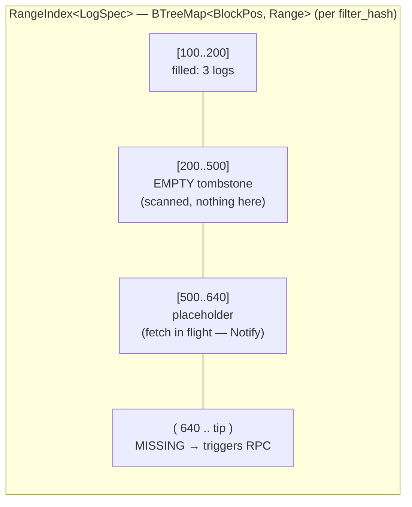

- Iter into a **filled** range → yields items immediately.
- Iter into an **empty** tombstone → yields nothing, **no RPC**.
- Iter into a **missing** range → triggers an `eth_getLogs`, guarded by a
  singleflight placeholder (concurrent readers `await` the same `Notify`).

### Durable: SQLite (via `rusqlite`, bundled)

`CacheDb` (`src/cache.rs`, shared) opens one file and runs the single
unified migration list — every family's tables exist in every cache file
(an empty table costs one b-tree page). The narrow views are vended per
concern: the cross-family `Coverage` (scanned ranges + reorg tombstones,
`src/cache/coverage.rs`) by the shared layer, and the per-family payload
views by `impl CacheDb` blocks in the family modules (`LogCache` /
`Erc20Cache` / `EventSignatureCache` / `TokenListCache` for EVM,
`BtcBlockCache` for Bitcoin) — the shared layer never names a family. One DB
file scopes one chain: the history tables carry no chain/network column.

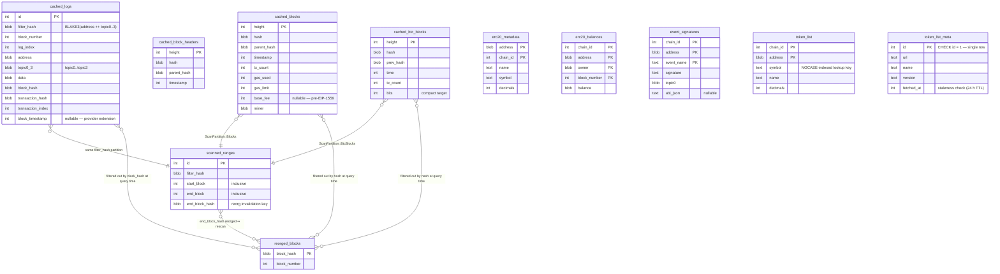

Key modelling decisions baked into the schema:

- **Uniqueness is `(filter_hash, block_hash, log_index)`**, *not*
  block_number — so the same log index on two forks can coexist. Reorged
  logs are **never deleted**; they stay in `cached_logs` and are filtered out
  at query time via `reorged_blocks`. (Append-only reorg handling, decision
  #7.)
- **`filter_hash`** = `BLAKE3(address ++ topic0..3)` partitions logs by the
  `eth_getLogs` filter that produced them. Different filters on the same
  contract (Transfer vs Approval) get separate partitions. The same BLOB
  column carries the typed `ScanPartition` for non-filter coverage: fixed
  derived blobs `BLAKE3("chainfold:blocks")` (EVM blocks) and
  `BLAKE3("chainfold:bitcoin:blocks")` — a closed enum, pinned three-way
  disjoint, so two families' block coverage can share one table and one
  file.
- **Hashes cross the coverage seam as the opaque `CoverageHash`** (32 raw
  bytes): the coverage tables only compare identity, so each family's hash
  newtype (EVM `0x` hex, Bitcoin display-order hex) converts via `From`
  exactly where a page is persisted or a reorg recorded — no per-source
  display convention leaks into shared storage. `reorged_blocks` is
  therefore cross-family; its height-scoped `cleanup_reorged_before` must be
  partitioned per family before Phase 7 wires finality-driven cleanup
  (flagged in [`ROADMAP.md`](./ROADMAP.md#backlog)).
- **The dense block tables** (`cached_blocks`, `cached_btc_blocks`) are
  height-keyed with INSERT-OR-REPLACE: a reorg refetch overwrites the stale
  fork row in place; until then the stale row is filtered at query time via
  `reorged_blocks`.
- **`scanned_ranges`** records *which ranges were fetched* even when they
  returned zero logs — that's how a gap query knows what it still needs. Its
  `end_block_hash` is the reorg-invalidation key: if that hash lands in
  `reorged_blocks`, the range is refetched.
- **Ranges are not eagerly merged** on insert; only finalized ranges are
  compacted (decision #8), so a tip reorg can't invalidate a huge merged
  range.
- **`cached_block_headers`** is shared across all filters (not partitioned),
  and carries the timestamp used to stamp `EvmEvent.timestamp` when the log
  itself lacks a `block_timestamp`.

**Matcher anchors** live in a *separate* SQLite file — `SqliteAnchorStore` is
a small `kv` table, independent of the log cache.

---

## 11. Data flow — cold, live, resume

The cold-backfill path and the live-push path share the same in-memory
`RangeIndex`; SQLite sits under the cold path and is drained-to under the
live path, never blocking either.

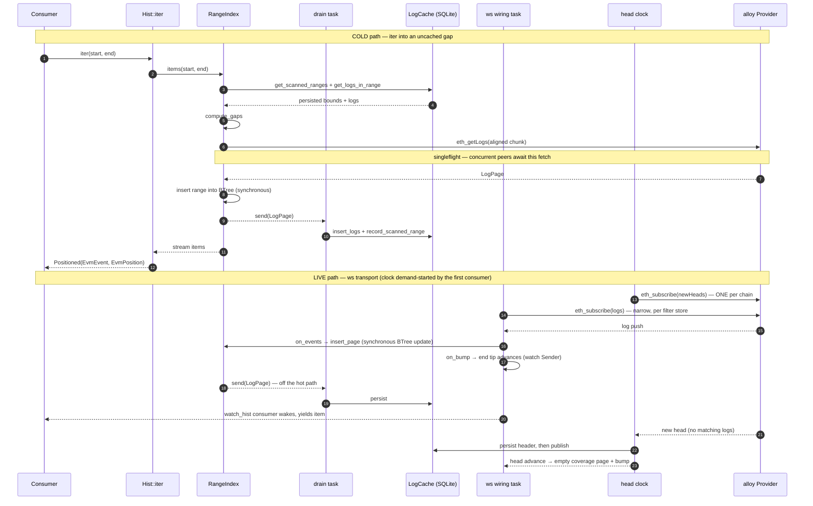

**Resume / subscribe-from-the-past** unifies the two: `watch_hist(&store,
saved_anchor)` splits each fresh snapshot at the running anchor and iterates
only the tail. Early snapshots walk the cold cache; once the walk reaches the
tip, new snapshots (driven by the wiring bumping the store's `end` tip)
extend the window seamlessly. The consumer never distinguishes "history" from
"live", and reconnect gap-fill is invisible.

---

## 12. Caching mechanics

Four mechanisms conspire to make guarantee #1 ("at most once") hold under
concurrency and slightly-misaligned requests:

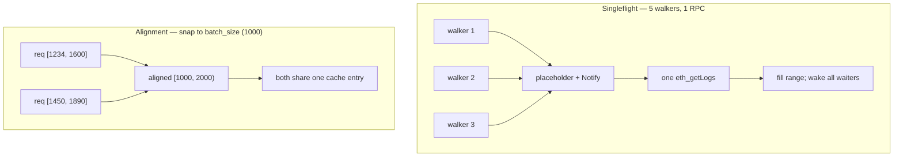

1. **At-most-once.** `scanned_ranges` + the in-memory tombstones mean a range
   is fetched once; later reads diff against what's scanned and fetch only the
   genuine gap.
2. **Singleflight.** The first reader into a cold gap installs a placeholder
   and fires the RPC; concurrent readers await the placeholder's `Notify`.
   (Test: 5 walkers → 1 `eth_getLogs`.)
3. **Alignment.** The gap-fill walk caps each fetch at a `chunk_size`-aligned
   boundary (`ChunkSize::chunk_end`, default 1000 blocks) so consumers asking
   slightly different ranges collide on the same cache entries — and no
   single request exceeds the chunk size (provider range caps). The gap
   *start* is never rounded down: blocks before the cursor are already
   covered, and refetching them would break at-most-once.
4. **SQLite off the live path.** A WS-delivered log goes
   `wiring → RangeIndex → consumer` synchronously; the durable write is
   drained in the background. Warm reads and live events never wait on disk.

The retry layer (`rpc_retry_layer`) wraps transient RPC failures with bounded
backoff; the observability contract counts every call so the "warm walk = 0
`eth_getLogs`" property is test-enforced, not aspirational.

---

## 13. Reorg & finality model

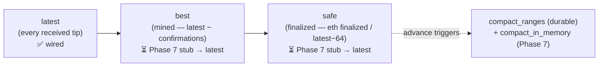

- **Logs are append-only.** Reorged block hashes go into `reorged_blocks`;
  queries filter them at read time. Nothing is truncated.
- **Scanned ranges self-invalidate.** A range whose `end_block_hash` is
  reorged is refetched.
- **Finality is chain-wide**: the `Finality` tier on
  `EvmChain::logs(filter, tier)` / `EvmChain::blocks(tier)`, not per-store
  accessors. `Latest` is fully wired; `Best`/`Safe` mirror `Latest` until
  Phase 7 wires their producers (`latest − confirmation_depth`; RPC
  `finalized`, else `latest − 64`) into the head clock.
- **Compaction runs only below `safe`** so a tip reorg can never invalidate a
  merged range (decision #8).
- **Consumer-side recovery today:** track `block_hash` on the last consumed
  `EvmEvent`; if a later walk surfaces a different hash at that position, walk
  back. Phase 7 may centralize this (reorg-aware `lca()`).

---

## 14. Ownership & lifetime

Every cancellable thing is owned by either an `Arc` handle (shared)
or an `AbortOnDropHandle` (single-owner; drop aborts — R7). **No raw
`tokio::spawn` survives its owning struct.** Background tasks hold only
`Weak` back-references to the store that owns them, so there is no
keep-alive cycle.

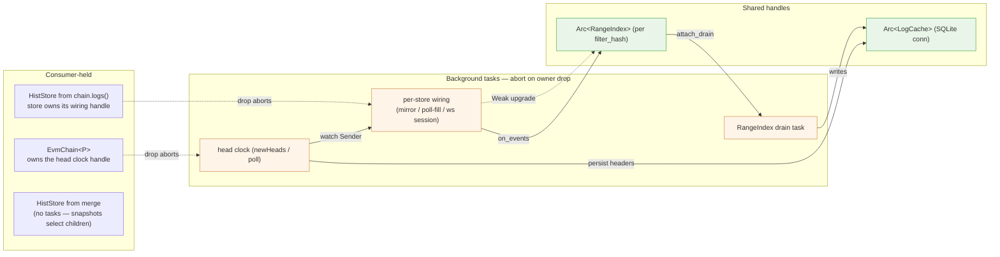

### Reactive footguns

Three recurring failure modes of change-driven streams, each pinned by a
regression test:

**Watch-coalescing.** Any task driven by a `tokio::sync::watch`
subscription must propagate **every** emission. The tempting bug: skip the
subscription's first emission as "already represented by the channel's init
value." **This loses updates** — `watch` coalesces, so an update arriving
between subscribe-time and the task's first poll shows up *as* the first
emission and gets dropped. **The rule: propagate every emission** (redundant
sends are harmless; the consumer-side watch coalesces too). Pinned by
`snapshots_advance_when_any_source_appends`. The two historical instances —
the matcher's `changes()` aggregator (removed by R4) and merge's tip
aggregators (removed by R3) — are both gone; today's merge `snapshots()`
seeds one snapshot per child before `select_all`ing their streams, which is
the same rule expressed structurally.

**Emit on advance, never re-emit an unchanged tip.** The dual of the above:
`snapshots()` is change-driven — the first emission is the current tip,
every later emission waits for a real *advance* (`rx.changed().await`).
A `snapshots()` that re-reads an unchanged tip busy-loops `watch_hist`: the
consumer re-splits an **empty** window `(anchor, tip]`, gets nothing to
yield, and loops again — a synchronous busy-loop inside one `poll` that
starves the executor. On a quiet chain the head wiring then never runs, so
the tip never advances: a permanent live-lock, not just wasted CPU
(discovered by the blocks `--follow` test on a fresh anvil, where even
`tokio::time::timeout` couldn't fire). Any new `HistStoreBackend::snapshots`
impl must gate re-emission on a real advance. Pinned by
`snapshots_wait_for_advance_not_busy_loop` (`range_index/store.rs`).

**The position-zero wart.** `watch_hist(store, P::default())` on a blocks
store *includes genesis*: `BlockNumber::ZERO` maps to the "before all
blocks" sentinel (`BlockPos::Bottom` / `HeightPos` bottom), so `split(ZERO)`
keeps block 0 in the tail. To follow strictly-after the tip on a fresh
chain, anchor at a real (non-genesis) block. Mirrors logs'
`EvmPosition::earliest()` `(0, 0)` convention.

---

## 15. Observability contract

The two headline guarantees are only credible if they stay *measurable*.
Chainfold emits a small, **stable** `tracing` contract at every RPC, SQLite,
and setup boundary — a contract, not incidental logging — described in one
place (`src/observe.rs`, shared: a second family participates by emitting
the same targets, with zero consumer changes).

Every span lives under a `chainfold::*` target: the **target** names the kind
of work (a section in a stats report), the **span name** labels the specific
operation within it. Consumers aggregate generically by `(target, name)` and
carry no per-label vocabulary — a span added at any call site shows up in
every consumer with no consumer change. The one exception is the RPC method:
`tracing` span names are static callsite metadata, while the method is
dynamic wire data, so RPC spans are named `rpc` and carry the method in a
`method` field; consumers label RPC rows by that field.

| Kind | target | row label |
|---|---|---|
| RPC call (span) | `chainfold::rpc` | `method` field — the JSON-RPC method (`eth_getLogs`, …) |
| HTTP attempt (span) | `chainfold::attempt` | span name — `attempt`; carries `endpoint` (scheme+host+port, key-bearing path/query stripped); nests inside its rpc span, one per wire try, so `attempt − rpc` counts retries |
| Connection setup (span) | `chainfold::connect` | span name — `connect` |
| SQLite read (span) | `chainfold::sqlite` | span name — the query (`get_blocks_in_range`, …) |
| Setup phase (span) | `chainfold::setup` | span name — the phase (`chainlist_load`, `client_build`, `db_open`, …) |
| Cache hit/miss (event) | `chainfold::cache` | `layer` + `outcome` fields |

Spans carry duration (open→close); cache events are instantaneous counters
with typed `layer`/`outcome` fields (`CacheLayer`/`CacheOutcome` closed
enums). A `singleflight` cache hit means a concurrent caller was coalesced
onto an in-flight fetch — an RPC *saved*.

**RPC spans are emitted at the transport boundary**, not at call sites — so
a new RPC call site cannot be forgotten. Per family: `RpcTimingLayer`
(`src/evm/transport.rs`, installed outermost in the alloy client stack,
before the retry layer) and `TracingTransport` (`src/bitcoin/transport.rs`,
the decorator around the reqwest-backed `jsonrpc` transport). A batch is one
wire request and gets one span, labelled with its shared method (chainfold
only issues homogeneous batches) and a `reqs` count of the JSON-RPC calls it
carries.

**Summing rule.** Spans may nest: a connection opens lazily inside the first
request that needs one, so its connect span (`ConnectTimingLayer` — a
reqwest-agnostic tower layer on the HTTP *connector*, timing DNS + TCP + TLS)
nests within that RPC span. This is what stops the first RPC of a session
from reading as mysteriously slow. Consumers that reconcile wall-clock
against span time sum **root spans only** (no `chainfold::*` ancestor);
nested spans get their own row but never enter a total — that would
double-count the handshake.

**Setup spans** time one-shot process-init phases that would otherwise hide
in the "untracked" remainder: the ~2 MB chainlist JSON parse
(`chainlist_load`), the TLS root-store load inside HTTP-client construction
(`client_build` — paid even by sessions that issue zero RPCs), the SQLite
open + migrations (`db_open`).

**Two consumers, one contract:**

- **CLI `--stats`** (`src/bin/chainfold/stats.rs`) — a `tracing_subscriber`
  Layer that tallies an end-of-run summary by `(target, row label)`: setup
  phases, RPC by method, SQLite read time, cache hit/miss, and the untracked
  remainder. Opt-in via `--stats` / `CHAINFOLD_STATS`; writes to stderr so
  stdout stays pipeable (the summary renders through the same table funnel
  as command output — one table per section with labeled columns
  (`method`/`phase`/`query`, `calls`, `wire` where batching occurred,
  `time`) — with the mode sniffed from stderr itself; see §16).
- **Daemon** (planned) — routes the same spans to an OTLP exporter
  (Tempo/Jaeger); no chainfold-specific glue. (`tracing-opentelemetry`'s
  `otel.name` convention can restore per-method operation names there.)

This doubles as the **anti-regression guard**: the instrumentation that feeds
the human summary also feeds test assertions on RPC counts (a second walk of a
cached range must issue zero `eth_getLogs`), so "minimize RPC" can't rot —
and because the spans come from the transport layer, the guard sees every
request, batched or not.

---

## 16. The CLI surface

`chainfold` (behind `feature = "cli"`) is the real binary — histories-first,
every read cached. `main` returns an `ExitCode` and renders errors via
`Display`.

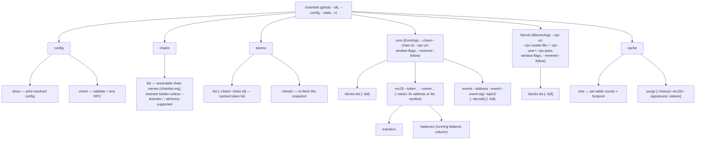

The window/limit flags (`--from`/`--to`/`--from-block`/`--num-blocks`/
`--limit`) are one shared `WindowArgs`, flattened into both families'
subtrees with identical semantics.

**Output rendering** funnels through `src/bin/chainfold/table.rs` — the only
module that imports `tabled` or emits raw ANSI (SGR, OSC-8 hyperlinks). An
`Out` value binds a destination stream to the render mode sniffed *from that
stream*, once, at the edge (`main`: stdout for command output, stderr for
`--stats`), so a table can never render with one stream's mode and land on
the other. Both modes share one space-separated layout whose only frame is
a single top rule per table with the title drawn inline (`── title ────`) —
an append-only `--follow` stream can never close a frame, so no table gets
more. Pretty (TTY) is dressing over it, never geometry: dimmed rules,
italic-cyan titles, bold headers, modest colors, OSC-8 explorer links;
Plain (piped) is the same text with **no escape bytes at all** — stripping
Pretty's ANSI yields the Plain render byte-for-byte (pinned by test, which
also pins `tabled`'s `ansi` feature measuring embedded escapes as
zero-width). Headers are word-capitalized by default (`gas used` →
`Gas Used`); `HeaderCase::AsIs` preserves identifier headers like
chainlist's `chainId`. Each table declares one `TableSpec` (column names, alignment,
min-width hints; `HexDetail` picks value abbreviation orthogonally) consumed
by both render paths: buffered `TableBuf` for bounded one-shot output, and
the append-only `RowWriter` (via `Out::rows`) for `--follow` streams, which
must print rows as they arrive and therefore use fixed spec widths.

**Chain resolution precedence (evm):** `--chain-id` > `--chain` > env
`CHAINFOLD_CHAIN` > config `[evm] default_chain` > built-in `ethereum`. Names
resolve against cached chainlist.org data via a `ChainResolver`
(lowest-chain-id-wins on shortName/chainSlug collisions, deterministic). RPC
selection: explicit `--rpc-url` > Alchemy (with API key) > chainlist public
RPC.

**Bitcoin endpoint resolution:** `--rpc-url` > config `[bitcoin] rpc_url`
(env-interpolated from `BITCOIND_RPC_URL`) > `http://127.0.0.1:8332`. Auth
funnels once to `BtcAuth`: flag user/pass > flag cookie > config user/pass >
config cookie > `~/.bitcoin/.cookie` when present > none. The implicit
`~/.bitcoin/.cookie` step applies to loopback endpoints only — an explicit
cookie works anywhere, but the implicit one never reaches a remote host
(it would leak the node's secret, and hosted providers reject requests
carrying a stray `Authorization` header).

**Histories-first** is the through-line: a `balances` read is a *history of
balances*, an `events` read a slice of *event history*, a `blocks list` a
slice of *block history*, and "value at tip" is just `hist.at(tip)`. Every
read maps onto the library `HistStore`, inheriting caching / resume / follow
for free. Growth path: `call` / `storage` / `code` accessors.

---

## 17. Type discipline

The EVM layer favors **semantic types over blind primitives** — a 20-byte
address can't be passed where a 32-byte hash is expected, a chain id can't be
swapped with a block number, a topic can't be confused with a hash.

| Type | Over | Notes |
|---|---|---|
| `Address` / `B256` | alloy | + `TxHash`/`BlockHash` aliases on fields that carry those |
| `Topic` | newtype over `B256` | owns the address↔topic relationship (`From<Address>` left-pads, `.address()` extracts); unwraps to `B256` at the alloy `Filter`/`Log` boundary |
| `ChainId` | `u64` | `#[serde(transparent)]` + `Ord` + `Display`; its `ToSql` lives in the *cache* layer so the domain type stays persistence-free |
| `BlockNumber` | `u64` | **affine**: block ± u64 = block; block − block = u64 via `.get()`. `#[serde(transparent)]` keeps the `EvmPosition` marshal byte-identical |
| `LogIdx` | `u32` | per-block log index. Named `LogIdx`, *not* `LogIndex`, to avoid colliding with the `RangeIndex` range tree |
| `FilterHash` | `[u8; 32]` | the BLAKE3 cache partition key; not an EVM hash, so a newtype (`ToSql` in the cache layer) |
| `Timestamp` | `u64` | source-agnostic (lives in `arch.rs`); the unit `time_pos`/`act_and_wait` speak |
| `SourceKey` | `String` | the merge-source / `MergedPos` clock / `MergedItem.source_key` key; `#[serde(transparent)]`; `MergedPos::get` speaks it |
| `BlockRange { from, to }` | `(u64, u64)` | named window in `compute_gaps` / alignment |
| `ChainProvider<P>` | `Provider` + `ChainId` | kills the redundant per-construction `eth_chainId` |
| `ChainHandle` / `ChainSelector` / `RpcSource` / `Url` | strings | CLI chain-resolution domain types |

`BlockNumber` and `LogIdx` staying `#[serde(transparent)]` is load-bearing:
saved resume-anchors stay byte-identical to the pre-newtype postcard encoding.
The SQLite/`compute_gaps`/alignment/RPC boundaries drop to raw `u64` at the
seam. `MergedPos<P>` holds typed positions since the merge split; the
remaining deliberately-generic boundary is `Position::marshal`'s
`serde_json::Value`.

---

## 18. Testing

| Suite | What it covers | Gate |
|---|---|---|
| Lib unit | Source-agnostic surface via `MockPos`; the range-index engine via the synthetic `MockSpec` testkit (featureless); per-family units | always |
| `tests/hist_store.rs` | `Hist` / `HistStore` shape | always |
| `tests/combinators.rs` | map/filter/since composition | always |
| `tests/interleave.rs` | cross-family interleave: app enum + `map_positions`, restart resume (the wallet recipe) | always |
| `tests/matcher.rs` | matcher incl. SQLite persistence across restart | always |
| `tests/mock_provider_smoke.rs` | alloy `Asserter` wrapper | `evm` |
| `tests/anvil_smoke.rs` | local anvil harness (fork case `#[ignore]`) | `evm` |
| `tests/blocks_history.rs` | local-anvil blocks source: cold/warm walk, poll follow | `#[ignore]` |
| `tests/bitcoin_blocks_history.rs` | regtest-bitcoind blocks source: cold walk → node killed → offline warm walk; poll follow | `bitcoin`, `#[ignore]` |
| `tests/cache_layering.rs` | fork-mainnet warm-cache speedup | `#[ignore]` |
| `tests/live_follow.rs` | anvil live-event latency | `#[ignore]` |
| `tests/owned_erc20.rs` | fork OwnedErc20 vs broad-filter baseline | `#[ignore]` |

(The ordered merge's own pins — min-frontier gating, same-position
coalescing, plain-position anchors — live in `src/merge/ordered.rs` unit
tests.)

Commands, external-process requirements (`anvil`, regtest `bitcoind`,
`MAINNET_RPC_URL`), and the coverage setup live in
[`DEVELOPMENT.md`](./DEVELOPMENT.md).

Anti-regression: several tests assert RPC counts through the observability
contract (e.g. a second walk of a cached range issues zero `eth_getLogs`).
Coverage runs via `cargo-llvm-cov`, uploaded to Codecov (patch ≥ 80%).

**Examples** (`examples/`, all `--features evm`) double as end-to-end
validation surfaces against real RPC:

| Example | Demonstrates |
|---|---|
| `bridge_explorer` | multi-chain cross-source merge (merge by `event.timestamp`) |
| `bridge_matcher` | cross-chain `Matcher` with anchor persistence in a separate SQLite file |

**Concurrency coverage.** The R6 suite (`src/range_index/tests.rs`, now
featureless over `MockSpec`) pins the shared-BTree soundness: singleflight
under a real `multi_thread` runtime, disjoint gaps fetching independently,
overlapping windows tiling the union with no double fetch, and two
reader-vs-writer scenarios (a deterministic parked-fetch insert-ahead case
and a stressed walk racing late inserts — no dup, no drop). The backbone
invariant: `walk_step` holds the tree `Mutex` across no await, so readers
and the live `insert_page` writer only interleave at await points. A loom
model of the placeholder protocol remains open in
[`ROADMAP.md`](./ROADMAP.md#backlog).

---

## 19. Locked-in design decisions

The numbered decisions this document cites (`decision #N`). Each was agreed
explicitly — do not reverse one silently; reopen it with the user first.

1. **Events are first-class**, not children of blocks. The block DAG is a
   source concern, not a storage concern.
2. **Custom table per reducer** — no opaque blob store. Each reducer owns
   its SQL schema.
3. **Core abstractions are `Position` / `Hist` / `HistStore` / `Signal`**
   ([§5](#5-core-abstractions)); items expose `.pos` via `Positioned`;
   navigation is `hist.split(p)`. No `Cursor`/`History` facade. `Signal`
   currently has no public producer (the head is the snapshot's `end()`);
   it returns with Phase 7's per-tier producers.
4. **Three finality tiers** — `Finality { Latest, Best, Safe }` is a
   chain-wide fact on the chain entity, not a per-store accessor. Bounded
   `*_hist(range)` windows deliberately take **no** tier (no tip, no clock —
   a dead parameter was rejected).
5. **Subscribe path is demand-started; no one-shot mode.** Chain
   construction is sync, infallible, RPC-free; the one head clock starts on
   first tip demand and runs until the chain + stores drop. No bare-head
   API. Live events bypass SQLite via the in-memory index.
6. **Concrete impls first, traits later** — don't abstract until 1–2 impls
   *and a client* exist. `EvmChain`/`BitcoinChain` are concrete siblings;
   there is no `Chain` trait.
7. **Reorg = append-only logs + `reorged_blocks` tombstones**, never
   truncate-and-re-append. Reorged logs are filtered at query time.
8. **Scanned ranges: no eager merge** — only ranges below the finalized tip
   are compacted, so a tip reorg can never invalidate a huge merged range.
9. **Reducer and Matcher both ship.** Fold (running balance) and
   correlation (`{matched, pending, orphans}`) are different problems — do
   not collapse them into one abstraction.
10. **Reducer position = a vector of N source positions**, one per input —
    deterministic, resumable, cross-chain. (The matcher uses the `{src, dst}`
    anchor pair instead.)
11. **Narrow filters over post-filtering.** `OwnedErc20` = an ordered merge
    of two RPC-level filters (`topic1=owner` out, `topic2=owner` in), not a
    client-side filter over all transfers; log delivery generally stays
    per-filter (`eth_subscribe(logs)` can't express OR-topics).
12. **Cache layering** ([§10](#10-storage-model)/[§12](#12-caching-mechanics)):
    one shared `CacheDb` schema; cross-family `Coverage` view; per-family
    payload views; in-memory `RangeIndex` above SQLite; SQLite never on the
    live path.
13. **Two merge variants, split by position space**
    ([§7](#7-merge--ordered-and-interleaved)): ordered (one space, coalescing,
    plain-`P` anchors) vs interleave (disjoint spaces, `MergedPos` vector
    clock); cross-family unification via app enum + `map_positions` — no
    `dyn` erasure.

The forward plan lives in [`ROADMAP.md`](./ROADMAP.md).
